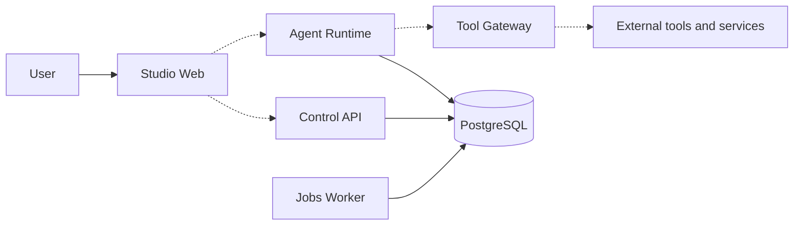

# Enterprise AI Agent Platform

> Build AI agents that bring knowledge, tools, and people together to move work forward.

<p align="center">
  <a href="#the-vision">Vision</a> ·
  <a href="#what-you-can-build">Use cases</a> ·
  <a href="#platform-capabilities">Capabilities</a> ·
  <a href="#how-it-fits-together">How it works</a> ·
  <a href="#technical-overview">Architecture</a> ·
  <a href="#get-started">Get started</a>
</p>

<p align="center">
  
</p>

Enterprise AI Agent Platform is a workspace for teams building AI agents around real business needs. It brings together the building blocks for defining agents, connecting knowledge and tools, organizing work, and involving people when decisions need their attention.

**Project status:** The platform is under active development. The diagram, examples, and capabilities on this page describe the product direction; individual features are at different stages of implementation.

## The vision

An effective agent needs more than a model. It needs context about the task, access to useful knowledge, a way to interact with its environment, and clear boundaries for what it may do. Teams also need to understand its work and bring human judgment into the process.

The platform is being developed as a common foundation for those needs, so teams can focus on designing useful agent experiences for their own organization.

## What you can build

The following examples illustrate possible applications as the platform develops:

- **Knowledge assistant:** Help a team find and understand information from its approved documents and resources.
- **Workflow assistant:** Gather context, prepare a draft, and route work to the right person for review.
- **Operations assistant:** Bring information from connected tools together to help staff investigate a request or issue.
- **Specialist agent:** Give an agent a focused role and a set of skills suited to a particular business task.

These are examples of intended use, not claims that ready-made solutions are currently available.

## Platform capabilities

### Agents and skills

Define an agent around a purpose, instructions, and boundaries. Skills provide reusable guidance for specific tasks, helping teams organize expertise across different agents.

### Knowledge and context

Give agents access to relevant organizational information so they can respond with the context needed for a task. Knowledge should be accessible according to the permissions of the people and workspace involved.

### Tools and integrations

Connect agents to approved capabilities and external systems. The platform's design places tool use behind a common governance boundary, where requests can be checked before action.

### Workflows and human approval

Bring agent work and human decisions into a shared process. A workflow can describe how a task moves forward and where a person needs to review an important action.

### Visibility and improvement

Help teams follow agent activity, investigate issues, and evaluate how well agents support their intended tasks. Feedback can then inform improvements to instructions, knowledge, tools, and workflows.

## How it fits together

An agent experience can begin with a person asking for help. The agent receives the relevant context, uses the knowledge and tools available to it, and works through the task. When an action needs human judgment, the process can pause for review before continuing. Throughout the journey, the team can follow what happened and improve the experience over time.

The illustration above shows this broader **agent harness**: the surrounding capabilities, context, governance, and visibility that support an agent as it works.

## Technical overview

The repository is organized as a monorepo, with separate applications for administration, execution, background work, and the user interface. The following diagram shows the intended relationships; individual integrations are still under development.



Solid lines represent the intended core service and data boundaries; dotted lines represent connections that require implementation or end-to-end verification. The diagram is an architectural view, not a guarantee that every user journey is operational.

| Component | Technology | Role |
| --- | --- | --- |
| [Studio Web](./apps/studio-web/) | Next.js, React, TypeScript | Interface foundation for managing agents and their work. |
| [Control API](./apps/control-api/) | Python, FastAPI, Pydantic | Administration and governance API foundation. |
| [Agent Runtime](./apps/agent-runtime/) | Python, FastAPI, LangGraph | Execution foundation for runs, state, tools, and events. |
| [Jobs Worker](./apps/jobs-worker/) | Python, SQLAlchemy | Background job processing backed by PostgreSQL. |
| Data and infrastructure | PostgreSQL, Redis, Qdrant, MinIO | Storage and supporting services configured for local development. |
| Contracts | JSON Schema, OpenAPI | Versioned definitions for shared payloads and APIs. |

The architecture separates the **control plane**, where configurations and policies are managed, from the **execution plane**, where agent work runs. PostgreSQL is used for durable application state; the development stack also includes supporting services for caching, retrieval, and object storage. Kafka is available as an optional development profile.

### Engineering principles

- **Trusted identity and scope:** Authorization and workspace context must be established by the server.
- **Governed tool use:** External operations are designed to pass through a shared Tool Gateway with policy and approval checks.
- **Durable execution:** Runs and background jobs are designed around persistent state and recovery rather than a RAM-only queue.
- **Human oversight:** High-impact actions require an authorized approval tied to the proposed action.
- **Versioned contracts:** API and data definitions provide a shared boundary between services and teams.

These are engineering requirements and design goals. Consult the [architecture](./docs/02-architecture/SYSTEM_ARCHITECTURE.md), [module specifications](./docs/04-module-specs/), and current source before assuming a capability is complete.

### Repository layout

```text
apps/        Studio Web, Control API, Agent Runtime, and Jobs Worker
libs/        Shared Python libraries
packages/    Shared TypeScript packages
contracts/   JSON Schema and OpenAPI definitions
database/    Database migrations
infra/       Local development infrastructure
tests/       Contract, integration, security, and other test suites
docs/        Product, architecture, engineering, and operations documentation
```

## Who is it for?

- **Product and business teams** exploring where agents can assist people and improve existing processes.
- **Engineers and AI practitioners** building agents, integrations, and workflows on a shared foundation.
- **Operators and reviewers** who need to understand agent activity and participate in important decisions.

## Get started

The steps below start the **development environment** from the repository root. They use PowerShell on Windows; the same tools are available on other platforms. This setup is for contributors and is not a production deployment.

### Prerequisites

- Git and Docker Desktop, with Docker running.
- Python 3.12 or later and `uv` 0.11.26.
- Node.js 22 and pnpm 10.18.3.

### 1. Get the project and configure it

Clone the repository from your GitHub repository URL, then open a terminal in the project directory. Create a local configuration file:

```powershell
Copy-Item .env.example .env
```

Open `.env` and replace the `replace-with-*` values with your own development credentials. Use distinct, strong values for the database and JWT secrets; the JWT secrets must be at least 32 characters long. Keep `.env` private and out of Git.

### 2. Install dependencies

```powershell
uv sync --all-packages --locked --group dev
pnpm install --frozen-lockfile
```

### 3. Start the services

```powershell
docker compose --env-file .env -f infra/compose/docker-compose.dev.yml up --build -d
docker compose --env-file .env -f infra/compose/docker-compose.dev.yml ps
```

The first startup downloads and builds images. The stack starts the APIs and their development dependencies; Studio Web is started separately in the next step. The local stack is intended for development and does not provide a complete production deployment or a configured model provider.

### 4. Start Studio Web

In a separate terminal, from the repository root:

```powershell
pnpm --filter studio-web dev
```

Open [http://localhost:3000](http://localhost:3000) for Studio. The Control API is available at [http://localhost:8000/docs](http://localhost:8000/docs) and the Agent Runtime at [http://localhost:8001/docs](http://localhost:8001/docs). Studio and API features are still being developed.

### 5. Stop the development environment

Stop Studio with `Ctrl+C`, then run:

```powershell
docker compose --env-file .env -f infra/compose/docker-compose.dev.yml down
```

The worker is optional and needs a valid tenant and workspace configured first; see [CONTRIBUTING.md](./CONTRIBUTING.md). The development Compose setup is not a backup or persistence strategy; protect any data you need before removing or recreating containers and volumes.

Before changing code, read the [agent instructions](./AGENTS.md) and the [collaboration and branching guide](./docs/00-governance/AGENT_COLLABORATION_AND_BRANCHING.md).

## Explore the project

- [Product requirements](./docs/01-product/PRODUCT_REQUIREMENTS.md) — the problems, users, and goals shaping the platform.
- [Roadmap](./docs/01-product/ROADMAP.md) — the intended direction for development.
- [Architecture](./docs/02-architecture/SYSTEM_ARCHITECTURE.md) — how the platform is designed.
- [Documentation index](./docs/00-governance/DOCUMENT_INDEX.md) — a guide to the complete project documentation.
- [Contributing](./CONTRIBUTING.md) — local setup and ways to contribute.

## Security

For security concerns, follow the private reporting guidance in [SECURITY.md](./SECURITY.md).
