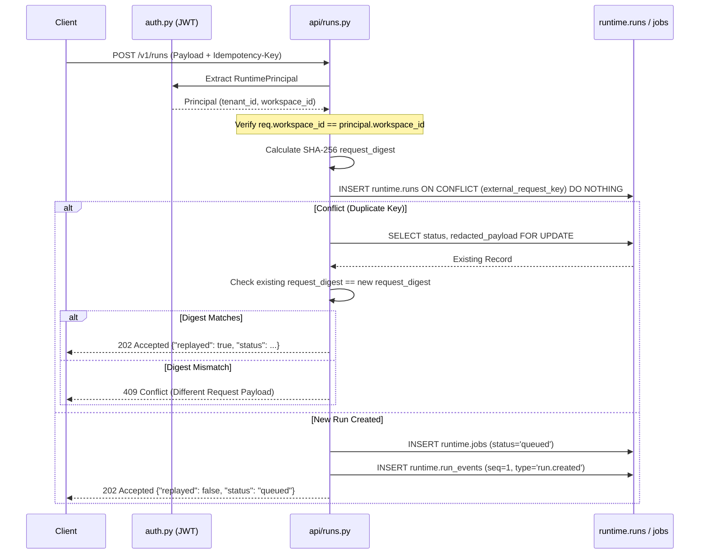

# `api/` — Cổng tiếp nhận HTTP & Phân phối sự kiện SSE (Ingress Gateway)

> **Trạng thái:** `PARTIAL`  
> **Mã nguồn đã rà soát:** [`api/runs.py`](runs.py), [`api/events.py`](events.py), [`api/health.py`](health.py), [`main.py`](../main.py)  
> **Tài liệu SPEC liên quan:** [`SPEC-RUNTIME-001.md`](../../../../../docs/04-module-specs/runtime/SPEC-RUNTIME-001.md), [`API_DESIGN_GUIDELINES.md`](../../../../../docs/06-api-contracts/API_DESIGN_GUIDELINES.md)

---

## 1. Mục đích

Package `api/` cung cấp bề mặt tiếp nhận (ingress surface) bên ngoài cho các yêu cầu HTTP và luồng sự kiện Server-Sent Events (SSE) của Bộ máy thực thi Agent (Agent Runtime). Module này chịu trách nhiệm mở các endpoint để khởi tạo các lần thực thi Agent (Agent Run) bất đồng bộ, phát luồng thông báo sự kiện thực thi trực tiếp, tiếp tục các lượt chạy bị tạm dừng sau khi có phê duyệt của con người (HITL), và báo cáo trạng thái sức khỏe chuyên sâu 3 mức phục vụ điều phối hạ tầng.

---

## 2. Trách nhiệm & Phạm vi không thuộc về module (Non-goals)

**Trách nhiệm của module:**
- Xác thực phong bì ủy quyền HTTP thông qua Bearer JWT (`RuntimePrincipal`).
- Xác thực yêu cầu tiếp nhận và khử trùng lặp sử dụng bắt buộc header `Idempotency-Key`.
- Chèn nguyên tử (atomic insertion) các bản ghi khởi tạo lần chạy (`runtime.runs`), tác vụ thực thi (`runtime.jobs`), và sự kiện ban đầu (`runtime.run_events`).
- Phát luồng sự kiện thực thi theo thời gian thực qua giao thức HTTP SSE (`text/event-stream`).
- Kiểm tra sức khỏe chuyên sâu (Deep Healthcheck) với cơ chế cô lập timeout để ngăn chặn hiện tượng đóng băng tiến trình do tín hiệu SIGSTOP.

**Phạm vi không thuộc về module:**
- Điều phối thực thi đồ thị (được ủy quyền cho worker / execution engine).
- Thực thi công cụ hoặc điều phối tác dụng phụ (được giao cho `tools/`).
- Quản lý phiên bản Agent hoặc siêu dữ liệu danh mục (thuộc quyền sở hữu của `apps/control-api`).
- Lưu trữ điểm lưu trạng thái (checkpoint) hoặc lưu trữ trạng thái dài hạn.

---

## 3. Trạng thái triển khai

| Khả năng | Trạng thái | Bằng chứng mã nguồn |
|---|---|---|
| Khởi tạo lần chạy (`POST /v1/runs`) | `IMPLEMENTED` | [`api/runs.py::start_run`](runs.py#L25) |
| Lấy trạng thái lần chạy (`GET /v1/runs/{id}`) | `IMPLEMENTED` | [`api/runs.py::get_run`](runs.py#L172) |
| Tiếp tục lần chạy (`POST /internal/v1/runs/{id}/resume`) | `IMPLEMENTED` | [`api/runs.py::resume_run`](runs.py#L221) |
| Phát luồng sự kiện (`GET /v1/runs/{id}/events`) | `IMPLEMENTED` | [`api/events.py::stream_events`](events.py#L18) |
| Thăm dò sức khỏe chuyên sâu (`GET /health`) | `IMPLEMENTED` | [`api/health.py::HealthChecker`](health.py#L35) |
| Thăm dò trạng thái sống Liveness (`GET /health/live`) | `IMPLEMENTED` | [`api/health.py::live`](health.py#L182) |
| Thăm dò trạng thái sẵn sàng Readiness (`GET /health/ready`) | `IMPLEMENTED` | [`api/health.py::ready`](health.py#L188) |

---

## 4. Sơ đồ File và Ký hiệu (Symbol Map)

| Tệp tin | Ký hiệu (Symbol) | Trách nhiệm |
|---|---|---|
| [`runs.py`](runs.py) | `StartRunRequest` | Pydantic model để khởi tạo lần chạy (`workspace_id`, `agent_version_id`, `inputs`, `conversation_id`). |
| [`runs.py`](runs.py) | `start_run()` | Xác thực claims JWT tenant/workspace, tính `request_digest`, áp dụng tính bất biến khi thực hiện lặp (idempotency), đưa job vào hàng đợi `runtime.jobs`. |
| [`runs.py`](runs.py) | `get_run()` | Lấy thông tin bản ghi lần chạy duy nhất được phân vùng theo `(tenant_id, workspace_id, run_id)`. |
| [`runs.py`](runs.py) | `resume_run()` | Xác thực trạng thái `waiting_approval`, chuyển trạng thái lần chạy sang `queued`, và đưa job `resume` vào hàng đợi. |
| [`events.py`](events.py) | `stream_events()` | Xác minh phạm vi workspace, gửi dòng thông báo kết nối và các sự kiện SSE có thứ tự (`sequence > last_event_id`). |
| [`health.py`](health.py) | `HealthChecker` | Thực thi các đầu dò nghiêm ngặt và không nghiêm ngặt trong threadpool riêng biệt để chống treo tiến trình. |
| [`health.py`](health.py) | `ComponentReport` | Dataclass báo cáo trạng thái thành phần, độ trễ tính bằng mili-giây, và thông điệp lỗi nếu có. |

---

## 5. Giao diện công khai & Hợp đồng dữ liệu (Interfaces & Contracts)

### Các Endpoint tiếp nhận
* `POST /v1/runs`: Chấp nhận payload JSON `StartRunRequest` kèm header `Idempotency-Key: <key>`. Trả về `202 Accepted` với nội dung `{"run_id": "...", "status": "queued", "replayed": false}`.
* `GET /v1/runs/{run_id}`: Trả về `200 OK` với trạng thái thực thi lần chạy, mốc thời gian và `trace_id`.
* `POST /internal/v1/runs/{run_id}/resume`: Trả về `200 OK` với `{"run_id": "...", "status": "queued"}`. Từ chối với `409 Conflict` nếu trạng thái lần chạy không phải là `waiting_approval`.
* `GET /v1/runs/{run_id}/events?last_event_id=0`: Trả về định dạng `text/event-stream`:
  ```http
  id: 1
  event: run.created
  data: {"request_digest": "..."}
  ```
* `GET /health`: Trả về trạng thái tổng thể (`ready`, `degraded`, hoặc `not_ready`) kèm chi tiết độ trễ từng thành phần con.

---

## 6. Luồng xử lý (Processing Flow)

### Luồng tiếp nhận lần chạy (`POST /v1/runs`)


---

## 7. Phụ thuộc & Tương tác liên module

- **Tương tác nội bộ cùng runtime:**
  - `agent_runtime.auth`: Sử dụng dependency `CurrentRuntimePrincipal` để giải mã JWT và lấy claims xác thực.
  - `agent_runtime.persistence.database`: Sử dụng `scoped_session()` context manager để nhận kết nối và thiết lập các biến phiên RLS.
  - `agent_runtime.settings`: Đọc cấu hình kết nối và giới hạn thời gian (timeout) qua `get_settings()`.
- **Bảng cơ sở dữ liệu tham chiếu:**
  - `runtime.runs`: Đọc / Chèn / Cập nhật trạng thái lần chạy.
  - `runtime.jobs`: Đưa các job run/resume vào hàng đợi xử lý.
  - `runtime.run_events`: Chèn sự kiện ban đầu; đọc dữ liệu phục vụ stream SSE.

---

## 8. Ranh giới Bảo mật, Phân vùng Tenant & Chính sách

1. **Kiểm tra khớp Token và Tham số đường dẫn:** Trong `runs.py`, `req.workspace_id` được đối chiếu trực tiếp với `principal.workspace_id`. Nếu có sai lệch, hệ thống trả về ngay `403 Forbidden` trước khi thực hiện truy vấn cơ sở dữ liệu.
2. **Ngữ cảnh phiên RLS:** Mọi thao tác cơ sở dữ liệu đều thực thi trong `scoped_session(tenant_id, workspace_id)`, thiết lập cục bộ `set_config('app.tenant_id', ...)` và `set_config('app.workspace_id', ...)`.
3. **Không để lộ khóa bí mật trực tiếp:** `StartRunRequest` chỉ nhận các tham số có cấu trúc. Khóa bí mật hay API key tuyệt đối không được truyền qua inputs.

---

## 9. Trạng thái, Tác dụng phụ (Side Effects) & Khôi phục sự cố

- **Đảm bảo tính bất biến (Idempotency):** Áp dụng ràng buộc `UNIQUE (tenant_id, workspace_id, external_request_key)` trên bảng `runtime.runs`. Việc phát lại yêu cầu (replay) bắt buộc phải có mã băm SHA-256 trùng khớp hoàn toàn.
- **Tiếp tục an toàn (Fail-Closed Resume):** Việc tiếp tục một lượt chạy (`resume_run`) khóa bản ghi bằng `FOR UPDATE` và khẳng định `status == 'waiting_approval'`. Mọi chuyển đổi trạng thái không hợp lệ đều ném `409 Conflict`.
- **Khả năng phục hồi của luồng SSE:** Việc phát luồng sự kiện truy vấn theo số thứ tự (sequence) và hỗ trợ client kết nối lại thông qua tham số `last_event_id`.

---

## 10. Kiểm thử & Gỡ lỗi

### Các lệnh kiểm thử thực tế đã xác minh
```powershell
# Chạy kiểm thử endpoint health và deep healthcheck
python -m pytest apps/agent-runtime/tests/test_health.py tests/contract/test_deep_healthcheck.py -v
```
*Bằng chứng thực tế*: **6 passed in 1.15s**.

---

## 11. Các khoảng trống kỹ thuật & Nợ kỹ thuật (Known Gaps / Technical Debt)

- `CODE_GAP`: `api/events.py` hiện chỉ phát các sự kiện đã có trong cơ sở dữ liệu rồi kết thúc generator; nó chưa duy trì vòng lặp `LISTEN/NOTIFY` của PostgreSQL hoặc kênh Redis Pub/Sub để đẩy sự kiện mới liên tục khi chúng phát sinh.
- `DESIGN_GAP`: Trong `api/runs.py`, payload sự kiện ban đầu chỉ lưu `request_digest`. Các tham số đầu vào đầy đủ được lưu trực tiếp dạng thô vào cột inputs của `runtime.runs`, cần có cơ chế làm sạch (sanitization) từ trước.

---

## 12. Tài liệu liên quan & Quy tắc bảo trì

- Mục lục gốc: [`agent_runtime/README.md`](../README.md)
- Đặc tả kiến trúc: [`SPEC-RUNTIME-001.md`](../../../../../docs/04-module-specs/runtime/SPEC-RUNTIME-001.md)
- Điều kiện cập nhật: Cập nhật tài liệu này khi bổ sung endpoint mới, thay đổi schema request/response, hoặc sửa đổi cơ chế ánh xạ JWT claims.
