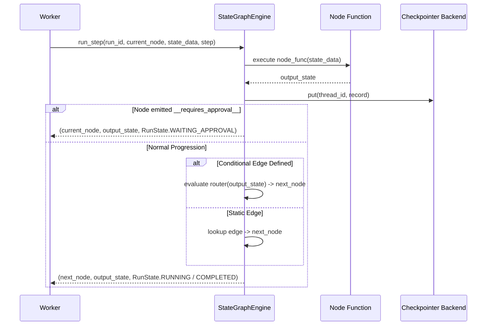

# `application/` — Đồ thị trạng thái điều phối & Phối hợp quy trình (State Graph Orchestration)

> **Trạng thái:** `PARTIAL`  
> **Mã nguồn đã rà soát:** [`application/state_graph.py`](state_graph.py), [`application/approval_manager.py`](approval_manager.py), [`application/outbox_dispatcher.py`](outbox_dispatcher.py), [`application/__init__.py`](__init__.py)  
> **Tài liệu SPEC liên quan:** [`SPEC-RUNTIME-001.md`](../../../../../docs/04-module-specs/runtime/SPEC-RUNTIME-001.md), [`ADR-006 Durable State`](../../../../../docs/02-architecture/adr/ADR-006-durable-state.md)

---

## 1. Mục đích

Package `application/` chứa các thành phần điều phối nội bộ cho quy trình thực thi (workflow) của Agent: một bộ máy đồ thị trạng thái xác định (`StateGraphEngine`) tích hợp với các bộ lưu điểm trạng thái (checkpointer) bên ngoài, một trình quản lý phê duyệt của con người (Human-in-the-Loop - HITL) (`ApprovalManager`) áp dụng chuyển đổi trạng thái nguyên tử Compare-And-Swap (CAS) cùng cơ chế xác thực mã băm hành động (action hash), và một trình điều phối outbox (`OutboxDispatcher`) phục vụ phát sự kiện có kiểm soát.

---

## 2. Trách nhiệm & Phạm vi không thuộc về module (Non-goals)

**Trách nhiệm của module:**
- Dẫn dắt các bước thực thi rời rạc qua các node đồ thị được định danh và các cạnh định tuyến có điều kiện (conditional router edges).
- Bắt buộc thực hiện lưu điểm trạng thái (checkpointing) trước và sau khi thực thi từng node.
- Chặn luồng thực thi của node khi cờ `__requires_approval__` được kích hoạt để chuyển sang trạng thái chờ phê duyệt `WAITING_APPROVAL`.
- Xác thực chống giả mạo mã băm hành động (action hash) và kiểm tra hạn sử dụng (TTL) cho các hành động phê duyệt của con người.
- Xếp hàng và định dạng các sự kiện Server-Sent Events (SSE) phát ra bên ngoài.

**Phạm vi không thuộc về module:**
- Cấp quyền thực thi công cụ hoặc xác thực JSON Schema (thuộc thẩm quyền tuyệt đối của `tools/dispatcher.py`).
- Quản trị các giao dịch kết nối cơ sở dữ liệu PostgreSQL thô (được giao cho `persistence/`).
- Vòng lặp tiến trình worker nền thực tế (thuộc quyền sở hữu của `apps/jobs-worker`).
- Trực tiếp gọi API các nhà cung cấp mô hình AI (được giao cho `llm/`).

---

## 3. Trạng thái triển khai

| Khả năng | Trạng thái | Bằng chứng mã nguồn |
|---|---|---|
| Bộ máy đồ thị trạng thái (State Graph Engine) | `PARTIAL` | [`application/state_graph.py::StateGraphEngine`](state_graph.py#L22) |
| Chuyển đổi trạng thái lần chạy (Run State Transitions) | `IMPLEMENTED` | [`application/state_graph.py::RunState`](state_graph.py#L13) |
| Tích hợp điểm lưu trạng thái (Checkpoint Integration) | `PARTIAL` | [`application/state_graph.py::StateGraphEngine.checkpoint`](state_graph.py#L47) |
| Quản lý phê duyệt con người (HITL Approval Manager) | `PARTIAL` | [`application/approval_manager.py::ApprovalManager`](approval_manager.py#L22) |
| Điều phối Outbox giao dịch (Transactional Outbox) | `SKELETON / PARTIAL` | [`application/outbox_dispatcher.py::OutboxDispatcher`](outbox_dispatcher.py#L11) |

---

## 4. Sơ đồ File và Ký hiệu (Symbol Map)

| Tệp tin | Ký hiệu (Symbol) | Trách nhiệm |
|---|---|---|
| [`state_graph.py`](state_graph.py) | `RunState` | Enum biểu diễn các trạng thái vòng đời lần chạy: `QUEUED`, `RUNNING`, `WAITING_APPROVAL`, `COMPLETED`, `FAILED`, `CANCELLED`. |
| [`state_graph.py`](state_graph.py) | `StateGraphEngine` | Điều phối các node, các cạnh và định tuyến có điều kiện. Yêu cầu một checkpointer ngoài và đóng an toàn khi lỗi (fail-closed) nếu thao tác ghi checkpoint thất bại. |
| [`state_graph.py`](state_graph.py) | `StateGraphEngine.run_step()` | Thực thi một bước đơn: chạy hàm node hiện tại, lưu điểm trạng thái, phát hiện cờ `__requires_approval__`, định tuyến sang node tiếp theo. |
| [`approval_manager.py`](approval_manager.py) | `ApprovalManager` | Bộ điều phối phê duyệt trong bộ nhớ. Tính mã băm SHA-256 `action_hash`, kiểm tra TTL, thực thi cập nhật quyết định CAS nguyên tử. |
| [`approval_manager.py`](approval_manager.py) | `ApprovalStatus` | Enum: `PENDING`, `APPROVED`, `REJECTED`, `EXPIRED`. |
| [`outbox_dispatcher.py`](outbox_dispatcher.py) | `OutboxDispatcher` | Quản lý hàng đợi các sự kiện phát ra ngoài có đánh số thứ tự (sequence) và định dạng chuỗi văn bản SSE. |

---

## 5. Giao diện công khai & Hợp đồng dữ liệu (Interfaces & Contracts)

### Giao diện `StateGraphEngine`
```python
class StateGraphEngine:
    def __init__(self, checkpointer: Any) -> None: ...
    def add_node(self, name: str, func: Callable[[Dict[str, Any]], Dict[str, Any]]) -> None: ...
    def add_edge(self, from_node: str, to_node: str) -> None: ...
    def add_conditional_edge(self, from_node: str, router: Callable[[Dict[str, Any]], str]) -> None: ...
    def checkpoint(self, run_id: str, state_data: Dict[str, Any], current_node: str, step: int = 0) -> str: ...
    def get_latest_checkpoint(self, run_id: str) -> Optional[Dict[str, Any]]: ...
    def run_step(self, run_id: str, current_node: str, state_data: Dict[str, Any], step: int = 0) -> Tuple[str, Dict[str, Any], RunState]: ...
```

### Giao diện `ApprovalManager`
```python
class ApprovalManager:
    def create_approval_request(self, run_id: str, workspace_id: str, tool_id: str, arguments: Dict[str, Any], approver_role: str = "approver") -> str: ...
    def decide(self, approval_id: str, decision: str, actor_id: str, action_hash_verification: str) -> Dict[str, Any]: ...
```

---

## 6. Luồng xử lý (Processing Flow)

### Luồng thực thi từng bước & Tạm dừng chờ phê duyệt


---

## 7. Phụ thuộc & Tương tác liên module

- **Hợp đồng với Checkpointer:** `StateGraphEngine` yêu cầu giao diện `checkpointer.put(config, record, metadata)` và `checkpointer.get_tuple(config)`. Hệ thống ném `RuntimeError` ngay lập tức nếu thao tác checkpointer thất bại.
- **Sự khác biệt với `tools/`:** `ApprovalManager` tính mã băm hành động dạng `sha256(f"{tool_id}:{json.dumps(args)}")`, trong khi `tools/dispatcher.py` kết hợp cả tenant ID, workspace ID, run ID, step key, agent version ID, và tool version ID.

---

## 8. Ranh giới Bảo mật, Phân vùng Tenant & Chính sách

1. **Không cho phép fallback lưu checkpoint vào bộ nhớ:** `StateGraphEngine` kiên quyết từ chối cấu hình `checkpointer=None` nhằm đảm bảo trạng thái không bao giờ bị lưu âm thầm vào bộ nhớ RAM tạm thời.
2. **Bảo vệ chống sửa đổi hành động (Action Tamper Guard):** Hàm `ApprovalManager.decide()` bắt buộc kiểm tra `action_hash_verification == record["action_hash"]`. Nếu các tham số công cụ bị thay đổi trong quá trình con người đánh giá, giao dịch phê duyệt sẽ bị từ chối.
3. **Thực thi thời hạn hiệu lực (TTL):** Các yêu cầu phê duyệt quá thời hạn sẽ chuyển sang trạng thái `EXPIRED` và đóng an toàn khi lỗi (fail-closed).

---

## 9. Trạng thái, Tác dụng phụ (Side Effects) & Khôi phục sự cố

- **An toàn khi phát lại (Replay Safety):** Quy trình thực thi tiếp tục từ điểm lưu trạng thái mới nhất được truy xuất qua `get_latest_checkpoint(run_id)`.
- **Hạn chế của bộ nhớ cục bộ:** Cả `ApprovalManager` và `OutboxDispatcher` hiện đang lưu trữ các bản ghi trong danh sách và từ điển nội bộ tiến trình Python (`self.approvals`, `self.outbox_events`). Việc khởi động lại tiến trình sẽ làm mất các yêu cầu phê duyệt đang chờ xử lý trừ khi chúng được lưu trữ đồng bộ trên PostgreSQL.

---

## 10. Kiểm thử & Gỡ lỗi

### Các lệnh kiểm thử thực tế đã xác minh
```powershell
# Chạy bài test khôi phục kiểm chứng quá trình crash và khởi động lại checkpointer
python -m pytest tests/recovery/test_resume_after_restart.py -v
```
*Bằng chứng thực tế*: **1 passed in 0.05s** (sử dụng mô phỏng checkpointer trên SQLite để xác thực logic tiếp tục thực thi).

---

## 11. Các khoảng trống kỹ thuật & Nợ kỹ thuật (Known Gaps / Technical Debt)

- `ARCHITECTURE_GAP`: `StateGraphEngine` là một bộ mô phỏng tự phát triển dài 112 dòng chứ chưa phải là đồ thị LangGraph Pregel chính thức (`langgraph.graph.StateGraph`).
- `CODE_GAP`: `ApprovalManager` hoạt động hoàn toàn trong bộ nhớ RAM và chưa kết nối với bảng `runtime.approval_requests`. Module `tools/dispatcher.py` đang phải tự thực hiện câu truy vấn kiểm tra phê duyệt riêng trên DB-56.
- `CODE_GAP`: `OutboxDispatcher` chưa thực hiện ghi vào bảng outbox của PostgreSQL (`governance.audit_events` hoặc `runtime.run_events`).

---

## 12. Tài liệu liên quan & Quy tắc bảo trì

- Mục lục gốc: [`agent_runtime/README.md`](../README.md)
- Kiến trúc ADR: [`ADR-006 Durable State`](../../../../../docs/02-architecture/adr/ADR-006-durable-state.md)
- Điều kiện cập nhật: Cập nhật tài liệu này khi thay thế `StateGraphEngine` bằng LangGraph Pregel hoặc chuyển đổi `ApprovalManager` sang sử dụng bảng PostgreSQL `runtime.approval_requests`.
