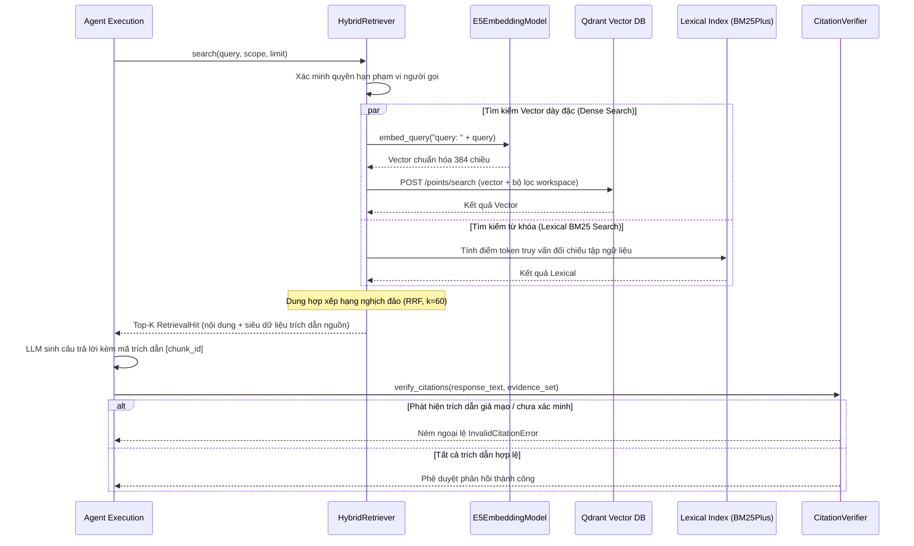

# `knowledge/` — Nền tảng truy xuất tri thức & Hợp đồng dữ liệu nạp (Knowledge Substrate)

> **Trạng thái:** `PARTIAL` (Mô hình embedding E5 đa ngôn ngữ, chỉ mục vector Qdrant, truy xuất lai kết hợp BM25+RRF, xác minh trích dẫn, và cổng cách ly dữ liệu nạp đã triển khai; Feast Store và Delta Audit Ledger đang là mô phỏng trong bộ nhớ RAM)  
> **Mã nguồn đã rà soát:** [`knowledge/hybrid_retriever.py`](hybrid_retriever.py), [`knowledge/embeddings.py`](embeddings.py), [`knowledge/qdrant_index.py`](qdrant_index.py), [`knowledge/citation_verifier.py`](citation_verifier.py), [`knowledge/ingestion_quarantine.py`](ingestion_quarantine.py), [`knowledge/hierarchical_chunker.py`](hierarchical_chunker.py), [`knowledge/retrieval_types.py`](retrieval_types.py), [`knowledge/delta_audit_ledger.py`](delta_audit_ledger.py), [`knowledge/feast_store.py`](feast_store.py), [`knowledge/__init__.py`](__init__.py)  
> **Tài liệu SPEC liên quan:** [`SPEC-KNOWLEDGE-001.md`](../../../../../docs/04-module-specs/knowledge/SPEC-KNOWLEDGE-001.md), [`knowledge-vector.v1.schema.json`](../../../../../contracts/jsonschema/knowledge-vector.v1.schema.json)

---

## 1. Mục đích

Package `knowledge/` cung cấp nền tảng tìm kiếm vector và từ khóa phục vụ cơ chế Tạo tăng cường truy xuất (Retrieval-Augmented Generation - RAG). Module này chịu trách nhiệm chạy embedding mô hình E5 đa ngôn ngữ offline, quản lý các collection trong cơ sở dữ liệu vector Qdrant, thực thi tìm kiếm lai kết hợp giữa BM25Plus và thuật toán dung hợp Reciprocal Rank Fusion (RRF), thẩm định trích dẫn trong phản hồi mô hình để chống ảo giác (anti-hallucination), và kiểm soát dữ liệu nạp qua cổng cách ly hợp đồng nghiêm ngặt.

---

## 2. Trách nhiệm & Phạm vi không thuộc về module (Non-goals)

**Trách nhiệm của module:**
- Suy luận CPU đồng bộ sinh dense vector chuẩn hóa 384 chiều sử dụng mô hình `intfloat/multilingual-e5-small`.
- Tương tác client REST Qdrant (`/points/search`) tuân thủ nghiêm ngặt hợp đồng `contracts/jsonschema/knowledge-vector.v1.schema.json`.
- Truy xuất lai kết hợp điểm số từ khóa BM25Plus và xếp hạng RRF trên các văn bản nguồn đã được cấp phép.
- Xác minh trích dẫn (`CitationVerifier`): đảm bảo mọi mã nguồn trong ngoặc vuông (`[chunk_id]`) trong phản hồi của LLM đều đối sánh chính xác tới bằng chứng thực tế được truy xuất.
- Kiểm soát hợp đồng dữ liệu nạp (`IngestionDataContractGate`): chuyển các tài liệu sai định dạng, trùng lặp hoặc chưa xác minh vào hàng đợi cách ly (quarantine dead-letter queue).
- Phân đoạn phân cấp (`HierarchicalLegalChunker`): bảo toàn cấu trúc văn bản pháp quy Chương -> Điều -> Khoản -> Điểm theo Nghị định 30/2020/NĐ-CP.

**Phạm vi không thuộc về module:**
- Quản lý giao diện người dùng hoặc quyền soạn thảo Knowledge Base (thuộc thẩm quyền của Control API).
- Cấp quyền truy xuất cho người dùng (quyền được kiểm tra trước khi truy vấn vector).
- Tự ý chuyển sang chế độ tìm kiếm từ khóa khi cụm cơ sở dữ liệu vector gặp sự cố (bắt buộc đóng an toàn fail-closed khi lỗi, không fallback âm thầm).

---

## 3. Trạng thái triển khai

| Khả năng | Trạng thái | Bằng chứng mã nguồn |
|---|---|---|
| Mô hình Embedding E5 đa ngôn ngữ | `IMPLEMENTED` | [`knowledge/embeddings.py::E5EmbeddingModel`](embeddings.py#L32) |
| Adapter chỉ mục Vector Qdrant | `IMPLEMENTED` | [`knowledge/qdrant_index.py::QdrantVectorIndex`](qdrant_index.py#L37) |
| Tìm kiếm lai BM25Plus + RRF | `IMPLEMENTED` | [`knowledge/hybrid_retriever.py::HybridRetriever`](hybrid_retriever.py#L38) |
| Bộ thẩm định trích dẫn nghiêm ngặt | `IMPLEMENTED` | [`knowledge/citation_verifier.py::CitationVerifier`](citation_verifier.py#L15) |
| Cổng cách ly dữ liệu nạp | `IMPLEMENTED` | [`knowledge/ingestion_quarantine.py::IngestionDataContractGate`](ingestion_quarantine.py#L52) |
| Phân đoạn pháp luật phân cấp | `IMPLEMENTED` | [`knowledge/hierarchical_chunker.py::HierarchicalLegalChunker`](hierarchical_chunker.py#L12) |
| Sổ cái kiểm toán Delta Audit | `PARTIAL` | [`knowledge/delta_audit_ledger.py::DeltaAuditLedger`](delta_audit_ledger.py#L13) (Mô phỏng cây Merkle trong bộ nhớ) |
| Kho đặc trưng Feast Feature Store | `PARTIAL` | [`knowledge/feast_store.py::FeastDualStore`](feast_store.py#L11) (Mô phỏng từ điển trong bộ nhớ) |

---

## 4. Sơ đồ File và Ký hiệu (Symbol Map)

| Tệp tin | Ký hiệu (Symbol) | Trách nhiệm |
|---|---|---|
| [`embeddings.py`](embeddings.py) | `E5EmbeddingModel` | Bọc mô hình HuggingFace tokenizers/onnx/torch tạo vector chuẩn hóa 384 chiều từ đầu vào `query: ` và `passage: `. |
| [`qdrant_index.py`](qdrant_index.py) | `QdrantVectorIndex` | Giao tiếp với API REST của Qdrant (`/points/search`). Bắt buộc lọc theo tenant/workspace và tuân thủ schema metadata vector. |
| [`hybrid_retriever.py`](hybrid_retriever.py) | `HybridRetriever` | Kết hợp tìm kiếm khoảng cách Cosine trên Qdrant với điểm BM25Plus sử dụng dung hợp xếp hạng nghịch đảo ($k=60$). |
| [`citation_verifier.py`](citation_verifier.py) | `CitationVerifier` | Trích xuất các mã trích dẫn (`[chunk_id]`) từ phản hồi và khẳng định sự tồn tại của chúng trong tập bằng chứng đã cấp. |
| [`ingestion_quarantine.py`](ingestion_quarantine.py) | `IngestionDataContractGate` | Xác thực payload tài liệu, schema, và checksum, chuyển các bản ghi không hợp lệ vào hàng đợi cách ly. |
| [`hierarchical_chunker.py`](hierarchical_chunker.py) | `HierarchicalLegalChunker` | Phân đoạn tài liệu theo regex pháp luật Việt Nam và chèn breadcrumb ngữ cảnh phân cấp vào từng chunk con. |
| [`retrieval_types.py`](retrieval_types.py) | `KnowledgeChunk`, `RetrievalHit`, `RetrievalScope` | Các dataclass có kiểu đại diện cho chunk, phạm vi tìm kiếm, và kết quả khớp. |

---

## 5. Giao diện công khai & Hợp đồng dữ liệu (Interfaces & Contracts)

### Thiết lập vận hành & Mô hình
Cài đặt gói mở rộng truy xuất với công cụ UV:
```powershell
uv sync --package agent-runtime --extra retrieval
```
Cung cấp bản chụp snapshot đáng tin cậy của mô hình `intfloat/multilingual-e5-small` tại revision `614241f622f53c4eeff9890bdc4f31cfecc418b3`. Truyền đường dẫn thư mục tuyệt đối tới `E5EmbeddingModel(Path(...))`. Các đầu vào vượt quá 512 token (bao gồm cả prefix và special token) sẽ bị từ chối.

### Giao diện truy xuất lai
```python
retriever = HybridRetriever(
    embeddings=e5_model,
    index=qdrant_index,
    authorization=knowledge_auth,
)
hits: tuple[RetrievalHit, ...] = retriever.search(
    query="chính sách bồi thường",
    scope=trusted_scope,
    authorized_chunks=published_chunks,
    top_k=5,
)
```

`trusted_scope` chứa UUID tenant/workspace lấy từ server; `published_chunks` phải được
load từ nguồn chuẩn có kiểm quyền. Không có adapter mặc định allow-all. Đây là API đồng bộ
cho worker/thread; không gọi trực tiếp trên event loop HTTP. Wiring API/ingestion và
kiểm chứng PostgreSQL/RLS chưa thuộc thay đổi embedding này.

### Giao diện thẩm định trích dẫn
```python
verifier = CitationVerifier()
# Ném ngoại lệ InvalidCitationError nếu phản hồi trích dẫn một chunk ID không có thật
verified_ids = verifier.verify_citations(output_text, evidence_set)
```

---

## 6. Luồng xử lý (Processing Flow)

### Luồng truy xuất lai & Thẩm định trích dẫn


---

## 7. Phụ thuộc & Tương tác liên module

- **Ranh giới tương tác:** Phạm vi truy xuất BẮT BUỘC phải nhận `tenant_id` và `workspace_id` được xác thực đáng tin cậy từ phía server-side.
- **Cơ sở dữ liệu / Lưu trữ:** Qdrant chỉ lưu trữ định danh chunk, hash và vector embeddings (`contracts/jsonschema/knowledge-vector.v1.schema.json`). Văn bản thô không bao giờ bị lưu trong metadata công khai của vector.
- **Truy xuất đóng an toàn khi lỗi (Fail-Closed):** Qdrant lỗi/thiếu index báo `RetrievalUnavailable`; thiếu hoặc lỗi model báo `EmbeddingUnavailable`. Không âm thầm chuyển sang kết quả từ khóa khi dense retrieval lỗi.

---

## 8. Ranh giới Bảo mật, Phân vùng Tenant & Chính sách

1. **Định danh điểm xác định (Deterministic Point IDs):** Point ID trong Qdrant được tính toán tất định từ mã băm SHA-256 của nội dung, phiên bản tài liệu, và phạm vi dữ liệu.
2. **Kiểm tra quyền hai lớp:** Quyền hạn của người gọi được kiểm tra trước khi truyền vector vào Qdrant, và các chunk đã lọc được kiểm tra lại lần nữa trước khi trả về văn bản gốc.
3. **Cấm tải mô hình tùy tiện:** `E5EmbeddingModel` bắt buộc phải có đường dẫn tệp cục bộ tường minh; việc tự động tải model từ Internet tại thời điểm runtime bị vô hiệu hóa hoàn toàn.

---

## 9. Trạng thái, Tác dụng phụ (Side Effects) & Khôi phục sự cố

- **Tính bền vững của Vector State:** Các collection trong Qdrant phải được cấu hình trên ổ đĩa bền vững (persistent volume). Mọi collection không tương thích về số chiều hoặc khoảng cách metric sẽ bị từ chối ngay khi khởi động.
- **Xử lý hàng đợi Dead-Letter:** `IngestionDataContractGate` bắt toàn bộ các đầu vào bị lỗi hoặc không đáng tin cậy, lưu vào danh sách `quarantined_records` kèm mã lỗi có kiểu `QuarantineCode` (ví dụ: `PAYLOAD_CORRUPTED`, `SCHEMA_VIOLATION`, `UNAPPROVED_METADATA`).

---

## 10. Kiểm thử & Gỡ lỗi

### Các lệnh kiểm thử thực tế đã xác minh
```powershell
# Chạy bộ test hợp đồng truy xuất E5 và kiểm tra cách ly dữ liệu nạp
python -m pytest tests/contract/test_e5_retrieval.py tests/contract/test_ingestion_quarantine.py -v
```
*Kiểm chứng ngày 2026-11-04*: **21 passed** cho hai files trên. Thêm **3 integration
tests PASS** với weights E5 offline và Qdrant server 1.9 thật; tìm được cùng point sau
khi restart Qdrant và mở tiến trình Python mới. Các kiểm tra dùng dữ liệu tổng hợp,
không chứng minh PostgreSQL/RLS hoặc wiring của chat/upload API.

---

## 11. Các khoảng trống kỹ thuật & Nợ kỹ thuật (Known Gaps / Technical Debt)

- `CODE_GAP`: `FeastDualStore` và `DeltaAuditLedger` hiện chỉ là các triển khai giả lập (mock) trong bộ nhớ, chưa được kết nối với cụm Redis thật hoặc bucket S3 chứa Delta Lake.
- `INTEGRATION_GAP`: Bộ test tích hợp mô hình embedding offline (`tests/integration/test_e5_embedding.py`) yêu cầu biến môi trường `E5_MODEL_SNAPSHOT` chỉ tới thư mục trọng số mô hình cục bộ; nếu thiếu sẽ tự động bỏ qua.

Live Qdrant test còn yêu cầu `E5_TEST_QDRANT_URL` trỏ tới môi trường test. Mặc định
test xóa collection riêng sau khi chạy. Harness kiểm restart có thể đặt
`E5_TEST_PERSISTENCE_PROBE` để ghi artifact tổng hợp và giữ collection tạm; harness
chịu trách nhiệm dọn collection/container riêng đó sau kiểm chứng. Compose phát triển
đã mount volume `qdrant_data` tại `/qdrant/storage`.

Strict typecheck cho bốn module retrieval dùng `apps/agent-runtime/mypy.retrieval.ini`;
stub `apps/agent-runtime/typings/rank_bm25.pyi` chỉ mô tả interface dependency đang dùng.

---

## 12. Tài liệu liên quan & Quy tắc bảo trì

- Mục lục gốc: [`agent_runtime/README.md`](../README.md)
- Đặc tả kiến trúc: [`SPEC-KNOWLEDGE-001.md`](../../../../../docs/04-module-specs/knowledge/SPEC-KNOWLEDGE-001.md)
- Hợp đồng Schema: [`contracts/jsonschema/knowledge-vector.v1.schema.json`](../../../../../contracts/jsonschema/knowledge-vector.v1.schema.json)
- Tài liệu tham khảo ngoài: [Mô hình intfloat/multilingual-e5-small](https://huggingface.co/intfloat/multilingual-e5-small), [Tài liệu tìm kiếm Qdrant](https://qdrant.tech/documentation/concepts/search/).
