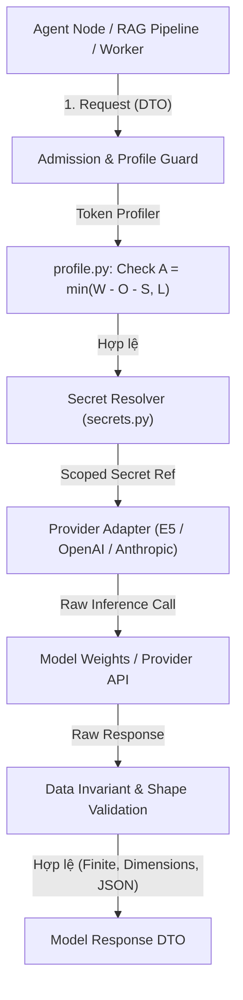

# `llm/` — Adapter Cổng kết nối mô hình & Nhà cung cấp (Model Gateway)

> **Trạng thái:** `PARTIALLY_IMPLEMENTED` (Hoàn thành phần **05-A** — Contracts, Ports, Profiles, Secrets & Offline E5 Adapter)  
> **Mã nguồn đã rà soát:** [`llm/__init__.py`](__init__.py), [`ports.py`](ports.py), [`errors.py`](errors.py), [`profile.py`](profile.py), [`secrets.py`](secrets.py), [`embedding_adapter.py`](embedding_adapter.py)  
> **Tài liệu SPEC liên quan:** [`SPEC-LLM-001.md`](../../../../../docs/04-module-specs/model-gateway/SPEC-LLM-001.md), [`MODEL_GATEWAY_DESIGN_DECISIONS.md`](../../../../../docs/04-module-specs/model-gateway/MODEL_GATEWAY_DESIGN_DECISIONS.md), [`TP-05-MODEL-GATEWAY`](../../../../../docs/09-implementation/task-packets/STEP-05-MODEL-GATEWAY/README.md)

---

## 1. Mục đích

Package `llm/` đóng vai trò là tầng trừu tượng hoá Cổng kết nối mô hình (**Model Gateway**) theo kiến trúc **Ports & Adapters (Hexagonal Architecture)** cho Bộ máy thực thi Agent (Agent Runtime). 

Module này tách biệt hoàn toàn tầng nghiệp vụ lõi (Agent loop, RAG ingestion, background jobs) khỏi các nhà cung cấp mô hình trí tuệ nhân tạo cụ thể (OpenAI, Anthropic, Google Gemini, vLLM, mô hình nhúng cục bộ E5). Module chịu trách nhiệm:
- Chuẩn hóa các giao thức gọi mô hình (Generation, Streaming, Embeddings).
- Kiểm soát tiếp nhận ngữ cảnh (Context Admission Control) và tính toán hạn mức token.
- Phân giải thông tin xác thực/khóa API an toàn theo ngữ cảnh Tenant/Workspace và Service allowlist.
- Bảo vệ tính toàn vẹn dữ liệu vector và phân loại lỗi hệ thống thống nhất.

---

## 2. Trách nhiệm & Phạm vi không thuộc về module (Non-goals)

**Trách nhiệm đã triển khai (Step 05-A):**
- Định nghĩa các Port trừu tượng hoá (`GenerationPort`, `StreamingPort`, `EmbeddingPort`, `TokenProfilePort`, `SecretResolverPort`).
- Xây dựng cây phân loại lỗi chuẩn hóa (`ModelGatewayError` taxonomy).
- Tính toán hạn mức tiếp nhận ngữ cảnh theo công thức $A = \min(W - O - S, L)$ và kiểm tra tràn ngữ cảnh trước khi gọi mô hình.
- Phân giải bí mật scoped (`ScopedSecretResolver`) với cơ chế che dấu (`RedactedSecret`), xác thực quyền service/workspace và fail-closed.
- Adapter tạo vector nhúng offline [`E5EmbeddingAdapter`](embedding_adapter.py) kết nối mô hình `intfloat/multilingual-e5-small` với các chốt chặn toàn vẹn (384 dimensions, số thực hữu hạn, semantic prefix routing).

**Trách nhiệm kế tiếp (Step 05-B & 05-C):**
- Sổ cái giữ chỗ ngân sách bền vững (Durable Budget Ledger & Reservation) và hạch toán vào `ops.model_usage` (05-B).
- Các Adapter gọi nhà cung cấp Generation thực tế (OpenAI, Anthropic, Gemini, vLLM) có guard và retry (05-C).

**Phạm vi không thuộc về module:**
- Không mở cổng public inference API `/generate` tùy tiện bỏ qua Agent run.
- Không hardcode API key, không chấp nhận key thô từ UI hoặc model output.
- Không dùng fake mock model làm fallback ngầm trong môi trường production.
- Không tự ý thực thi các side-effect của Tool (thuộc quyền kiểm soát duy nhất của Tool Gateway `tools/dispatcher.py`).

---

## 3. Trạng thái triển khai

| Khả năng | Trạng thái | Bằng chứng mã nguồn |
|---|---|---|
| Giao thức trừu tượng (Ports & Protocols) | `IMPLEMENTED` | [`ports.py`](ports.py) (`GenerationPort`, `StreamingPort`, `EmbeddingPort`, v.v.) |
| Cây phân loại lỗi (Error Taxonomy) | `IMPLEMENTED` | [`errors.py`](errors.py) (`ModelGatewayError`, `ModelContextTooLargeError`, v.v.) |
| Quản lý hồ sơ Token & Admission Control | `IMPLEMENTED` | [`profile.py`](profile.py) (`TokenProfiler`, công thức $A = \min(W - O - S, L)$) |
| Bộ phân giải bí mật phân vùng (Scoped Secret Resolver) | `IMPLEMENTED` | [`secrets.py`](secrets.py) (`ScopedSecretResolver`, `RedactedSecret`) |
| Adapter nhúng Offline Multilingual-E5 | `IMPLEMENTED` | [`embedding_adapter.py`](embedding_adapter.py) (`E5EmbeddingAdapter`, 384-dim) |
| Sổ cái ngân sách & Đối soát mức dùng (Ledger/Usage) | `PENDING_05B` | Chờ triển khai tại Step 05-B |
| Live Generation Provider Adapters (OpenAI/Anthropic/...) | `PENDING_05C` | Chờ triển khai tại Step 05-C |

---

## 4. Sơ đồ File và Ký hiệu (Symbol Map)

| Tệp tin | Ký hiệu (Symbol) | Trách nhiệm |
|---|---|---|
| [`__init__.py`](__init__.py) | Package Entrypoint | Xuất bản các symbols công khai: Ports, Adapters, Resolvers, Errors, Profilers. |
| [`ports.py`](ports.py) | `GenerationPort`<br>`StreamingPort`<br>`EmbeddingPort`<br>`TokenProfilePort`<br>`SecretResolverPort` | Định nghĩa các hợp đồng Protocol trừu tượng cho toàn bộ Model Gateway. |
| [`errors.py`](errors.py) | `ModelGatewayError`<br>`ModelContextTooLargeError`<br>`ModelRateLimitedError`<br>`ModelUnavailableError`<br>... | Cây phân loại lỗi thống nhất, ánh xạ chính xác HTTP/Domain status codes. |
| [`profile.py`](profile.py) | `TokenProfiler`<br>`estimate_tokens_heuristic` | Đo lường token và xác thực điều kiện tiếp nhận ngữ cảnh (Context Admission Guard). |
| [`secrets.py`](secrets.py) | `ScopedSecretResolver`<br>`RedactedSecret` | Phân giải bí mật từ server-side state, che dấu log/trace (`***`), kiểm tra tenant/workspace. |
| [`embedding_adapter.py`](embedding_adapter.py) | `E5EmbeddingAdapter`<br>`EMBEDDING_DIMENSIONS` | Hiện thực hoá `EmbeddingPort` cho mô hình E5 offline, kiểm tra số thực hữu hạn và 384 dimensions. |

---

## 5. Giao diện công khai & Hợp đồng dữ liệu (Interfaces & Contracts)

Các DTOs chuẩn hóa được định nghĩa tại thư viện chia sẻ `agent_contracts.model_contracts`:
- `ModelProfile`: Hồ sơ năng lực và giới hạn token/ngữ cảnh của mô hình.
- `ModelGenerationRequest` / `ModelGenerationResponse`: DTO yêu cầu và phản hồi sinh văn bản / tool calling.
- `ModelEmbeddingRequest` / `ModelEmbeddingResponse`: DTO yêu cầu và phản hồi vector nhúng.
- `ModelStreamingDelta`: DTO chunk truyền phát luồng.

Chữ ký các cổng chính tại [`ports.py`](ports.py):
```python
class GenerationPort(Protocol):
    async def generate(self, request: ModelGenerationRequest) -> ModelGenerationResponse: ...

class StreamingPort(Protocol):
    def stream(self, request: ModelGenerationRequest) -> AsyncIterator[ModelStreamingDelta]: ...

class EmbeddingPort(Protocol):
    async def embed(self, request: ModelEmbeddingRequest) -> ModelEmbeddingResponse: ...

class TokenProfilePort(Protocol):
    def measure(
        self, profile: ModelProfile, text: str, tools: list[dict[str, Any]] | None = None
    ) -> TokenMeasurement: ...

class SecretResolverPort(Protocol):
    def resolve(
        self, service: str, tenant_id: UUID, workspace_id: UUID, secret_ref: str
    ) -> str: ...
```

---

## 6. Luồng xử lý điều phối (Processing Flow)



---

## 7. Ranh giới Bảo mật, Phân vùng Tenant & Chính sách

1. **Server-side Credential Authority:**
   - Client/Agent chỉ truyền `secret_ref` (ví dụ `env:OPENAI_API_KEY`), tuyệt đối không chấp nhận API key thô.
   - `ScopedSecretResolver` xác thực cặp `(tenant_id, workspace_id)` và `service` cho phép. Nếu sai workspace hoặc cố truy cập biến môi trường hệ thống ngoài allowlist, lập tức chặn với `SecretAccessDeniedError`.
2. **Redaction & Không rò rỉ Log:**
   - Lớp `RedactedSecret` bảo vệ chuỗi nhạy cảm: `str(secret)` và `repr(secret)` luôn trả về `'***'`. Lấy giá trị thật qua phương thức có chủ đích `reveal()`.
3. **Mô hình Offline & Air-gapped (Decision D05-08):**
   - [`E5EmbeddingAdapter`](embedding_adapter.py) bọc mô hình local `intfloat/multilingual-e5-small` ghim cứng SHA revision `614241f622f53c4eeff9890bdc4f31cfecc418b3`.
   - Chạy 100% offline, `local_files_only=True`, không đòi hỏi network call và zero-secret.

---

## 8. Kiểm thử & Bằng chứng nghiệm thu

Các ca kiểm thử đã triển khai và đạt `PASS` trong phần 05-A:
- **Contract & Profile Tests:** `tests/contract/test_model_contracts.py` (12 tests)
  - Khớp JSON Schema canonical và Pydantic DTO.
  - Công thức tính Context Allowance và từ chối `ModelContextTooLargeError`.
- **Scoped Secrets Tests:** `apps/agent-runtime/tests/test_scoped_secrets.py` (5 tests)
  - Phân giải secret hợp lệ theo service.
  - Chặn truy cập trái tenant/workspace hoặc biến ngoài allowlist.
  - Redaction chuỗi `***` trong representation/string format.
- **E5 Embedding Adapter Tests:** `apps/agent-runtime/tests/test_e5_embedding_adapter.py` (6 tests)
  - Semantic prefix routing (`query:` vs `passage:`).
  - Xác thực nghiêm ngặt độ dài 384 dimensions.
  - Từ chối vector chứa $NaN$, $\pm\infty$ với `ModelInvalidResponseError`.

**Lệnh chạy kiểm thử xác minh:**
```powershell
.venv/Scripts/python.exe -m pytest apps/agent-runtime/tests/test_scoped_secrets.py apps/agent-runtime/tests/test_e5_embedding_adapter.py tests/contract/test_model_contracts.py -v
```

---

## 9. Khoảng trống kỹ thuật & Bước tiếp theo (Next Steps)

- **Step 05-B:** Xây dựng cơ chế giữ chỗ ngân sách trước khi gọi mô hình (Atomic Reservation Ledger), xử lý tranh chấp đa replica và hạch toán bền vững vào bảng `ops.model_usage`.
- **Step 05-C:** Triển khai các Generation Provider Adapters thực tế với streaming, retry backoff và fallback policy.
