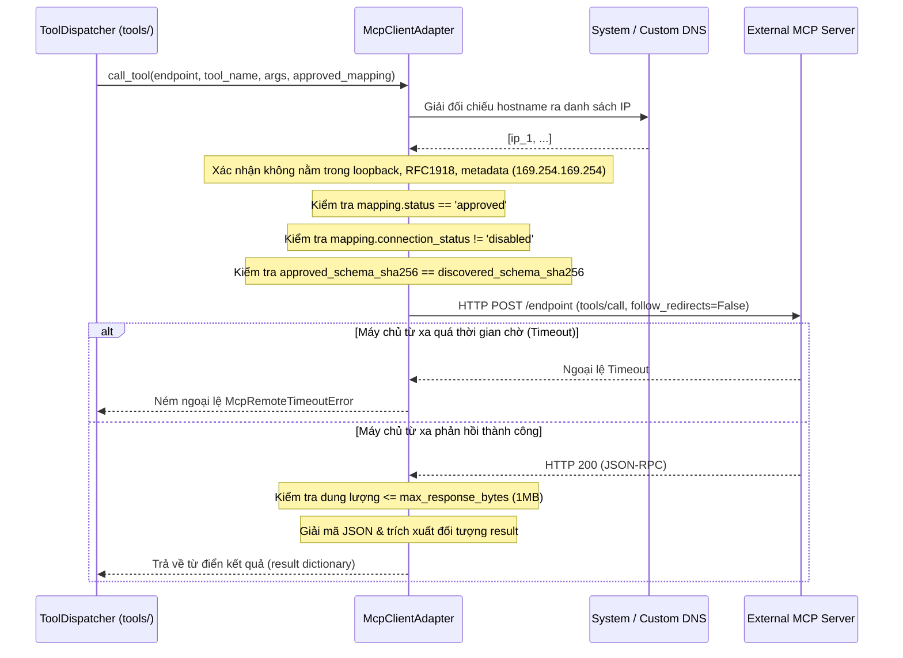

# `mcp/` — Adapter Client giao thức Model Context Protocol (MCP)

> **Trạng thái:** `PARTIAL` (Client Streamable HTTP, kiểm tra SSRF luồng ra, gọi giao thức JSON-RPC 2.0, và phát hiện trôi dạt schema đã triển khai; các cơ chế truyền tải stdio/SSE và lưu ảnh chụp khám phá chưa triển khai)  
> **Mã nguồn đã rà soát:** [`mcp/client.py`](client.py), [`mcp/errors.py`](errors.py), [`mcp/__init__.py`](__init__.py)  
> **Tài liệu SPEC liên quan:** [`SPEC-MCP-001.md`](../../../../../docs/04-module-specs/mcp/SPEC-MCP-001.md), [`CR-MCP-001.md`](../../../../../docs/05-change-requests/CR-MCP-001.md), [`ADR-012 MCP Gateway`](../../../../../docs/02-architecture/adr/ADR-012-mcp-gateway.md)

---

## 1. Mục đích

Package `mcp/` cung cấp adapter phía client cho giao thức ngữ cảnh mô hình (Model Context Protocol - MCP). Module này thực thi các công cụ từ xa được lưu trữ trên các máy chủ MCP bên ngoài thông qua Streamable HTTP, bắt buộc thực thi các ranh giới an toàn mạng luồng ra (chống tấn công SSRF), bảo vệ chống trôi dạt schema bằng chữ ký mật mã, kiểm soát thời gian chờ (timeout), và tuân thủ các đặc tả giao thức JSON-RPC 2.0.

---

## 2. Trách nhiệm & Phạm vi không thuộc về module (Non-goals)

**Trách nhiệm của module:**
- Giải đối chiếu tên miền đích và ngăn chặn triệt để SSRF luồng ra tới các mạng nội bộ (dải IP RFC1918, loopback, link-local, địa chỉ IP dịch vụ đám mây `169.254.169.254`, và kỹ thuật vượt rào IP số nguyên).
- Xác minh trạng thái phê duyệt và trạng thái kết nối khả dụng trước khi thực hiện các yêu cầu HTTP ra bên ngoài.
- Xác thực tính ổn định của schema: phát hiện trôi dạt schema phía upstream bằng cách so sánh `discovered_schema_sha256` với `approved_schema_sha256`.
- Bắt buộc giới hạn các yêu cầu HTTP: không chuyển hướng (`follow_redirects=False`), cấu hình timeout linh hoạt, và giới hạn kích thước phản hồi tối đa (mặc định 1 MB).
- Định dạng và gửi các phong bì `tools/call` chuẩn JSON-RPC 2.0 và phân tích kết quả trả về.

**Phạm vi không thuộc về module:**
- Cấp quyền cho Agent hoặc người dùng thực thi công cụ (thuộc thẩm quyền tuyệt đối của `tools/dispatcher.py`).
- Quản lý các máy chủ tiến trình con nội bộ (`stdio` transport bị vô hiệu hóa trong giai đoạn MVP).
- Tạo hoặc quản lý mã xác thực OAuth / Bearer token (được ủy quyền cho bộ giải quyết secret của kết nối).

---

## 3. Trạng thái triển khai

| Khả năng | Trạng thái | Bằng chứng mã nguồn |
|---|---|---|
| Phương thức truyền tải Streamable HTTP | `IMPLEMENTED` | [`mcp/client.py::McpClientAdapter.call_tool`](client.py#L107) |
| Phòng thủ SSRF luồng ra chuyên sâu | `IMPLEMENTED` | [`mcp/client.py::McpClientAdapter.validate_endpoint`](client.py#L46) |
| Chặn kỹ thuật vượt rào IP số nguyên & DNS | `IMPLEMENTED` | [`mcp/client.py::McpClientAdapter.validate_endpoint`](client.py#L68) |
| Kiểm tra vân tay trôi dạt Schema (Drift) | `IMPLEMENTED` | [`mcp/client.py::McpClientAdapter.call_tool`](client.py#L129) |
| Chặn chuyển hướng & Giới hạn dung lượng | `IMPLEMENTED` | [`mcp/client.py::McpClientAdapter.call_tool`](client.py#L164) |
| Phương thức truyền tải tiến trình con Stdio | `NOT_IMPLEMENTED` | Bị loại bỏ theo quyết định kiến trúc trong giai đoạn MVP |
| Phương thức truyền tải phát luồng SSE | `NOT_IMPLEMENTED` | Hiện chỉ hỗ trợ POST đồng bộ với header Accept |

---

## 4. Sơ đồ File và Ký hiệu (Symbol Map)

| Tệp tin | Ký hiệu (Symbol) | Trách nhiệm |
|---|---|---|
| [`client.py`](client.py) | `McpClientAdapter` | Adapter chính xử lý xác thực endpoint và thực thi từ xa qua JSON-RPC 2.0 trên nền HTTP. |
| [`client.py`](client.py) | `validate_endpoint()` | Giải đối chiếu DNS và kiểm tra tất cả các địa chỉ IP được phân giải đối chiếu với danh sách các khối CIDR bị chặn. |
| [`client.py`](client.py) | `call_tool()` | Thực hiện `POST` tới endpoint từ xa với payload `tools/call`, kiểm tra trạng thái, mã băm schema, và giới hạn byte. |
| [`errors.py`](errors.py) | `McpError` | Ngoại lệ cơ sở cho toàn bộ các lỗi client MCP. |
| [`errors.py`](errors.py) | `McpEndpointBlockedError` | Ném ra khi endpoint vi phạm quy tắc SSRF, sai giao thức hoặc vi phạm ràng buộc chuyển hướng. |
| [`errors.py`](errors.py) | `McpToolNotApprovedError` | Ném ra nếu `approved_mapping.status != 'approved'`. |
| [`errors.py`](errors.py) | `McpSchemaDriftError` | Ném ra khi `approved_schema_sha256 != discovered_schema_sha256`. |
| [`errors.py`](errors.py) | `McpConnectionDisabledError`| Ném ra nếu kết nối bị vô hiệu hóa hoặc máy chủ từ xa trả về mã trạng thái HTTP lỗi. |
| [`errors.py`](errors.py) | `McpRemoteTimeoutError` | Ném ra khi endpoint từ xa bị quá thời gian chờ (timeout) trong quá trình thực thi. |

---

## 5. Giao diện công khai & Hợp đồng dữ liệu (Interfaces & Contracts)

### Chữ ký phương thức Adapter
```python
class McpClientAdapter:
    def __init__(
        self,
        allow_localhost_dev: bool = False,
        dns_resolver: Optional[Callable[[str, int], List[str]]] = None,
    ): ...

    def validate_endpoint(self, endpoint_url: str) -> bool: ...

    async def call_tool(
        self,
        endpoint_url: str,
        tool_name: str,
        arguments: Dict[str, Any],
        approved_mapping: Dict[str, Any],
    ) -> Dict[str, Any]: ...
```

### Định dạng gói tin mạng JSON-RPC 2.0
```json
{
  "jsonrpc": "2.0",
  "id": "operation_key_or_name",
  "method": "tools/call",
  "params": {
    "name": "remote_tool_name",
    "arguments": { ... }
  }
}
```

---

## 6. Luồng xử lý (Processing Flow)

### Luồng gọi công cụ MCP từ xa


---

## 7. Phụ thuộc & Tương tác liên module

- **Đối tượng gọi:** `agent_runtime.tools.dispatcher.McpToolAdapter` gọi tới `McpClientAdapter.call_tool()`.
- **Mạng ngoại vi:** Sử dụng thư viện `httpx.AsyncClient` cho các yêu cầu HTTP bất đồng bộ.
- **Ranh giới SSRF:** Sử dụng thư viện tiêu chuẩn `ipaddress` và `socket.getaddrinfo`.

---

## 8. Ranh giới Bảo mật, Phân vùng Tenant & Chính sách

1. **Thực thi chống SSRF luồng ra:** Phương thức `validate_endpoint()` kiểm tra:
   - Chỉ cho phép các giao thức `http` và `https`.
   - Hostname biểu diễn dưới dạng số nguyên thô (ví dụ: `2130706433` -> `127.0.0.1`) sẽ được chuyển đổi sang IP và đánh giá.
   - Chặn tuyệt đối: `is_loopback`, `is_private` (RFC 1918: `10.0.0.0/8`, `172.16.0.0/12`, `192.168.0.0/16`), `is_link_local` (`169.254.0.0/16`), `is_multicast`, `is_reserved`, `is_unspecified`.
2. **Cấm chuyển hướng nghiêm ngặt:** `follow_redirects=False` ngăn chặn máy chủ từ xa chuyển hướng (bounce) một URL công khai hợp lệ vào các địa chỉ mạng nội bộ.
3. **Phòng chống tấn công bom phản hồi (Response Bomb):** Giới hạn độ dài nội dung phản hồi trong mức `max_response_bytes` (mặc định 1 MB) để ngăn chặn tấn công tràn bộ nhớ gây từ chối dịch vụ.

---

## 9. Trạng thái, Tác dụng phụ (Side Effects) & Khôi phục sự cố

- **Phi trạng thái (Stateless):** Adapter này không duy trì bộ đệm kết nối hoặc trạng thái phiên làm việc nào.
- **Tính mơ hồ khi quá thời gian chờ:** Nếu xảy ra `httpx.TimeoutException`, nó ném `McpRemoteTimeoutError`. Trong `ToolDispatcher`, trạng thái này được xếp vào loại `unknown` chứ không tự động thử lại để bảo đảm an toàn.

---

## 10. Kiểm thử & Gỡ lỗi

### Các lệnh kiểm thử thực tế đã xác minh
```powershell
# Chạy bộ test hợp đồng client MCP kiểm tra SSRF và kết nối
python -m pytest tests/contract/test_skill_and_mcp_contracts.py -k "mcp" -v
```
*Bằng chứng thực tế*: **2 passed in 0.18s**.

---

## 11. Các khoảng trống kỹ thuật & Nợ kỹ thuật (Known Gaps / Technical Debt)

- `DESIGN_GAP`: Hiện mới chỉ hỗ trợ giao thức truyền tải HTTP. Cơ chế phát luồng Server-Sent Events (SSE) hai chiều cho các công cụ MCP chạy dài chưa được triển khai.
- `CODE_GAP`: Quá trình giải đối chiếu DNS được thực hiện một lần trước khi kết nối, nhưng `httpx` hiện chưa ghim địa chỉ IP đã phân giải (pinning) để chống lại tấn công chuyển địa chỉ DNS tức thời (DNS rebinding / TOCTOU).

---

## 12. Tài liệu liên quan & Quy tắc bảo trì

- Mục lục gốc: [`agent_runtime/README.md`](../README.md)
- Đặc tả kiến trúc: [`SPEC-MCP-001.md`](../../../../../docs/04-module-specs/mcp/SPEC-MCP-001.md)
- Yêu cầu thay đổi: [`CR-MCP-001.md`](../../../../../docs/05-change-requests/CR-MCP-001.md)
- Quyết định kiến trúc ADR: [`ADR-012 MCP Gateway`](../../../../../docs/02-architecture/adr/ADR-012-mcp-gateway.md)
- Điều kiện cập nhật: Cập nhật tài liệu này khi bổ sung phương thức truyền tải (SSE/stdio) hoặc thay đổi quy tắc lọc dải IP SSRF.
