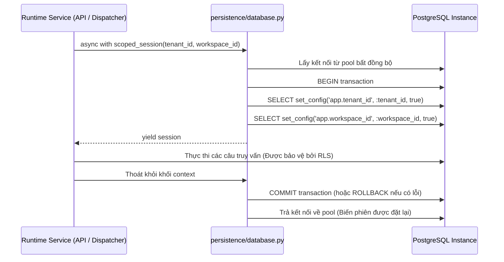

# `persistence/` — Pool kết nối CSDL & Giao dịch phạm vi RLS (Persistence Layer)

> **Trạng thái:** `PARTIAL` (Cơ chế quản lý pool kết nối PostgreSQL bất đồng bộ và thiết lập ngữ cảnh phiên RLS đã triển khai; các adapter lưu checkpoint bền vững LangGraph và kho lưu trữ BLOB chưa có)  
> **Mã nguồn đã rà soát:** [`persistence/database.py`](database.py), [`persistence/__init__.py`](__init__.py)  
> **Tài liệu SPEC liên quan:** [`SPEC-RUNTIME-001.md`](../../../../../docs/04-module-specs/runtime/SPEC-RUNTIME-001.md), [`ADR-006 Durable State`](../../../../../docs/02-architecture/adr/ADR-006-durable-state.md), [`CANONICAL_DATABASE_56.md`](../../../../../docs/00-governance/CANONICAL_DATABASE_56.md)

---

## 1. Mục đích

Package `persistence/` quản trị kết nối cơ sở dữ liệu cho Bộ máy thực thi Agent (Agent Runtime). Module này khởi tạo các pool kết nối bất đồng bộ của SQLAlchemy, cung cấp các session factory, và áp dụng thiết lập ngữ cảnh Bảo mật cấp hàng (Row-Level Security - RLS) ở cấp độ phiên làm việc của PostgreSQL nhằm phục vụ việc cô lập dữ liệu theo tenant.

---

## 2. Trách nhiệm & Phạm vi không thuộc về module (Non-goals)

**Trách nhiệm của module:**
- Khởi tạo và cấu hình các engine SQLAlchemy bất đồng bộ (`AsyncEngine`) với tính năng thăm dò trước kết nối (pre-ping) và tái tạo định kỳ (pool recycling).
- Cung cấp async context manager `scoped_session(tenant_id, workspace_id)` để thiết lập biến phiên `app.tenant_id` và `app.workspace_id` thông qua lệnh PostgreSQL `set_config(..., is_local=true)`.
- Xác thực và bắt buộc các kết nối cơ sở dữ liệu của runtime chỉ được nhắm tới PostgreSQL (`postgresql+asyncpg://` hoặc `postgresql+psycopg://`).

**Phạm vi không thuộc về module:**
- Thực thi di chuyển lược đồ dữ liệu (migrations) hoặc định nghĩa DDL (thuộc sở hữu của `database/migrations/`).
- Lưu trữ đồ thị trạng thái điểm lưu (checkpoint state graphs) của LangGraph (dành cho bảng `runtime.checkpoint_refs`).
- Chứa logic nghiệp vụ hoặc xử lý giao dịch cho từng thực thể cụ thể.

---

## 3. Trạng thái triển khai

| Khả năng | Trạng thái | Bằng chứng mã nguồn |
|---|---|---|
| Pool kết nối PostgreSQL bất đồng bộ | `IMPLEMENTED` | [`persistence/database.py::get_engine`](database.py#L20) |
| Nhà cung cấp Session Factory | `IMPLEMENTED` | [`persistence/database.py::get_session_factory`](database.py#L38) |
| Phiên làm việc phân vùng RLS | `IMPLEMENTED` | [`persistence/database.py::scoped_session`](database.py#L48) |
| Từ chối các CSDL không phải PostgreSQL | `IMPLEMENTED` | [`persistence/database.py::get_engine`](database.py#L26) |
| Kho lưu điểm trạng thái LangGraph Checkpoint | `NOT_IMPLEMENTED` | Chưa có adapter checkpointer PostgreSQL trong module này |

---

## 4. Sơ đồ File và Ký hiệu (Symbol Map)

| Tệp tin | Ký hiệu (Symbol) | Trách nhiệm |
|---|---|---|
| [`database.py`](database.py) | `RuntimeDatabaseUnavailable` | Ngoại lệ ném ra khi `DATABASE_URL` chưa cấu hình, không phải PostgreSQL, hoặc kết nối thất bại. |
| [`database.py`](database.py) | `get_engine()` | Khởi tạo lười (lazy) đối tượng singleton `AsyncEngine` với `pool_pre_ping=True` và `pool_recycle=300`. |
| [`database.py`](database.py) | `get_session_factory()` | Trả về `async_sessionmaker[AsyncSession]` gắn với engine đang hoạt động. |
| [`database.py`](database.py) | `scoped_session()` | Async context manager mở một giao dịch và thực thi các câu lệnh `set_config` cho phiên làm việc. |

---

## 5. Giao diện công khai & Hợp đồng dữ liệu (Interfaces & Contracts)

### API kết nối và phạm vi phiên làm việc
```python
from agent_runtime.persistence.database import scoped_session

# Mở giao dịch với các biến RLS được thiết lập tự động
async with scoped_session(tenant_id="<uuid>", workspace_id="<uuid>") as session:
    result = await session.execute(
        text("SELECT * FROM runtime.runs WHERE id = :run_id"),
        {"run_id": run_id}
    )
```

### Các lệnh thiết lập ngữ cảnh PostgreSQL
```sql
SELECT set_config('app.tenant_id', :tenant_id, true);
SELECT set_config('app.workspace_id', :workspace_id, true);
```
Tham số `is_local = true` bảo đảm rằng các biến cấu hình ngữ cảnh sẽ tự động được thu hồi/xóa bỏ khi giao dịch hoàn tất (commit) hoặc bị hoàn tác (rollback).

---

## 6. Luồng xử lý (Processing Flow)

### Vòng đời của một phiên Scoped Session


---

## 7. Phụ thuộc & Tương tác liên module

- **Các thành phần gọi upstream:**
  - `agent_runtime.api.runs`: Dùng `scoped_session` để chèn và truy vấn bảng `runtime.runs` và `runtime.jobs`.
  - `agent_runtime.api.events`: Dùng `scoped_session` để phát luồng dữ liệu từ `runtime.run_events`.
  - `agent_runtime.tools.dispatcher`: Dùng `_session_factory` và `_scope()` để bắt buộc áp dụng RLS trước khi giải quyết công cụ.
- **Trình điều khiển cơ sở:** Thư viện `asyncpg` hoặc `psycopg3` qua SQLAlchemy AsyncIO.

---

## 8. Ranh giới Bảo mật, Phân vùng Tenant & Chính sách

1. **Bắt buộc sử dụng PostgreSQL:** Động cơ chủ động từ chối SQLite, MySQL, hoặc CSDL trong bộ nhớ bằng cách yêu cầu URL phải bắt đầu bằng `postgresql+asyncpg://`, `postgresql+psycopg://`, hoặc `postgresql://`. SQLite không thể thực thi chính sách RLS của PostgreSQL.
2. **Cấu hình phạm vi cục bộ (`is_local=true`):** Ngăn ngừa nhiễm độc pool kết nối (connection pool contamination), tránh trường hợp kết nối được tái sử dụng vẫn lưu định danh của tenant trước đó.

---

## 9. Trạng thái, Tác dụng phụ (Side Effects) & Khôi phục sự cố

- **Kiểm tra sức khỏe kết nối:** Cấu hình với `pool_pre_ping=True` để phát hiện các kết nối bị đứt (ví dụ: sau khi database khởi động lại) trước khi gửi truy vấn.
- **Thời gian tái tạo kết nối:** Các kết nối được tái tạo mới sau mỗi 300 giây để phòng ngừa rò rỉ tài nguyên.

---

## 10. Kiểm thử & Gỡ lỗi

### Các lệnh kiểm thử thực tế đã xác minh
```powershell
# Chạy bài test hợp đồng event bus kiểm tra yêu cầu session factory của CSDL
python -m pytest tests/contract/test_event_bus_contract.py -v
```
*Bằng chứng thực tế*: **2 passed in 0.08s**.

*(Lưu ý: Các bài kiểm thử tích hợp RLS thực tế trong `tests/integration/test_rls_requires_context.py` được bỏ qua trừ khi biến môi trường `MIGRATION_DATABASE_URL` được trỏ tới một cơ sở dữ liệu PostgreSQL đang hoạt động).*

---

## 11. Các khoảng trống kỹ thuật & Nợ kỹ thuật (Known Gaps / Technical Debt)

- `CODE_GAP`: Các class lưu điểm trạng thái bền vững (`PostgresSaver` hoặc tương đương cho LangGraph checkpoint) hiện chưa có mặt trong package này.
- `CODE_GAP`: `scoped_session` mới chỉ thiết lập `tenant_id` và `workspace_id`, chưa cấu hình các biến ngữ cảnh `app.user_id` hoặc `app.user_roles` trong phiên PostgreSQL.

---

## 12. Tài liệu liên quan & Quy tắc bảo trì

- Mục lục gốc: [`agent_runtime/README.md`](../README.md)
- Thiết kế CSDL chuẩn hóa: [`CANONICAL_DATABASE_56.md`](../../../../../docs/00-governance/CANONICAL_DATABASE_56.md)
- Quyết định kiến trúc ADR: [`ADR-006 Durable State`](../../../../../docs/02-architecture/adr/ADR-006-durable-state.md)
- Điều kiện cập nhật: Cập nhật tài liệu này khi thay đổi các thông số pool kết nối, cấu hình SSL của engine, hoặc các biến phiên RLS.
