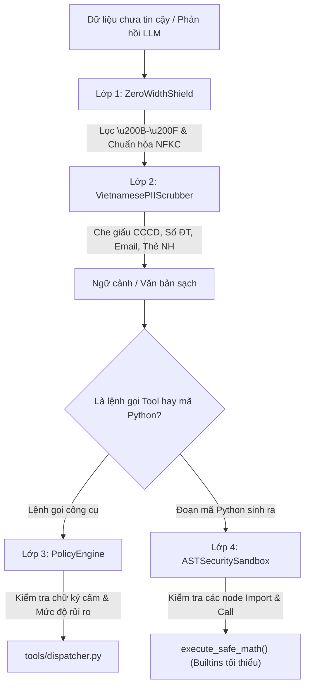

# `safety/` — Bộ kiểm soát an toàn phòng thủ 4 lớp chuyên sâu (Guardrail Suite)

> **Trạng thái:** `PARTIAL` (4 lớp phòng thủ đã triển khai: Zero-Width Shield, Làm sạch PII tiếng Việt, Policy Engine PEP, và AST Math Sandbox; việc tích hợp dạng middleware hook vào đồ thị thực thi đang chờ xử lý)  
> **Mã nguồn đã rà soát:** [`safety/zero_width_shield.py`](zero_width_shield.py), [`safety/pii_scrubber.py`](pii_scrubber.py), [`safety/policy_engine.py`](policy_engine.py), [`safety/ast_sandbox.py`](ast_sandbox.py), [`safety/__init__.py`](__init__.py)  
> **Tài liệu SPEC liên quan:** [`SPEC-SECURITY-001.md`](../../../../../docs/04-module-specs/security/SPEC-SECURITY-001.md), [`PROMPT_INJECTION_DEFENSE_DESIGN.md`](../../../../../docs/04-module-specs/security/PROMPT_INJECTION_DEFENSE_DESIGN.md)

---

## 1. Mục đích

Package `safety/` triển khai ranh giới phòng thủ đa tầng cho nền tảng. Module này có nhiệm vụ giảm thiểu các cuộc tấn công tiêm câu lệnh (prompt injection), loại bỏ các payload ẩn giấu ký tự vô hình (steganographic payloads), làm sạch và che giấu thông tin định danh cá nhân (PII) tiếng Việt theo Nghị định 13/2023/NĐ-CP, áp dụng danh sách đen năng lực tại Điểm thực thi chính sách (Policy Enforcement Point - PEP), và phân tích tĩnh cây cú pháp trừu tượng (AST) của mã code do LLM sinh ra trước khi thực thi tính toán toán học trong môi trường cách ly có kiểm soát.

---

## 2. Trách nhiệm & Phạm vi không thuộc về module (Non-goals)

**Trách nhiệm của module:**
- **Lớp 1 (Mức Byte / Unicode):** Loại bỏ các ký tự độ rộng bằng 0 (zero-width) và chuẩn hóa đồng dạng Unicode (NFKC).
- **Lớp 2 (Làm sạch PII):** Che giấu và ẩn số Căn cước công dân (CCCD 12 số), số điện thoại viễn thông Việt Nam, địa chỉ email, và số thẻ thanh toán/ngân hàng.
- **Lớp 3 (Thực thi chính sách):** Kiểm tra đối chiếu tham số gọi công cụ với các dấu hiệu chèn lệnh hệ thống (shell injection) và đánh giá cấp độ rủi ro.
- **Lớp 4 (Kiểm toán mã nguồn AST):** Phân tích tĩnh cây cú pháp trừu tượng Python để chặn các lệnh import độc hại, gọi hàm hệ thống và built-in không an toàn, đồng thời cung cấp môi trường sandbox tính toán biểu thức toán học với phạm vi tối giản.

**Phạm vi không thuộc về module:**
- Phân quyền cơ sở dữ liệu có thẩm quyền hoặc cơ chế RLS (thuộc thẩm quyền của PostgreSQL).
- Điều phối và áp dụng tính bất biến của Tool Gateway (thuộc thẩm quyền của `tools/dispatcher.py`).
- Lọc kết nối mạng luồng ra tầng mạng (thuộc thẩm quyền của `mcp/client.py`).

---

## 3. Trạng thái triển khai

| Khả năng | Trạng thái | Bằng chứng mã nguồn |
|---|---|---|
| Lớp 1: Lá chắn Zero-Width Shield | `IMPLEMENTED` | [`safety/zero_width_shield.py::ZeroWidthShield`](zero_width_shield.py#L11) |
| Lớp 2: Làm sạch PII tiếng Việt | `IMPLEMENTED` | [`safety/pii_scrubber.py::VietnamesePIIScrubber`](pii_scrubber.py#L10) |
| Lớp 3: Điểm thực thi chính sách PEP | `IMPLEMENTED` | [`safety/policy_engine.py::PolicyEngine`](policy_engine.py#L14) |
| Lớp 4: Sandbox bảo mật mã AST | `IMPLEMENTED` | [`safety/ast_sandbox.py::ASTSecuritySandbox`](ast_sandbox.py#L41) |
| Tích hợp Hook vào pipeline | `PARTIAL` | Các class kiểm soát an toàn đã hoàn thiện nhưng chưa được đăng ký làm ASGI middleware hoặc node wrapper chuẩn hóa |

---

## 4. Sơ đồ File và Ký hiệu (Symbol Map)

| Tệp tin | Ký hiệu (Symbol) | Trách nhiệm |
|---|---|---|
| [`zero_width_shield.py`](zero_width_shield.py) | `ZeroWidthShield` | Chuẩn hóa văn bản qua NFKC, loại bỏ ký tự zero-width (khoảng trắng vô hình, dấu nối, đảo chiều), và tùy chọn lọc bỏ các ký tự CJK lạc dòng. |
| [`pii_scrubber.py`](pii_scrubber.py) | `VietnamesePIIScrubber` | Regex che giấu CCCD 12 số, số điện thoại đầu số Việt Nam, email, và số thẻ. Trả về thống kê số lượng đã xử lý. |
| [`policy_engine.py`](policy_engine.py) | `PolicyEngine` | Xác thực lệnh gọi công cụ đối chiếu với manifest đã đăng ký, chặn các dấu hiệu tiêm lệnh (`os.system`, `rm -rf`, `drop table`). |
| [`policy_engine.py`](policy_engine.py) | `PolicyViolationError` | Ngoại lệ ném ra khi vi phạm chính sách hoặc phát hiện dấu hiệu tấn công. |
| [`ast_sandbox.py`](ast_sandbox.py) | `ASTSecurityScanner` | NodeVisitor duyệt cây AST để phát hiện các node `Import`, `ImportFrom`, và `Call` thuộc danh sách cấm. |
| [`ast_sandbox.py`](ast_sandbox.py) | `ASTSecuritySandbox` | Kiểm toán cây cú pháp code và thực thi an toàn các công thức toán học xác định với từ điển `__builtins__` tối thiểu. |
| [`ast_sandbox.py`](ast_sandbox.py) | `ASTSecurityViolation` | Ngoại lệ ném ra khi phát hiện cấu trúc AST nguy hiểm. |

---

## 5. Giao diện công khai & Hợp đồng dữ liệu (Interfaces & Contracts)

### API các thành phần 4 lớp bảo vệ
```python
# Lớp 1: Lá chắn Zero-Width
shield = ZeroWidthShield()
cleaned_text, stripped_count = shield.sanitize(text: str, strip_cjk: bool = False)

# Lớp 2: Làm sạch PII
scrubber = VietnamesePIIScrubber()
redacted_text, stats = scrubber.scrub(text: str)
# stats: {"cccd": int, "phone": int, "email": int, "card": int}

# Lớp 3: Điểm thực thi chính sách
pep = PolicyEngine(manifest: Dict[str, Any])
verdict = pep.evaluate_tool_call(tool_id: str, arguments: Dict[str, Any], user_role: str)
# verdict: {"allowed": bool, "tool_id": str, "risk_level": str, "requires_approval": bool, "sandbox": str}

# Lớp 4: Sandbox AST
sandbox = ASTSecuritySandbox()
sandbox.validate_code(source_code: str) -> bool
result_scope = sandbox.execute_safe_math(source_code: str, scope: Dict[str, Any]) -> Dict[str, Any]
```

---

## 6. Luồng xử lý (Processing Flow)

### Quy trình đường ống bảo vệ 4 lớp


---

## 7. Phụ thuộc & Tương tác liên module

- **Chỉ sử dụng thư viện tiêu chuẩn:** Xây dựng hoàn toàn bằng các module Python thuần `re`, `unicodedata`, `ast`. Không phụ thuộc vào các mô hình ML cồng kềnh, đảm bảo tốc độ xử lý dưới một mili-giây.
- **Theo dõi qua Tracing:** `observability.tracer.SpanName` dành riêng các span cho các lớp an toàn này: `GUARDRAIL_PII_SCRUB`, `POLICY_PEP_CHECK`, và `GUARDRAIL_OUTPUT_FILTER`.

---

## 8. Ranh giới Bảo mật, Phân vùng Tenant & Chính sách

1. **Các đối tượng cấm trong AST:**
   - Hàm cấm: `eval`, `exec`, `open`, `__import__`, `compile`, `globals`, `locals`.
   - Module cấm: `os`, `sys`, `subprocess`, `socket`, `shutil`, `requests`, `http`.
2. **Tuân thủ quy định pháp luật Việt Nam:** Hỗ trợ tuân thủ Nghị định 13/2023/NĐ-CP về bảo vệ dữ liệu cá nhân thông qua việc thay thế số CCCD bằng dạng `[CCCD_REDACTED_***123]` (chỉ giữ lại 3 số cuối phục vụ đối soát kiểm toán).
3. **Nguyên tắc phòng thủ theo chiều sâu (Defense-in-Depth):** Các cơ chế kiểm soát an toàn đóng vai trò như lớp màng lọc bảo vệ bổ sung, nhưng TUYỆT ĐỐI KHÔNG thay thế cơ chế Row-Level Security tại CSDL hoặc các bước xác minh phê duyệt của Tool Gateway.

---

## 9. Trạng thái, Tác dụng phụ (Side Effects) & Khôi phục sự cố

- **Phi trạng thái (Stateless):** Toàn bộ 4 thành phần hoạt động như các hàm biến đổi dữ liệu thuần túy, có tính tất định và không lưu giữ trạng thái trong CSDL.
- **Thực thi đóng an toàn khi lỗi (Fail-Closed):** Mọi lỗi cú pháp không thể phân tích hoặc phát hiện từ khóa trong danh sách đen đều lập tức ném ngoại lệ có kiểu (`PolicyViolationError`, `ASTSecurityViolation`).

---

## 10. Kiểm thử & Gỡ lỗi

### Các lệnh kiểm thử thực tế đã xác minh
```powershell
# Chạy bộ test truy vết OpenTelemetry bao phủ các span guardrails và kiểm thử trực tiếp AST
python -m pytest tests/contract/test_opentelemetry_tracing.py -v
```
*Bằng chứng thực tế*: **3 passed in 0.12s**.

---

## 11. Các khoảng trống kỹ thuật & Nợ kỹ thuật (Known Gaps / Technical Debt)

- `CODE_GAP`: Cơ chế làm sạch PII bằng biểu thức chính quy (regex) chưa bắt được các số điện thoại được viết bằng chữ (ví dụ: "không chín không tám...").
- `CODE_GAP`: Phương thức `ASTSecuritySandbox.execute_safe_math` hiện sử dụng lệnh `exec()` của Python với từ điển `__builtins__` bị giới hạn. Mặc dù đã quét AST trước, môi trường container cách ly hoàn toàn (như gVisor hoặc WebAssembly) vẫn được khuyến nghị cho môi trường sản xuất khi thực thi mã không tin cậy.

---

## 12. Tài liệu liên quan & Quy tắc bảo trì

- Mục lục gốc: [`agent_runtime/README.md`](../README.md)
- Đặc tả kiến trúc: [`SPEC-SECURITY-001.md`](../../../../../docs/04-module-specs/security/SPEC-SECURITY-001.md)
- Tài liệu thiết kế: [`PROMPT_INJECTION_DEFENSE_DESIGN.md`](../../../../../docs/04-module-specs/security/PROMPT_INJECTION_DEFENSE_DESIGN.md)
- Điều kiện cập nhật: Cập nhật tài liệu này khi bổ sung quy tắc regex PII, cập nhật danh sách module bị cấm trong AST, hoặc điều chỉnh các dải ký tự unicode zero-width.
