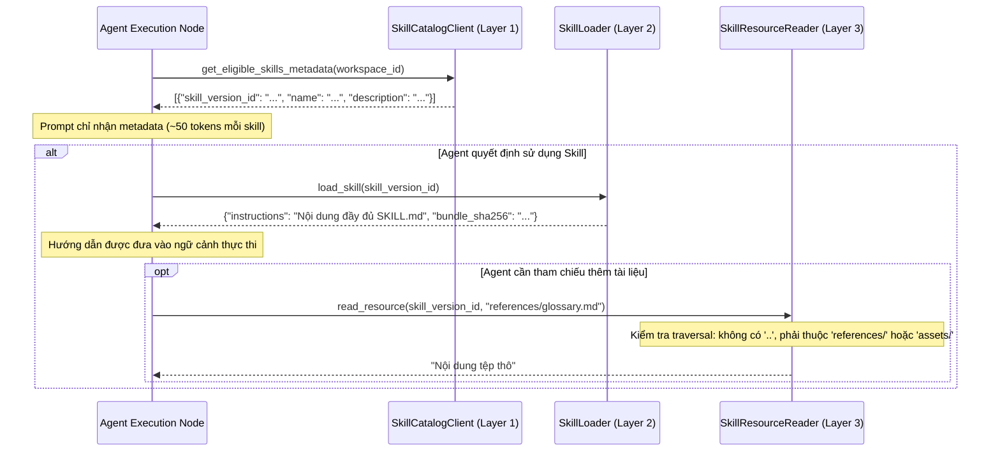

# `skills/` — Nạp Skill theo nhu cầu & Kiểm soát an toàn tài nguyên (Progressive Disclosure)

> **Trạng thái:** `PARTIAL` (Cơ chế nạp thông tin theo nhu cầu 3 lớp, bảo mật chống duyệt đường dẫn traversal, và nạp manifest đã triển khai; kho lưu trữ trong bộ nhớ RAM là mô phỏng, kết nối lưu trữ MinIO và cơ sở dữ liệu chưa được kích hoạt)  
> **Mã nguồn đã rà soát:** [`skills/catalog_client.py`](catalog_client.py), [`skills/loader.py`](loader.py), [`skills/resource_reader.py`](resource_reader.py), [`skills/__init__.py`](__init__.py)  
> **Tài liệu SPEC liên quan:** [`SPEC-SKILL-001.md`](../../../../../docs/04-module-specs/skill/SPEC-SKILL-001.md), [`CR-SKILL-001.md`](../../../../../docs/05-change-requests/CR-SKILL-001.md), [`ADR-011 Skill Engine`](../../../../../docs/02-architecture/adr/ADR-011-skill-engine.md)

---

## 1. Mục đích

Package `skills/` triển khai mô hình Nạp thông tin theo nhu cầu 3 lớp (3-Layer Progressive Disclosure) cho Agent Skills (Track 3 Day 21). Cơ chế này cho phép các Agent khám phá các Skill khả dụng thông qua siêu dữ liệu rút gọn tiết kiệm token, nạp nội dung hướng dẫn `SKILL.md` đầy đủ khi có nhu cầu, và đọc an toàn các tài sản tài liệu tham chiếu đồng thời kiểm soát nghiêm ngặt ranh giới duyệt thư mục nhằm ngăn chặn thực thi script trái phép.

---

## 2. Trách nhiệm & Phạm vi không thuộc về module (Non-goals)

**Trách nhiệm của module:**
- **Lớp 1 (Khám phá — Discover):** Cung cấp siêu dữ liệu nhẹ (`name`, `description`, `skill_version_id`) cho các skill đang hoạt động và được ghim, nhằm tối ưu hóa dung lượng cửa sổ ngữ cảnh (context window).
- **Lớp 2 (Nạp — Load):** Nạp toàn bộ nội dung hướng dẫn của `SKILL.md` và mã băm SHA-256 của gói bundle theo nhu cầu khi Agent quyết định sử dụng một skill.
- **Lớp 3 (Tài nguyên — Resources):** Cung cấp tài liệu tham khảo tĩnh (`references/`) và tệp tài sản (`assets/`) từ các gói bundle bất biến.
- Thực thi cơ chế bảo vệ chống tấn công duyệt đường dẫn (chặn `..`, dấu gạch chéo đầu, dấu gạch chéo ngược `\`, và ký tự null).
- Thực thi giới hạn an toàn MVP: ngăn chặn tuyệt đối việc truy cập hoặc thực thi trong thư mục `scripts/`.

**Phạm vi không thuộc về module:**
- Cấp quyền thực thi công cụ (Skills chỉ cung cấp hướng dẫn dạng văn bản; việc gọi công cụ BẮT BUỘC phải đi qua `tools/dispatcher.py`).
- Trực tiếp thực thi mã Python hoặc các tệp nhị phân thực thi ngoài.
- Lưu trữ hoặc giải nén tệp lưu trữ nén thô `.tar.gz` / `.zip` từ MinIO (thuộc quyền sở hữu của mặt phẳng nạp dữ liệu Ingestion / Control Plane).

---

## 3. Trạng thái triển khai

| Khả năng | Trạng thái | Bằng chứng mã nguồn |
|---|---|---|
| Lớp 1: Khám phá siêu dữ liệu | `IMPLEMENTED` | [`skills/catalog_client.py::SkillCatalogClient.get_eligible_skills_metadata`](catalog_client.py#L11) |
| Lớp 2: Nạp Skill theo nhu cầu | `IMPLEMENTED` | [`skills/loader.py::SkillLoader.load_skill`](loader.py#L11) |
| Lớp 3: Đọc an toàn tài nguyên | `IMPLEMENTED` | [`skills/resource_reader.py::SkillResourceReader.read_resource`](resource_reader.py#L15) |
| Chống duyệt đường dẫn & Zip-Slip | `IMPLEMENTED` | [`skills/resource_reader.py::SkillResourceReader`](resource_reader.py#L17) |
| Khóa thực thi Scripts (MVP) | `IMPLEMENTED` | [`skills/resource_reader.py::SkillResourceReader`](resource_reader.py#L22) |
| Backend lưu trữ MinIO / S3 | `NOT_IMPLEMENTED` | Hiện dùng dictionary mô phỏng truyền qua constructor |

---

## 4. Sơ đồ File và Ký hiệu (Symbol Map)

| Tệp tin | Ký hiệu (Symbol) | Trách nhiệm |
|---|---|---|
| [`catalog_client.py`](catalog_client.py) | `SkillCatalogClient` | Lọc các skill đã ghim theo `workspace_id` và `status == 'active'`, tạo danh sách siêu dữ liệu rút gọn. |
| [`loader.py`](loader.py) | `SkillLoader` | Nạp nội dung markdown của `SKILL.md` đã ghim theo `skill_version_id`. Từ chối các skill bị vô hiệu hóa (`disabled`). |
| [`resource_reader.py`](resource_reader.py) | `SkillResourceReader` | Giải quyết đường dẫn tương đối trong bundle skill. Bắt buộc danh sách trắng thư mục và chuẩn hóa đường dẫn. |
| [`resource_reader.py`](resource_reader.py) | `SkillResourceSecurityViolation` | Ngoại lệ ném ra khi phát hiện hành vi duyệt đường dẫn trái phép hoặc vi phạm ranh giới thư mục cho phép. |

---

## 5. Giao diện công khai & Hợp đồng dữ liệu (Interfaces & Contracts)

### Giao thức 3 lớp nạp thông tin
```python
# Lớp 1: Khám phá (Discover)
class SkillCatalogClient:
    def __init__(self, pinned_skills: List[Dict[str, Any]] = None): ...
    def get_eligible_skills_metadata(self, workspace_id: str) -> List[Dict[str, str]]: ...

# Lớp 2: Nạp (Load)
class SkillLoader:
    def __init__(self, store: Optional[Dict[str, Dict[str, Any]]] = None): ...
    def load_skill(self, skill_version_id: str) -> Dict[str, Any]: ...

# Lớp 3: Tài nguyên (Resources)
class SkillResourceReader:
    def __init__(self, resource_store: Dict[str, Dict[str, str]] = None): ...
    def read_resource(self, skill_version_id: str, relative_path: str) -> str: ...
```

---

## 6. Luồng xử lý (Processing Flow)

### Luồng nạp thông tin theo nhu cầu 3 lớp


---

## 7. Phụ thuộc & Tương tác liên module

- **Ranh giới tương tác với `tools/`:** Skills có thể mô tả quy trình và cách sử dụng công cụ trong tài liệu markdown, nhưng Skills không thể tự thực thi công cụ. Mọi lệnh gọi công cụ phải do Agent phát ra và đi qua `tools/dispatcher.py`.
- **Sai lệch hiện tại:** Các kho dữ liệu (`store`, `resource_store`) hiện được truyền dưới dạng từ điển Python nội bộ khi khởi tạo thay vì tải từ `catalog.skills` hoặc kho lưu trữ đối tượng MinIO.

---

## 8. Ranh giới Bảo mật, Phân vùng Tenant & Chính sách

1. **Khóa chống duyệt đường dẫn (Path Traversal):** `SkillResourceReader` chuẩn hóa đường dẫn bằng `pathlib.Path(relative_path).as_posix()`. Hệ thống ném ngoại lệ `SkillResourceSecurityViolation` nếu:
   - Đường dẫn chứa đoạn `..`.
   - Đường dẫn bắt đầu bằng dấu `/` (đường dẫn tuyệt đối).
   - Đường dẫn chứa dấu gạch chéo ngược `\`.
2. **Danh sách trắng thư mục (Whitelisting):** Quyền truy cập chỉ giới hạn trong hai thư mục `references/` hoặc `assets/`.
3. **Vô hiệu hóa Scripts (MVP):** Mọi đường dẫn bắt đầu bằng `scripts/` sẽ ném ngoại lệ `PermissionError("Scripts execution/reading is disabled in MVP.")`.
4. **Kiểm tra trạng thái Skill:** `SkillLoader.load_skill()` khẳng định `status != 'disabled'`.

---

## 9. Trạng thái, Tác dụng phụ (Side Effects) & Khôi phục sự cố

- **Chỉ đọc / Không tạo tác dụng phụ:** Skills chứa tài liệu bất biến và các tệp tĩnh. Việc đọc skill hoàn toàn không tạo tác dụng phụ và không thay đổi trạng thái cơ sở dữ liệu.
- **Tính khả dụng của kho lưu:** Nếu `skill_version_id` hoặc đường dẫn tệp tài nguyên yêu cầu không tồn tại trong kho, các ngoại lệ có kiểu (`ValueError`, `FileNotFoundError`) được ném ra để đóng an toàn khi lỗi (fail-closed).

---

## 10. Kiểm thử & Gỡ lỗi

### Các lệnh kiểm thử thực tế đã xác minh
```powershell
# Chạy bộ test hợp đồng skill manifest và bảo mật đọc tài nguyên
python -m pytest tests/contract/test_skill_and_mcp_contracts.py -k "skill" -v
```
*Bằng chứng thực tế*: **3 passed in 0.15s**.

---

## 11. Các khoảng trống kỹ thuật & Nợ kỹ thuật (Known Gaps / Technical Debt)

- `CODE_GAP`: `SkillLoader` và `SkillResourceReader` nhận từ điển trong bộ nhớ tại hàm khởi tạo. Việc kết nối sản xuất tới bảng `catalog.skills`/`catalog.skill_versions` và lưu trữ đối tượng MinIO chưa được triển khai.
- `CODE_GAP`: Logic giải nén tarball với tính năng bảo vệ chống Zip-Slip chưa được tích hợp trực tiếp trong `resource_reader.py` (hiện giả định dữ liệu tài nguyên đã được giải nén sẵn thành các cặp key-value).

---

## 12. Tài liệu liên quan & Quy tắc bảo trì

- Mục lục gốc: [`agent_runtime/README.md`](../README.md)
- Đặc tả kiến trúc: [`SPEC-SKILL-001.md`](../../../../../docs/04-module-specs/skill/SPEC-SKILL-001.md)
- Yêu cầu thay đổi: [`CR-SKILL-001.md`](../../../../../docs/05-change-requests/CR-SKILL-001.md)
- Quyết định kiến trúc ADR: [`ADR-011 Skill Engine`](../../../../../docs/02-architecture/adr/ADR-011-skill-engine.md)
- Điều kiện cập nhật: Cập nhật tài liệu này khi tích hợp cơ chế nạp bundle từ MinIO hoặc thay đổi quy tắc kiểm duyệt đường dẫn tài nguyên.
