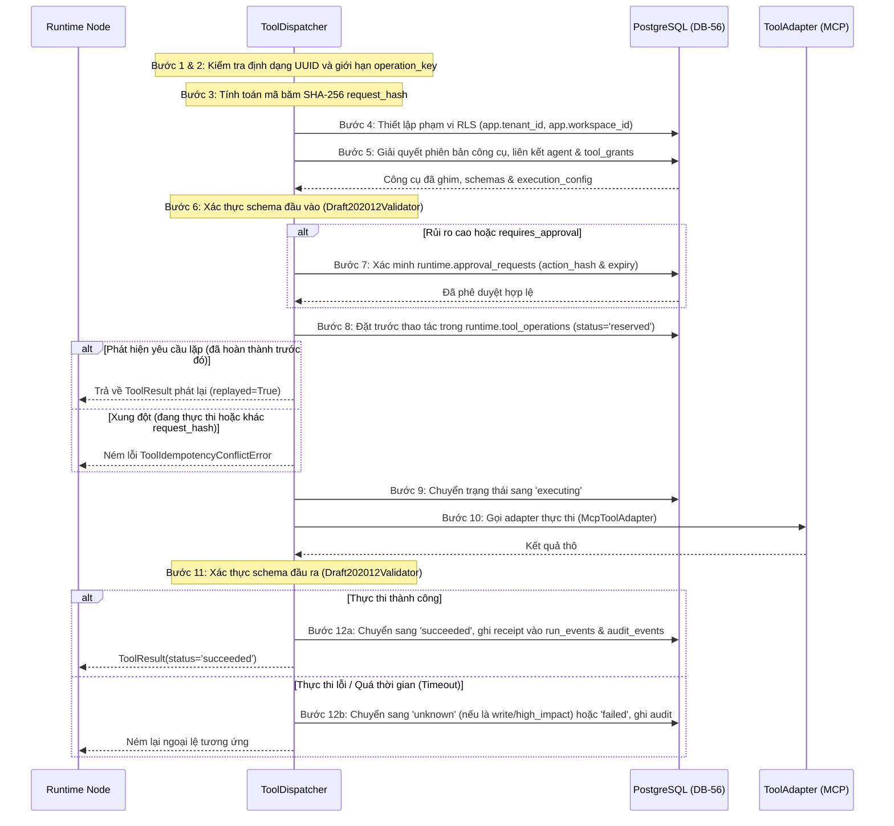

# `tools/` — Cổng kiểm soát thực thi công cụ 12 bước chuẩn hóa (Canonical Tool Gateway)

> **Trạng thái:** `PARTIAL` (Cổng PostgreSQL 12 bước hoàn chỉnh, tính bất biến khi thực hiện lặp, kiểm tra phê duyệt, và adapter MCP đã triển khai; adapter HTTP và Builtin chưa có, và dispatcher hiện chưa được nối vào đồ thị thực thi)  
> **Mã nguồn đã rà soát:** [`tools/dispatcher.py`](dispatcher.py), [`tools/__init__.py`](__init__.py)  
> **Tài liệu SPEC liên quan:** [`SPEC-TOOL-001.md`](../../../../../docs/04-module-specs/tool/SPEC-TOOL-001.md), [`ADR-008 Tool Dispatcher`](../../../../../docs/02-architecture/adr/ADR-008-12-step-tool-dispatcher.md), [`CANONICAL_DATABASE_56.md`](../../../../../docs/00-governance/CANONICAL_DATABASE_56.md)

---

## 1. Mục đích

Package `tools/` là cổng kiểm soát thực thi và chính sách có thẩm quyền tối cao đối với toàn bộ các thao tác tạo tác dụng phụ (side effects) trong nền tảng. Mọi lệnh gọi công cụ (`mcp`, `builtin`, `http`) bắt buộc phải đi qua `ToolDispatcher`. Tuyệt đối không một node đồ thị Agent, script của Skill, client MCP, hay frontend nào được phép trực tiếp gọi dịch vụ bên ngoài mà không thông qua cổng này.

---

## 2. Trách nhiệm & Phạm vi không thuộc về module (Non-goals)

**Trách nhiệm của module:**
- Thực thi có thẩm quyền giao thức 12 bước chuẩn hóa của Tool Dispatcher.
- Giải quyết các liên kết bất biến từ bảng `catalog.agent_tool_bindings` và kiểm tra quyền phía máy chủ đang hoạt động trong `catalog.tool_grants`.
- Xác thực JSON Schema cho tham số đầu vào và kết quả đầu ra của công cụ (`Draft202012Validator`).
- Bắt buộc phê duyệt của con người gắn liền với hành động cụ thể thông qua `runtime.approval_requests` (khớp mã băm `action_hash`).
- Đặt trước tính bất biến (idempotency reservation) nghiêm ngặt trong `runtime.tool_operations` qua khóa duy nhất `(tenant_id, workspace_id, operation_key)`.
- Tạo biên nhận cuối cùng (terminal receipt) trong `runtime.run_events` và ghi nhật ký kiểm toán bất biến trong `governance.audit_events`.

**Phạm vi không thuộc về module:**
- Giao thức mạng tầng thấp, lọc SSRF, hoặc tuần tự hóa JSON-RPC 2.0 (được giao cho `mcp/`).
- Khám phá, phân tích cú pháp hoặc quản lý siêu dữ liệu của Skills (được giao cho `skills/`).
- Phê duyệt hoặc đưa ra quyết định chấp thuận của con người (thuộc quyền sở hữu của Control API).
- Tự ý cấp quyền độc lập dựa vào câu lệnh prompt của mô hình AI.

---

## 3. Trạng thái triển khai

| Khả năng | Trạng thái | Bằng chứng mã nguồn |
|---|---|---|
| Vòng đời Dispatcher 12 bước | `IMPLEMENTED` | [`tools/dispatcher.py::ToolDispatcher.execute`](dispatcher.py#L349) |
| Giải quyết ràng buộc & cấp quyền | `IMPLEMENTED` | [`tools/dispatcher.py::ToolDispatcher._resolve`](dispatcher.py#L136) |
| Tính toán mã băm hành động (Action Hash) | `IMPLEMENTED` | [`tools/dispatcher.py::ToolDispatcher.compute_action_hash`](dispatcher.py#L112) |
| Xác minh phê duyệt (Approval Verification) | `IMPLEMENTED` | [`tools/dispatcher.py::ToolDispatcher._verify_approval`](dispatcher.py#L218) |
| Đặt trước tính bất biến (Idempotency Reservation) | `IMPLEMENTED` | [`tools/dispatcher.py::ToolDispatcher._reserve`](dispatcher.py#L242) |
| Chuyển đổi trạng thái thao tác | `IMPLEMENTED` | [`tools/dispatcher.py::ToolDispatcher._transition`](dispatcher.py#L278) |
| Adapter công cụ MCP | `IMPLEMENTED` | [`tools/dispatcher.py::McpToolAdapter`](dispatcher.py#L80) |
| Adapter công cụ HTTP & Builtin | `NOT_IMPLEMENTED` | Thiếu trong mapping `ToolDispatcher._adapters` |
| Tích hợp vào đồ thị thực thi | `NOT_CONNECTED` | Chưa được gọi bởi `application/state_graph.py` |

---

## 4. Sơ đồ File và Ký hiệu (Symbol Map)

| Tệp tin | Ký hiệu (Symbol) | Trách nhiệm |
|---|---|---|
| [`dispatcher.py`](dispatcher.py) | `ToolInvocation` | Phong bì gọi công cụ bất biến: `principal`, `run_id`, `agent_version_id`, `tool_version_id`, `operation_key`, `arguments`, `step_key`, `approval_request_id`, `trace_id`. |
| [`dispatcher.py`](dispatcher.py) | `ToolResult` | Kết quả thực thi có cấu trúc: `status`, `operation_key`, `replayed`, `result`, `external_reference`. |
| [`dispatcher.py`](dispatcher.py) | `ToolAdapter` | Giao thức định nghĩa phương thức `async def invoke(execution_config, arguments, operation_key)`. |
| [`dispatcher.py`](dispatcher.py) | `McpToolAdapter` | Adapter kết nối lệnh gọi công cụ sang `agent_runtime.mcp.client.McpClientAdapter`. |
| [`dispatcher.py`](dispatcher.py) | `ToolDispatcher` | Bộ máy Cổng kiểm soát thực thi công cụ 12 bước chuẩn hóa dựa trên PostgreSQL. |
| [`dispatcher.py`](dispatcher.py) | `ToolExecutionError` & Subclasses | Hệ thống phân cấp ngoại lệ có kiểu: `ToolNotFoundError`, `ToolSchemaValidationError`, `ToolPolicyDeniedError`, `ToolApprovalRequiredError`, `ToolIdempotencyConflictError`, `ToolAmbiguousOutcomeError`. |

---

## 5. Giao diện công khai & Hợp đồng dữ liệu (Interfaces & Contracts)

### Dataclass gọi công cụ chuẩn hóa
```python
@dataclass(frozen=True, slots=True)
class ToolInvocation:
    principal: AuthenticatedPrincipal
    run_id: str
    agent_version_id: str
    tool_version_id: str
    operation_key: str
    arguments: dict[str, Any]
    step_key: str
    approval_request_id: str | None = None
    trace_id: str | None = None
```

### Hệ thống phân cấp lỗi có kiểu
```
ToolExecutionError
├── ToolNotFoundError
├── ToolSchemaValidationError
├── ToolPolicyDeniedError
├── ToolApprovalRequiredError
├── ToolIdempotencyConflictError
└── ToolAmbiguousOutcomeError
```

---

## 6. Luồng xử lý 12 bước chuẩn hóa (12-Step Processing Flow)

Phương thức `ToolDispatcher.execute()` triển khai quy trình 12 bước bắt buộc:



---

## 7. Phụ thuộc & Tương tác liên module

- **Tương tác nội bộ cùng runtime:**
  - `agent_runtime.mcp.client`: `McpToolAdapter` ủy quyền thực thi từ xa cho `McpClientAdapter.call_tool()`.
  - `platform_common.principal`: Nhận đối tượng xác thực đáng tin cậy `AuthenticatedPrincipal`.
- **Bảng cơ sở dữ liệu tham chiếu:**
  - `catalog.agent_tool_bindings`: Giải quyết liên kết phiên bản công cụ với Agent.
  - `catalog.tool_versions`: Đọc `input_schema`, `output_schema`, `execution_config`, `risk` đã ghim.
  - `catalog.tools`: Phân loại công cụ (`mcp`, `builtin`, `http`).
  - `catalog.tool_grants`: Quyền RBAC cấp từ phía máy chủ cho `call.principal.roles`.
  - `integration.mcp_tool_mappings` & `integration.connections`: Xác minh trạng thái kết nối MCP đang hoạt động và dấu vân tay schema không bị trôi dạt.
  - `runtime.approval_requests`: Kiểm tra `action_hash` chưa hết hạn.
  - `runtime.tool_operations`: Khóa tính bất biến, request hash, trạng thái (`reserved`, `executing`, `succeeded`, `failed`, `unknown`).
  - `runtime.runs`: Tăng số thứ tự sự kiện `next_event_seq` một cách nguyên tử.
  - `runtime.run_events`: Thêm sự kiện biên nhận `tool.operation.receipt`.
  - `governance.audit_events`: Ghi nhật ký kiểm toán bất biến.

---

## 8. Ranh giới Bảo mật, Phân vùng Tenant & Chính sách

1. **Phân vùng bảo mật cấp hàng (RLS):** Mọi giao dịch bắt đầu bằng `_scope()` thực thi lệnh `set_config('app.tenant_id', ...)` và `set_config('app.workspace_id', ...)` với `is_local=true`.
2. **Bảo vệ chống sửa đổi mã băm hành động (Action Hash):** Phương thức `compute_action_hash()` băm chuỗi JSON chuẩn hóa của:
   ```json
   {
     "agent_version_id": "...",
     "arguments": {...},
     "run_id": "...",
     "step_key": "...",
     "tenant_id": "...",
     "tool_version_id": "...",
     "workspace_id": "..."
   }
   ```
   Nếu tham số chỉ cần sai khác một ký tự hoặc khoảng trắng, việc xác thực phê duyệt sẽ đóng an toàn khi lỗi (fail-closed) với `ToolApprovalRequiredError`.
3. **Phát hiện trôi dạt Schema (Schema Drift):** Đối với công cụ MCP, `approved_schema_sha256` được so sánh nghiêm ngặt với `discovered_schema_sha256`. Nếu công cụ phía upstream bị biến đổi mà chưa được quản trị viên duyệt lại, lệnh gọi sẽ thất bại với `ToolPolicyDeniedError`.
4. **Bảo vệ khóa bí mật (Secrets):** Nếu kết nối yêu cầu secret và `secret_ref` khác null, hệ thống bắt buộc giải quyết secret tại server-side và từ chối việc truyền secret thô từ phía client.

---

## 9. Trạng thái, Tác dụng phụ (Side Effects) & Khôi phục sự cố

- **Kết quả không rõ ràng (`unknown`):** Nếu xảy ra lỗi mạng quá thời gian (timeout) hoặc mất kết nối từ xa trong khi thực thi công cụ ghi/rủi ro cao, `ToolDispatcher` chuyển trạng thái sang `status='unknown'`. Hệ thống chủ động từ chối tự động thử lại (blind retry) để tránh tác dụng phụ lặp lại, yêu cầu đối soát thủ công từ người vận hành.
- **Phát lại bất biến (Idempotent Replays):** Việc phát lại cùng một `operation_key` với cùng một `request_hash` sẽ trả về ngay kết quả `ToolResult(replayed=True)` đã lưu trước đó mà không thực hiện lại tác dụng phụ ra bên ngoài.

---

## 10. Kiểm thử & Gỡ lỗi

### Các lệnh kiểm thử thực tế đã xác minh
```powershell
# Chạy bộ test hợp đồng Tool Dispatcher 12 bước chuẩn hóa
python -m pytest tests/contract/test_tool_dispatcher_12step.py -v
```
*Bằng chứng thực tế*: **2 passed in 0.12s**.

---

## 11. Các khoảng trống kỹ thuật & Nợ kỹ thuật (Known Gaps / Technical Debt)

- `CODE_GAP`: `ToolDispatcher` hiện chỉ hỗ trợ loại `mcp` trong `self._adapters`. Các adapter cho công cụ nội hợp `builtin` và công cụ `http` chưa được phát triển.
- `CODE_GAP`: Cổng kiểm soát này hiện chưa được nối vào các node thực thi của `application/state_graph.py`.
- `DESIGN_GAP`: Việc ghi nhật ký vào `governance.audit_events` hiện dùng trường `details_redacted`, nhưng bảng CSDL thiếu các cột `prev_hash` và `record_hash` để phục vụ xác minh chuỗi băm chống giả mạo bằng mật mã học.

---

## 12. Tài liệu liên quan & Quy tắc bảo trì

- Mục lục gốc: [`agent_runtime/README.md`](../README.md)
- Đặc tả kiến trúc: [`SPEC-TOOL-001.md`](../../../../../docs/04-module-specs/tool/SPEC-TOOL-001.md)
- Quyết định kiến trúc ADR: [`ADR-008 Tool Dispatcher`](../../../../../docs/02-architecture/adr/ADR-008-12-step-tool-dispatcher.md)
- Điều kiện cập nhật: Cập nhật tài liệu này bất cứ khi nào câu truy vấn giải quyết công cụ, trạng thái dispatcher 12 bước, hoặc giao diện adapter bị thay đổi.
