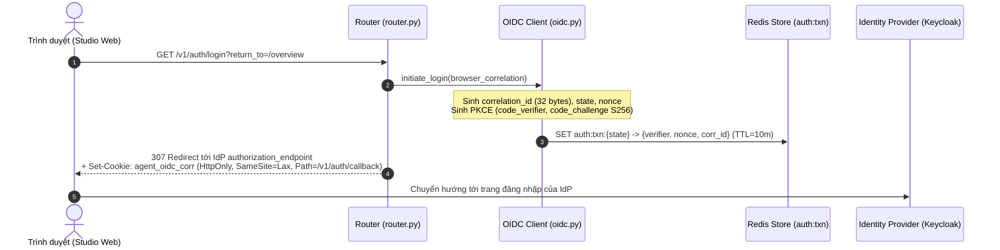
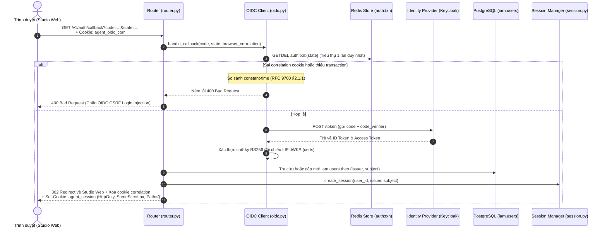
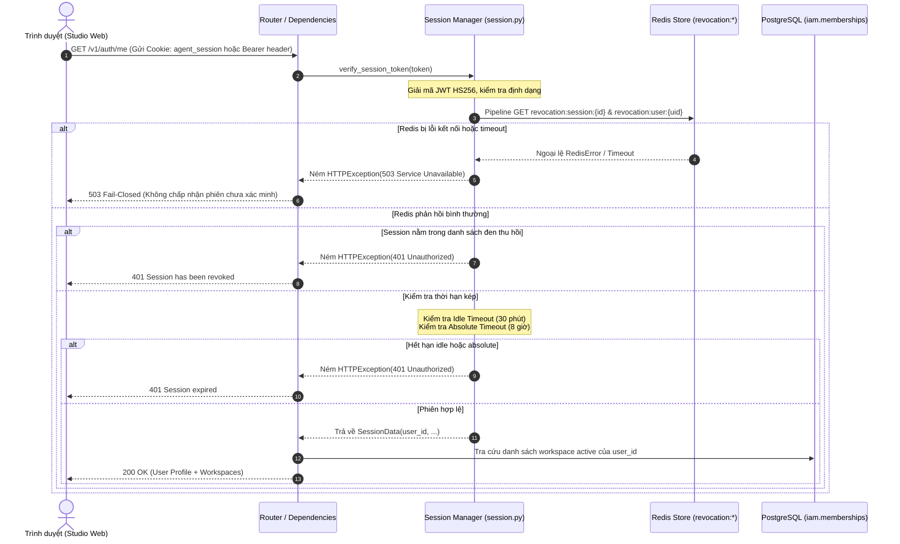
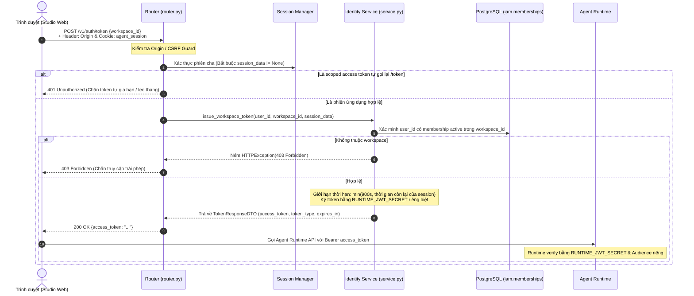
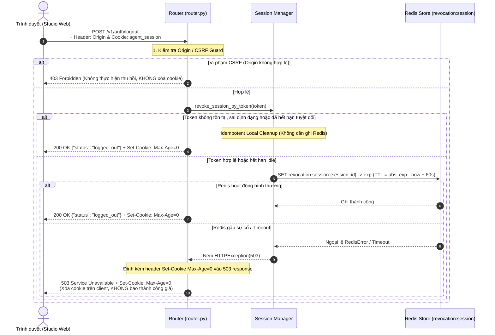

# `identity/` — Phân hệ Xác thực, Danh tính & Quản lý Phiên (Step 02 — Authentication)

> **Trạng thái:** `IMPLEMENTED / REMEDIATED` (Đã khắc phục toàn diện findings R01–R09; hoàn tất các bản sửa lỗi bảo mật P0-01 và P0-02)  
> **Mã nguồn đã rà soát:** `api/`, `dto/`, `models/`, `providers/`, `repositories/`, `security/`, `services/`, `__init__.py`  
> **Tài liệu SPEC liên quan:** [`SPEC-AUTH-001.md`](../../../../../../docs/04-module-specs/auth/SPEC-AUTH-001.md), [`AUTH_DESIGN_DECISIONS.md`](../../../../../../docs/04-module-specs/auth/AUTH_DESIGN_DECISIONS.md), [`SPEC-SECURITY-001.md`](../../../../../../docs/04-module-specs/security/SPEC-SECURITY-001.md), [`ADR-018`](../../../../../../docs/02-architecture/adr/ADR-018-identity-discovery-projection.md), [`DECISIONS.md`](../../../../../../docs/09-implementation/task-packets/STEP-02-AUTHENTICATION/DECISIONS.md)

---

## 1. Mục đích

Package `identity/` cung cấp toàn bộ nền tảng quản lý danh tính, xác thực phiên người dùng và ủy quyền token cho Control Plane API:
- Điều phối giao thức đăng nhập chuẩn **OIDC Authorization Code Flow với PKCE S256** kết nối với Identity Provider (IdP) doanh nghiệp (Keycloak).
- Ngăn chặn tấn công OIDC CSRF Login Injection thông qua cơ chế ràng buộc trình duyệt trước xác thực (**Browser Correlation Cookie** theo chuẩn RFC 9700 §2.1.1).
- Ánh xạ danh tính an toàn vào bảng `iam.users` theo cặp khóa tự nhiên `(issuer, subject)`, bảo đảm nguyên tắc cô lập danh tính tuyệt đối.
- Cấp phát và duy trì phiên làm việc ứng dụng phi trạng thái (**Stateless Session Token**) ký bảo mật qua HS256, lưu tại HTTP-Only Cookie kết hợp với danh sách thu hồi phân tán (**Redis Revocation Denylist**) mà không cần mở rộng thêm bảng CSDL mới (bảo toàn nguyên tắc **Strictly DB-56**).
- Kiểm soát thời hạn phiên kép đồng nhất: thời gian chờ nhàn rỗi (**Idle Timeout - 30 phút**) và thời hạn tuyệt đối (**Absolute Timeout - 8 giờ**) trên mọi phương thức truyền tải (Cookie và Bearer).
- Cung cấp cơ chế thu hồi phiên tức thời (`revoke_session`) và thu hồi hàng loạt toàn bộ phiên của người dùng (`revoke_user`) với thời hạn lưu trữ có giới hạn (**Bounded Retention**) và cập nhật đơn điệu (**Monotonic Lua Script**).
- Trao đổi token có phạm vi (**Scoped Workspace Token**) cho Agent Runtime được ký bằng secret độc lập, bị giam hãm bởi thời hạn phiên cha và cấm tuyệt đối việc tự gia hạn hoặc leo thang workspace.

---

## 2. Trách nhiệm & Phạm vi không thuộc về module (Goals & Non-goals)

### Trách nhiệm của module:
1. **Khởi tạo và xác minh giao dịch OIDC:** Tạo và lưu trữ giao dịch xác thực (state, nonce, PKCE code verifier) trong Redis với thời hạn TTL 10 phút, tiêu thụ nguyên tử một lần (`GETDEL` / Lua).
2. **Ràng buộc ngữ cảnh trình duyệt:** Cấp cookie tương quan `agent_oidc_corr` và xác minh bằng so khớp thời gian không đổi (`hmac.compare_digest`) tại callback.
3. **Ánh xạ người dùng & Ngăn ngừa liên kết tự động:** Chỉ cho phép đăng nhập khi IdP trả về token hợp lệ; tra cứu và khởi tạo `iam.users` duy nhất theo `(issuer, subject)`; nghiêm cấm việc tự động liên kết tài khoản khác `issuer` qua email.
4. **Quản lý vòng đời phiên ứng dụng:** Tạo mới, làm mới (refresh) và xác minh tính hợp lệ của token phiên; đồng bộ kiểm tra trạng thái thu hồi trên Redis với nguyên tắc **Fail-Closed** (ném lỗi HTTP 503 khi Redis sập, không bao giờ mở rào bảo vệ).
5. **Đăng xuất bảo mật:** Xóa bỏ cookie tại trình duyệt và xác nhận ghi nhận thu hồi thành công lên Redis; bảo đảm tính bất biến (idempotent) khi token đã hết hạn hoặc đã thu hồi; không xóa cookie khi vi phạm CSRF.
6. **Bảo vệ đột biến bằng CSRF Guard:** Bắt buộc kiểm tra Origin / Referer hoặc anti-CSRF headers (`X-Requested-With`, `Sec-Fetch-Site`) đối với các endpoint `/logout`, `/refresh`, `/token`.
7. **Phân quyền ủy nhiệm cho Runtime:** Cấp phát Access Token ngắn hạn (15 phút) có chứa ngữ cảnh workspace đã được xác thực phía server, ký bằng `runtime_jwt_secret` riêng biệt.

### Phạm vi không thuộc về module (Non-goals):
- **Tự phát triển hệ thống mật khẩu / OTP nội bộ:** Module ủy quyền 100% việc lưu trữ mật khẩu, MFA, khôi phục tài khoản cho Keycloak / IdP ngoại vi.
- **Tự động cấp quyền hoặc vai trò:** Đăng nhập thành công KHÔNG tự động trao quyền thành viên workspace (`iam.memberships`) hoặc vai trò quản trị viên (`owner`/`admin`).
- **Quản lý lời mời workspace:** Quản trị lời mời và phê duyệt thành viên thuộc phạm vi của Bước 03 (Workspaces & Invitations).
- **Mở rộng bảng CSDL domain:** Nghiêm cấm tạo thêm bảng `iam.sessions`, `iam.invitations` hoặc sửa đổi cấu trúc các migration canonical (`0001`, `0002`, `0003`).

---

## 3. Trạng thái triển khai

| Khả năng | Trạng thái | Bằng chứng mã nguồn |
|---|---|---|
| OIDC Code Flow + PKCE S256 | `IMPLEMENTED` | [`providers/oidc_client.py::OidcClient.initiate_login`](providers/oidc_client.py), [`providers/oidc_client.py::OidcClient.handle_callback`](providers/oidc_client.py) |
| Browser Correlation (RFC 9700 §2.1.1) | `IMPLEMENTED` | [`api/router.py::login`](api/router.py), [`api/router.py::callback`](api/router.py), [`providers/oidc_client.py::handle_callback`](providers/oidc_client.py) |
| Lưu trữ giao dịch OIDC Redis phân tán | `IMPLEMENTED` | [`repositories/auth_transaction_repository.py::RedisAuthTransactionStore`](repositories/auth_transaction_repository.py) (Atomic `GETDEL` / Lua) |
| Ánh xạ người dùng `(issuer, subject)` | `IMPLEMENTED` | [`services/auth_service.py::IdentityService.get_or_provision_user`](services/auth_service.py), [`repositories/user_repository.py::UserRepository`](repositories/user_repository.py) |
| Phiên làm việc không trạng thái (JWT HS256) | `IMPLEMENTED` | [`services/session_service.py::SessionManager.create_session`](services/session_service.py) |
| Kiểm soát hết hạn kép (Idle 30m / Absolute 8h) | `IMPLEMENTED` | [`models/session.py::SessionData.is_idle_expired`](models/session.py), [`services/session_service.py::SessionManager.verify_session_token`](services/session_service.py) |
| Thu hồi phiên phân tán Fail-Closed (HTTP 503) | `IMPLEMENTED` | [`repositories/session_repository.py::RedisRevocationStore.is_session_revoked`](repositories/session_repository.py) |
| Thu hồi diện rộng (User Cutoff & Monotonic Lua) | `IMPLEMENTED` | [`repositories/session_repository.py::RedisRevocationStore._LUA_REVOKE_USER`](repositories/session_repository.py), [`repositories/session_repository.py::RedisRevocationStore.revoke_user`](repositories/session_repository.py) |
| Bảo vệ xóa cookie khi Logout gặp lỗi 503 | `IMPLEMENTED` | [`api/router.py::logout`](api/router.py), [`api/dependencies.py::get_clear_session_cookie_headers`](api/dependencies.py) |
| CSRF & Origin Guard cho Cookie Mutations | `IMPLEMENTED` | [`core/auth.py::verify_csrf_or_origin`](../../core/auth.py), [`api/router.py`](api/router.py) |
| Scoped Workspace Token Delegation (Runtime Key) | `IMPLEMENTED` | [`services/auth_service.py::IdentityService.issue_workspace_token`](services/auth_service.py), [`api/router.py::exchange_workspace_token`](api/router.py) |
| Discovery an toàn với DB-56 | `PROPOSED` | [`ADR-018`](../../../../../../docs/02-architecture/adr/ADR-018-identity-discovery-projection.md) (Hiện dùng SQL projection an toàn phía service & repository) |

---

## 4. Sơ đồ Cấu trúc Phân tầng & Ký hiệu (Symbol Map)

```text
apps/control-api/src/control_api/modules/identity/
├── __init__.py
├── README.md
├── adapters/
│   ├── __init__.py
│   └── memory_session_store.py
├── api/
│   ├── __init__.py
│   ├── router.py
│   └── dependencies.py
├── dto/
│   ├── __init__.py
│   ├── requests.py
│   └── responses.py
├── services/
│   ├── __init__.py
│   ├── auth_service.py
│   └── session_service.py
├── repositories/
│   ├── __init__.py
│   ├── user_repository.py
│   ├── session_base.py
│   ├── memory_session_store.py
│   ├── session_repository.py
│   └── auth_transaction_repository.py
├── providers/
│   ├── __init__.py
│   └── oidc_client.py
├── security/
│   ├── __init__.py
│   └── crypto.py
└── models/
    ├── __init__.py
    ├── errors.py
    └── session.py
```

| Tầng | Tệp tin | Ký hiệu (Symbol) | Trách nhiệm |
|---|---|---|---|
| `security/` | [`security/crypto.py`](security/crypto.py) | `generate_pkce_pair()`, `verify_pkce()` | Tạo chuỗi ngẫu nhiên `code_verifier` và hàm băm URL-safe Base64 SHA-256 `code_challenge`. |
| `security/` | [`security/crypto.py`](security/crypto.py) | `sign_jwt_hs256()`, `verify_jwt_hs256()` | Ký và xác thực chữ ký token đối xứng HS256 với cơ chế xác thực claims chuẩn thời gian thực. |
| `security/` | [`security/crypto.py`](security/crypto.py) | `verify_jwt_rs256_jwks()`, `verify_oidc_id_token_rs256()` | Xác thực ID Token bất đối xứng RS256 đối soát với JWKS endpoint của IdP, hỗ trợ xoay khóa (`kid`). |
| `models/` | [`models/session.py`](models/session.py) | `SessionVerificationStatus`, `SessionData`, `StoredSessionState`, `AuthTransaction` | Enum trạng thái xác minh phiên (`StrEnum`) và cấu trúc dữ liệu nội bộ bất biến biểu diễn phiên làm việc, trạng thái lưu trữ và giao dịch OIDC. |
| `models/` | [`models/errors.py`](models/errors.py) | `IdentityError`, `RepositoryUnavailableError`, `AuthorizationDatabaseUnavailableError`, `RevocationStoreUnavailableError`, `AuthTransactionStoreUnavailableError`, `SessionExpiredError` | Ngoại lệ miền lưu trữ và phiên thuần túy (Clean Architecture, không phụ thuộc FastAPI `HTTPException`). |
| `dto/` | [`dto/requests.py`](dto/requests.py), [`dto/responses.py`](dto/responses.py) | `LoginInitiateResponse`, `CallbackResponse`, `CurrentUserResponse`, `WorkspaceMembershipDTO`, `TokenRequestDTO`, `TokenResponseDTO` | Hợp đồng DTO cho các endpoint `/v1/auth/*` với hỗ trợ extra="forbid" và OpenAPI 3.1. |
| `repositories/` | [`repositories/session_base.py`](repositories/session_base.py) | `BaseRevocationStore` (ABC) | Giao diện hợp đồng trừu tượng (Port) cho authoritative session state và revocation storage. |
| `repositories/` | [`repositories/memory_session_store.py`](repositories/memory_session_store.py) | `InMemoryRevocationStore`, `RevocationDenylist` | Adapter lưu trữ session in-memory thread-safe chuyên biệt phục vụ unit testing cô lập. |
| `adapters/` | [`adapters/memory_session_store.py`](adapters/memory_session_store.py) | `InMemoryRevocationStore`, `RevocationDenylist` | Điểm truy cập adapter test in-memory cho các module và test bên ngoài. |
| `repositories/` | [`repositories/user_repository.py`](repositories/user_repository.py) | `UserRepository`, `user_repository` | Tầng truy cập CSDL PostgreSQL cho người dùng và hàm phân quyền workspace. |
| `repositories/` | [`repositories/session_repository.py`](repositories/session_repository.py) | `RedisRevocationStore`, `InMemoryRevocationStore`, `BaseRevocationStore`, `revocation_denylist` | Kho lưu trữ trạng thái phiên và danh sách thu hồi phân tán trên Redis với Fail-Closed & Lua scripts. |
| `repositories/` | [`repositories/auth_transaction_repository.py`](repositories/auth_transaction_repository.py) | `RedisAuthTransactionStore`, `InMemoryAuthTransactionStore`, `auth_transaction_store` | Lưu trữ và hủy nguyên tử giao dịch xác thực OIDC (`state`, `nonce`, `code_verifier`). |
| `providers/` | [`providers/oidc_client.py`](providers/oidc_client.py) | `OidcClient`, `oidc_client` | Client thực hiện giao thức OIDC, khám phá cấu hình IdP, khởi tạo URL và đổi mã code lấy ID token. |
| `services/` | [`services/session_service.py`](services/session_service.py) | `SessionManager`, `session_manager` | Đối tượng điều phối trung tâm quản lý tạo phiên, xác minh đồng nhất, làm mới và thu hồi. |
| `services/` | [`services/auth_service.py`](services/auth_service.py) | `IdentityService`, `identity_service`, `WorkspaceAccessDeniedError` | Tầng nghiệp vụ ánh xạ người dùng, tra cứu danh sách workspace và phát hành token ủy nhiệm. |
| `api/` | [`api/dependencies.py`](api/dependencies.py) | `set_session_cookie()`, `clear_session_cookie()`, `get_clear_session_cookie_headers()`, `set_correlation_cookie()`, `clear_correlation_cookie()` | Tiện ích quản lý cookie HTTP-Only cho phiên làm việc và correlation. |
| `api/` | [`api/router.py`](api/router.py) | `router` | Khai báo các route FastAPI `/v1/auth`: `login`, `callback`, `me`, `refresh`, `logout`, `token`. |

---

## 5. Giao diện công khai & Hợp đồng dữ liệu (Interfaces & Contracts)

### Danh mục Endpoints Chuẩn tắc

```yaml
GET  /v1/auth/login     # Khởi tạo luồng OIDC PKCE và cấp correlation cookie
GET  /v1/auth/callback  # Nhận mã code, xác minh browser correlation, cấp cookie phiên
GET  /v1/auth/me        # Lấy thông tin user hiện tại và danh sách workspace active
POST /v1/auth/refresh   # Gia hạn idle timeout trong phạm vi absolute timeout (CSRF Guard)
POST /v1/auth/logout    # Thu hồi phiên tại Redis, xóa cookie trình duyệt (CSRF Guard)
POST /v1/auth/token     # Đổi phiên ứng dụng lấy Scoped Token cho Runtime (CSRF Guard)
```

### Cấu trúc Token Claims

#### 1. Application Session Token (HS256 — Ký bởi `JWT_SECRET_KEY`)
```json
{
  "type": "session",
  "session_id": "c1f7a42b-5e68-4a92-91f8-d4a962a9c11a",
  "sub": "00000000-0000-0000-0000-000000000001",
  "iss": "enterprise-agent-platform",
  "aud": "enterprise-control-api",
  "original_iss": "http://localhost:8080/realms/enterprise",
  "original_sub": "keycloak-user-uuid",
  "iat": 1731140000,
  "idle_exp": 1731141800,
  "exp": 1731168800
}
```

#### 2. Runtime Scoped Access Token (HS256 — Ký bởi `RUNTIME_JWT_SECRET`)
```json
{
  "type": "access_token",
  "sub": "00000000-0000-0000-0000-000000000001",
  "user_id": "00000000-0000-0000-0000-000000000001",
  "tenant_id": "11111111-1111-1111-1111-111111111111",
  "workspace_id": "22222222-2222-2222-2222-222222222222",
  "roles": ["developer"],
  "scopes": ["workspace:read", "workspace:write"],
  "iss": "enterprise-agent-platform",
  "aud": "enterprise-agent-runtime",
  "session_id": "c1f7a42b-5e68-4a92-91f8-d4a962a9c11a",
  "iat": 1731140000,
  "exp": 1731140900
}
```

---

## 6. Luồng xử lý (Processing Flow)

Nhằm giúp việc kiểm thử, rà soát mã nguồn và gỡ lỗi được mạch lạc, phân hệ xác thực phân rã thành **5 tiểu luồng xử lý độc lập**:

---

### 6.1. Luồng Khởi tạo Đăng nhập & Ràng buộc Trình duyệt (Login Initiation)
* **Mục tiêu:** Khởi tạo giao dịch OIDC với PKCE S256 và ràng buộc trình duyệt bằng cookie `agent_oidc_corr` (RFC 9700 §2.1.1).



---

### 6.2. Luồng Tiếp nhận Callback & Cấp phát Phiên (Callback & Session Issuance)
* **Mục tiêu:** Tiêu thụ nguyên tử giao dịch xác thực, đối soát tương quan trình duyệt, xác minh token IdP và ánh xạ `iam.users`.



---

### 6.3. Luồng Xác thực Phiên & Tra cứu Workspace (Uniform Session Verification & /me)
* **Mục tiêu:** Xác minh token đồng nhất trên cả Cookie và Bearer, kiểm tra danh sách thu hồi trên Redis (Fail-Closed) và kiểm tra thời hạn kép.



---

### 6.4. Luồng Trao đổi Token Ủy quyền cho Runtime (Scoped Workspace Token Delegation)
* **Mục tiêu:** Cấp token truy cập có phạm vi ngắn hạn (15 phút) cho Agent Runtime; chặn token tự gia hạn hoặc leo thang workspace.



---

### 6.5. Luồng Đăng xuất An toàn & Thu hồi Phiên (Secure Logout & Revocation)
* **Mục tiêu:** Thu hồi phiên tại Redis, xóa cookie trên trình duyệt; bảo đảm idempotent và bảo vệ cookie cleanup ngay cả khi Redis gặp sự cố.



---

## 7. Phụ thuộc & Tương tác liên module

- **Cơ sở dữ liệu (PostgreSQL):**
  - Đọc và ghi duy nhất vào bảng [`iam.users`](../../../../../../database/migrations/0001_baseline.sql).
  - Tra cứu quyền hạn và tư cách thành viên tại [`iam.memberships`](../../../../../../database/migrations/0001_baseline.sql).
- **Lưu trữ phân tán (Redis):**
  - Giao dịch tiền xác thực OIDC: Khóa `auth:txn:{state}` với thời hạn 10 phút.
  - Danh sách đen thu hồi phiên cá lẻ: Khóa `revocation:session:{session_id}`.
  - Ranh giới thu hồi người dùng diện rộng: Khóa `revocation:user:{user_id}`.
- **Tiêu thụ downstream (Agent Runtime):**
  - [`agent_runtime.auth.verify_runtime_token`](../../../../agent-runtime/src/agent_runtime/auth.py) tiếp nhận Access Token ký bởi `IdentityService.issue_workspace_token()` thông qua khóa bí mật `RUNTIME_JWT_SECRET`.
- **Giao diện Frontend (Studio Web):**
  - Trang đăng nhập [`(auth)/login/page.tsx`](../../../../studio-web/src/app/(auth)/login/page.tsx) tiếp nhận các tham số lỗi IdP, hỗ trợ điều hướng sạch sẽ.
  - Bố cục điều khiển [`(console)/w/[workspaceId]/layout.tsx`](../../../../studio-web/src/app/(console)/w/[workspaceId]/layout.tsx) gọi trực tiếp `/v1/auth/me` để nạp danh sách workspace động và xử lý đăng xuất.

---

## 8. Ranh giới Bảo mật, Phân vùng Tenant & Chính sách

1. **Ranh giới tin cậy phía Server (Server-Side Trust Boundary):**
   - Định danh người dùng (`user_id`), phạm vi thuê bao (`tenant_id`) và không gian làm việc (`workspace_id`) được phân giải độc quyền từ phiên làm việc đã xác minh trên server. Tuyệt đối không chấp nhận các thuộc tính định danh do client gửi lên.
2. **Phòng chống OIDC CSRF Login Injection (RFC 9700 §2.1.1):**
   - Cookie `agent_oidc_corr` được gắn cờ `HttpOnly`, `SameSite=Lax`, giới hạn đường dẫn tại `Path=/v1/auth/callback`.
   - Nếu Browser B sử dụng authorization code phát sinh từ phiên của Browser A, hệ thống từ chối ngay lập tức với mã lỗi `400 Bad Request`.
3. **Chính sách Thu hồi Fail-Closed:**
   - Khi Redis gặp sự cố, phương thức `is_session_revoked()` ném `HTTPException(503)`. Hệ thống kiên quyết đóng rào bảo vệ, không bao giờ coi một phiên chưa kiểm tra được trạng thái thu hồi là hợp lệ.
4. **Bảo toàn Ranh giới Bất biến DB-56:**
   - Không sử dụng quyền `BYPASSRLS` hay tài khoản superuser.
   - Phiên làm việc được quản lý hoàn toàn phi trạng thái trên JWT kết hợp Redis Denylist, bảo tồn nguyên vẹn 56 bảng CSDL chuẩn mà không phát sinh bảng rác.
5. **Cách ly Khóa ký Token (Dual Secret Isolation):**
   - `JWT_SECRET_KEY` chỉ dùng để ký phiên ứng dụng giữa Trình duyệt và Control API.
   - `RUNTIME_JWT_SECRET` độc lập hoàn toàn, chỉ dùng để ký Scoped Token chuyển giao cho Agent Runtime.

---

## 9. Trạng thái, Tác dụng phụ (Side Effects) & Khôi phục sự cố

### Cấu hình Bền vững của Redis:
- Cấu hình chuẩn trong Compose: `--appendonly yes --appendfsync everysec --maxmemory 256mb --maxmemory-policy noeviction`.
- Dữ liệu thu hồi phiên được lưu bền vững trên Docker volume `redis_data`.

### Ma trận Ứng phó Sự cố & Phục hồi:

| Kịch bản sự cố | Tác động thực tế | Hành vi bảo mật của hệ thống |
|---|---|---|
| **Restart Control API** | Không mất mát dữ liệu | Phiên làm việc không trạng thái tiếp tục hoạt động bình thường mà không cần đăng nhập lại. |
| **Mất kết nối Redis tạm thời** | Không xác minh được trạng thái thu hồi | Hệ thống trả về `HTTP 503` (Fail-Closed). Không một request chưa xác minh nào được lọt qua. |
| **Restart Redis Server** | Dữ liệu được nạp lại từ tệp AOF | Phục hồi toàn bộ danh sách đen thu hồi phiên trong vòng 1 giây trước khi restart. |
| **Mất sạch dữ liệu Redis (Volume Lost)** | Mất các bản ghi thu hồi phiên cũ | Do phiên là stateless JWT, các phiên cũ còn hạn tuyệt đối (tối đa 8h) có thể tạm thời được chấp nhận lại nếu client còn giữ token. Đây là ranh giới chấp nhận đánh đổi để duy trì kiến trúc phi trạng thái DB-56. |

---

## 10. Kiểm thử & Gỡ lỗi

### Các lệnh kiểm thử thực tế đã xác minh đạt 100%

```powershell
# 1. Chạy bộ kiểm thử chuyên sâu về bảo mật xác thực (20 bài kiểm thử)
uv run pytest tests/security/test_authentication_security.py -v -o pythonpath="."

# 2. Chạy bộ kiểm thử API tầng Router của Control Plane (10 bài kiểm thử)
uv run pytest apps/control-api/tests/ -v

# 3. Kiểm tra tính tương thích hợp đồng OpenAPI 3.1 bằng JSON Schema Draft 2020-12
uv run pytest tests/contract/test_openapi_compatibility.py -v

# 4. Kiểm tra tĩnh tính toàn vẹn của lược đồ CSDL DB-56 và migrations
uv run python -B scripts/validate_database_schema.py

# 5. Kiểm tra định dạng và chất lượng mã nguồn bằng Ruff
uv run ruff check apps/control-api/src/control_api/modules/identity/

# 6. Kiểm tra biên dịch và sinh trang tĩnh Next.js Studio Web
pnpm --filter studio-web build
```

*Bằng chứng thực tế*: **125 passed, 2 skipped** (2 bài kiểm thử Redis thật được đánh dấu `BLOCKED` chính xác do môi trường máy chủ).

---

## 11. Các khoảng trống kỹ thuật & Nợ kỹ thuật (Known Gaps / Technical Debt)

- `DESIGN_GAP (ADR-018)`: Tài liệu kiến trúc [`ADR-018-identity-discovery-projection.md`](../../../../../../docs/02-architecture/adr/ADR-018-identity-discovery-projection.md) hiện đang ở trạng thái `PROPOSED`. Hai hàm projection `iam.get_user_workspaces` và `iam.resolve_user_workspace_membership` chưa nằm trong migration chính thức (`0001`–`0003`). Hiện tại mã nguồn [`service.py`](service.py#L140) đang sử dụng truy vấn SQL projection an toàn có gắn ngữ cảnh `user_id` làm giải pháp tương thích.
- `INFRA_GAP (Docker Engine)`: Engine WSL2 của máy chủ Windows hiện tại gặp sự cố mount hệ điều hành (`getpwuid(0) failed 2`), khiến daemon Docker không thể khởi tạo container. Do đó, các bài test tích hợp trên Redis/PostgreSQL thật đang được cách ly và ghi nhận trạng thái `BLOCKED` một cách trung thực.

---

## 12. Tài liệu liên quan & Quy tắc bảo trì

- Mục lục kiến trúc phân hệ: [`SPEC-AUTH-001.md`](../../../../../../docs/04-module-specs/auth/SPEC-AUTH-001.md)
- Quyết định thiết kế danh tính: [`AUTH_DESIGN_DECISIONS.md`](../../../../../../docs/04-module-specs/auth/AUTH_DESIGN_DECISIONS.md)
- Báo cáo khắc phục lỗi kiểm toán: [`docs/09-implementation/reviews/20261109-step-02-authentication-remediation/REPORT.md`](../../../../../../docs/09-implementation/reviews/20261109-step-02-authentication-remediation/REPORT.md)
- Báo cáo bảo mật đăng xuất & thu hồi: [`docs/09-implementation/reviews/20261109-task-01-session-revocation/REPORT.md`](../../../../../../docs/09-implementation/reviews/20261109-task-01-session-revocation/REPORT.md)
- **Quy tắc bảo trì bắt buộc:**
  - Tuyệt đối không thay đổi `verify_session_token` để bỏ qua việc kiểm tra danh sách thu hồi trên Redis.
  - Khi bổ sung mutation endpoints sử dụng cookie xác thực, bắt buộc phải bọc qua hàm kiểm tra `verify_csrf_or_origin(request)`.
  - Mọi thay đổi đối với thời gian sống của token phiên phải đồng bộ cập nhật giá trị tính toán retention deadline trong `session.py` và `settings.py`.

