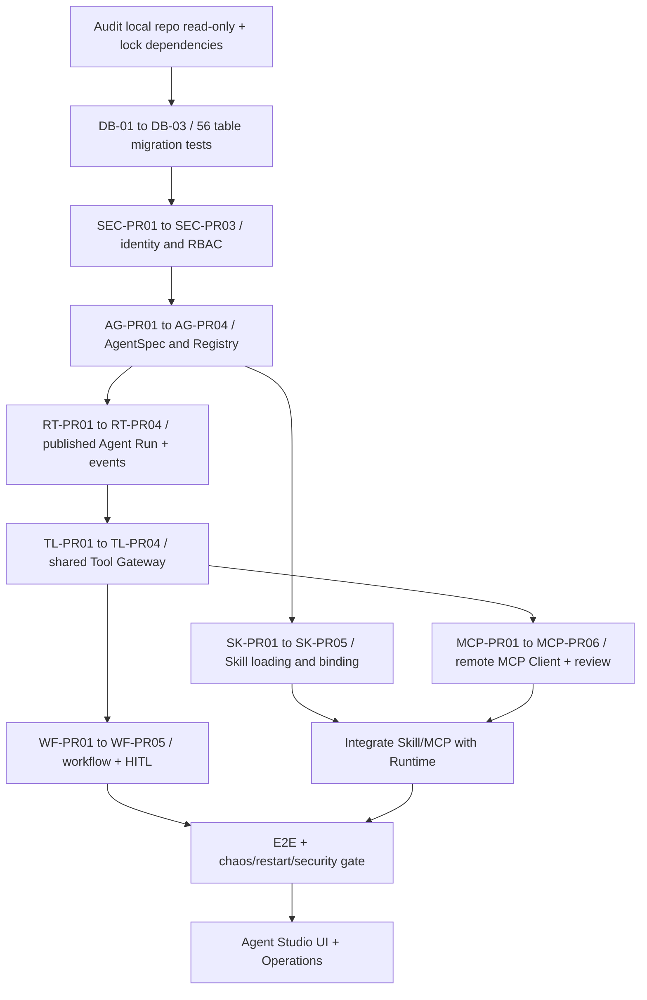

# Coding Agent Execution Plan — Enterprise Agent Platform P0 / 56-Table Baseline

**Status:** ready to assign work, **not** a completed code implementation.

## 1. Mandatory reading order

1. `docs/00-governance/CANONICAL_DATABASE_56.md` — authoritative target: 56 domain tables.
2. `docs/00-governance/DB-56_MIGRATION_IMPLEMENTATION.md` — build 50→53→56 and verify.
3. `references/ENTERPRISE_AGENT_PLATFORM_0001_BASELINE.sql` and Database Design/Data Dictionary — existing 50 table baseline.
4. `references/CR-SKILL-001.md`, `references/CR-MCP-001.md` — previously agreed module scope.
5. Five `docs/04-module-specs/SPEC-*.md` files — module boundaries, APIs, state machines and tests.
6. `references/ENTERPRISE_AGENT_PLATFORM_STEP_BY_STEP_IMPLEMENTATION_RUNBOOK_V1.md` and existing repository structure — initial implementation order. Resolve conflicts using this doc and ADR instead of guessing.

## 2. Source-of-truth resolution matrix

| Concern | Source of truth | Conflict rule |
|---|---|---|
| Target table inventory | `CANONICAL_DATABASE_56.md` | Old “50 tables” is historical initial DDL, not final goal |
| Original DDL column names/checks | `0001_BASELINE.sql` | Do not invent column names or statuses; add migration with ADR |
| Skill 3-table delta | `CR-SKILL-001` | No duplicate Skill registry |
| MCP 3-table delta | `CR-MCP-001` | No duplicate Tool Registry/Connection Registry |
| Agent lifecycle | `SPEC-AGENT-001` | Run belongs Runtime, not Registry |
| Run/Checkpoint and event | `SPEC-RUNTIME-001` | Checkpoint ≠ Memory; no invented run statuses |
| Tool execution | `SPEC-TOOL-001` | One central Gateway for HTTP/MCP/Builtin |
| Permissions, grants, RLS | `SPEC-SECURITY-001` | Policy fail closed; only trusted principal sets tenant context |
| Workflow, HITL | `SPEC-WORKFLOW-001` | Approval human decision outside LLM |
| HTTP contract | `contracts/openapi/*.yaml` after approved API-01 | Regenerate DTOs and clients, no hand-maintained drift |
| Deployment/test state | CI runs and logs | Never mark implemented from design file alone |

## 3. Work sequencing and dependencies

Parallelize contracts and read-only audits, but do not expose MCP writes before Tool Gateway and authorization tests pass. DB migrations can be authored in separate PRs; each PR must leave DB consistent and reversible by a forward repair migration.

## 4. One PR per request — coding protocol

For every PR, Coding Agent must:

1. Inventory actual local files, git status, current migration head, test tooling and commit SHA **before editing**. Do not infer local code from documentation. If already implemented, inspect/verify instead of reimplementing.
2. State the bounded goal and exact owned modules. Point to canonical spec and dependency PRs.
3. Produce file change list and migration impact first. **No refactor outside scope**.
4. Implement with least privilege, validation, structured errors and telemetry hooks.
5. Run unit and contract tests, then DB integration/tenant/RLS and e2e tests as dependencies allow; do not substitute mocked HTTP for real DB proof.
6. Report each acceptance criterion as `PASS`, `FAIL`, `BLOCKED`, or `NOT_RUN`, with test command, environment, commit hash and relevant (redacted) logs.
7. Deliver concise PR report (`summary`, `files`, `schema_delta`, `tests`, `risks`, `rollback/recovery`, `next_dependents`).

If a proposed file path differs from repository reality, **modify equivalent existing module instead of creating duplicate implementations**. If a new 57th domain table appears necessary, stop and write ADR; don't create it silently.

## 5. Cross-PR integration acceptance scenario

Use sandbox case `Prepare quotation → request human approval → send via approved mock Tool`:

- Operator creates Skill `quotation-procedure`, publishes `skill_versions` (one pinned).
- Admin configures/mock-registers Tool or approved remote MCP Tool mapping (pin `tool_version_id` and schema SHA).
- Developer creates Agent draft, chooses Skill + Tool, validates, publishes immutable version.
- Operator starts run with request idempotency key, sees events and tool intent.
- Runtime loads Skill instructions on demand; tool may be proposed but not executed without policy.
- Approval request persists and live process is stopped/restarted.
- Authorized reviewer approves exact action hash. Resume loads checkpoint, rechecks grants and mapping.
- Gateway executes mock side effect once; operations receipt, run event, audit and model usage recorded.
- Replay same request/decision does not produce duplicate side effect; tenant B cannot view any of the records.

Pass only if evidence spans Control API, Runtime, PostgreSQL and mocked upstream under actual restart; no API keys or user PII in trace.

## 6. Decision gate & anti-patterns

- **Do not** replace LangGraph with Agno as incidental refactor; Agno is comparative reference for registry/ops.
- **Do not** let model generate code and run it in host shell to “execute skills”.
- **Do not** auto-enable a newly discovered MCP Tool or Skill.
- **Do not** treat MCP transport protocol version as granting business permissions.
- **Do not** call completed schema “56 production tables” without migration verification.
- **Do not** use mock LLM success as production evaluation.
- **Do not** overwrite 0001 historical migration in already deployed environments.

## 7. Ready-to-copy task prompt

> Đọc `docs/00-governance/CANONICAL_DATABASE_56.md`, `docs/00-governance/DB-56_MIGRATION_IMPLEMENTATION.md`, năm file `docs/04-module-specs/SPEC-*.md`, và các CR-SKILL/MCP trong `references/`. Kiểm kê repository local read-only, phân biệt đã code/đã test/chỉ có tài liệu. Chốt danh sách 56 bảng đích (50+3+3). Không sửa code cho đến khi lập mapping giữa source hiện tại và spec; sau đó chỉ thực hiện PR đầu tiên chưa hoàn thành (ưu tiên Database Verification / Identity). Không tự tạo thêm bảng, microservice, Agent Engine hoặc runtime tool executor. Báo test PASS/FAIL/NOT_RUN/BLOCKED theo bằng chứng và nêu mọi quyết định cần ADR.
