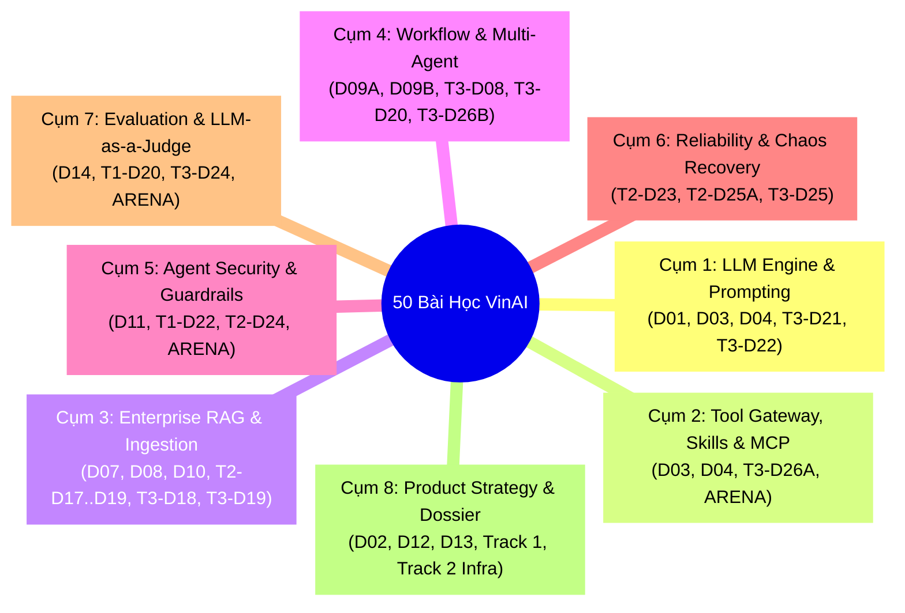

# HƯỚNG DẪN DÀNH CHO AI CODING AGENT: ĐỌC, GOM CỤM & ÁP DỤNG 50 BÀI HỌC VINAI CAPSTONE

> **Tài liệu:** Cẩm nang Hướng dẫn Thực thi & Tự động hóa Dành cho AI Coding Agents  
> **Dự án:** Enterprise AI Agent Platform  
> **Tài liệu nguồn:** `C:\Users\Admin\Desktop\KLTN\VinAI\Vin\MUC_LUC_LO_TRINH_CAP_DU_AN.md`  
> **Bản đồ chỉ mục máy đọc:** `docs/00-governance/VINAI_CAPSTONE_CLUSTER_INDEX.json`

---

## 1. Bản chất & Nguyên tắc Vận hành của AI Coding Agent

Khi tiếp cận một kho tài liệu khổng lồ gồm **50 bài học và dự án thực hành**, AI Coding Agent **tuyệt đối không được đọc tuyến tính từng ngày từ 1 đến 50** vì sẽ gây cạn kiệt cửa sổ ngữ cảnh (Context Exhaustion), nhiễu loạn logic giữa code bài tập nhỏ (toy code) và kiến trúc doanh nghiệp lớn.

Agent phải tuân thủ **Quy tắc Gom cụm Chuyên môn (Knowledge Clustering)**:
1. **Tra cứu Chỉ mục:** Mở file [`VINAI_CAPSTONE_CLUSTER_INDEX.json`](./VINAI_CAPSTONE_CLUSTER_INDEX.json) để biết bài học thuộc Cụm nào và trỏ tới thư mục nguồn nào trên đĩa.
2. **Đọc đúng Trọng tâm:** Chỉ đọc các file nghiệp vụ trong thư mục nguồn của Day đó (`src/`, `tests/`, `data/`).
3. **Chuyển hóa vào Nền tảng:** Đưa thuật toán hoặc dataset của Day đó vào đúng module đích trong `ENTERPRISE_AGENT_PLATFORM` mà không phá vỡ các bất biến kiến trúc (DB-56, 12-Step ToolDispatcher, Server-Side Trust).

---

## 2. Bản đồ 8 Cụm Kiến Thức (The 8 Knowledge Clusters)

Hệ thống đã tự động phân loại 50 bài học thành 8 Cụm chuyên sâu:



| Mã Cụm | Tên Cụm Chuyên Môn | Các Day ID Thành viên | Module Đích trong Nền Tảng |
|---|---|---|---|
| **`CLUSTER_1`** | **LLM Engine & Prompting** | `VIN-P1-D01`, `D03`, `D04`, `VIN-T3-D21`, `D22` | `apps/agent-runtime/src/agent_runtime/llm/` & `SPEC-LLM-001` |
| **`CLUSTER_2`** | **Tools, Skills & MCP Gateway** | `VIN-P1-D03`, `D04`, `VIN-T3-D26A`, `VIN-COMP-ARENA` | `SPEC-TOOL-001`, `SPEC-SKILL-001`, `SPEC-MCP-001` |
| **`CLUSTER_3`** | **Enterprise RAG & Knowledge** | `VIN-P1-D07`, `D08`, `D10`, `VIN-T2-D17..D19`, `VIN-T3-D18..D19` | `SPEC-KNOWLEDGE-001` & `apps/agent-runtime/src/agent_runtime/knowledge/` |
| **`CLUSTER_4`** | **Workflow & Multi-Agent** | `VIN-P1-D09A`, `D09B`, `VIN-T3-D08`, `D20`, `D26B` | `SPEC-WORKFLOW-001` & `apps/agent-runtime/src/agent_runtime/application/` |
| **`CLUSTER_5`** | **Security & Guardrails** | `VIN-P1-D11`, `VIN-T1-D22`, `VIN-T2-D24`, `VIN-COMP-ARENA` | `SPEC-SECURITY-001` & `apps/agent-runtime/src/agent_runtime/safety/` |
| **`CLUSTER_6`** | **Reliability & Chaos** | `VIN-T2-D23`, `VIN-T2-D25A`, `VIN-T3-D25` | `SPEC-RUNTIME-001` & `apps/agent-runtime/src/agent_runtime/context/` |
| **`CLUSTER_7`** | **Evaluation & Benchmarks** | `VIN-P1-D14`, `VIN-T1-D20`, `VIN-T3-D24`, `VIN-COMP-ARENA` | `SPEC-EVAL-001` & thư mục `evals/` |
| **`CLUSTER_8`** | **Product Strategy Dossier** | `VIN-P1-D02`, `D12`, `D13`, toàn bộ Track 1 & Track 2 Infra | `docs/01-product/`, `docs/08-operations/` & KLTN Dossier |

---

## 3. Quy trình 4 Bước Chuẩn (SOP) để Agent Đọc & Áp dụng

Khi được giao nhiệm vụ thực thi một Cụm hoặc một Day bất kỳ, AI Coding Agent phải tuân thủ 4 bước sau:

### Bước 1: Tra cứu Thư mục Nguồn trên Đĩa
- Mở `docs/00-governance/VINAI_CAPSTONE_CLUSTER_INDEX.json`.
- Tìm `day_id` để lấy `source_path` chính xác. Ví dụ:
  - Day `VIN-P1-D09B` $\rightarrow$ `C:\Users\Admin\Desktop\KLTN\VinAI\Vin\Phase_1_Core_Foundations\K4-Day9-Multi-Agent-A2A-main`.
  - Day `VIN-T3-D26A` $\rightarrow$ `C:\Users\Admin\Desktop\KLTN\VinAI\Vin\Track_3_Agentic_AI\Day26-MCP-Tools-Integration-main`.

### Bước 2: Khảo sát & Đọc Tài liệu Nghiệp vụ Nguồn
- Dùng công cụ `run_command` hoặc `read_file` để kiểm tra cây thư mục của Day đó:
  - Đọc `README.md` hoặc `assignment.md` để hiểu User Story và Hard Requirements.
  - Đọc các file code thuật toán trong `src/` (hoặc file `.py` chính).
  - Đọc các ca kiểm thử trong `tests/` và dữ liệu mẫu trong `data/`.

### Bước 3: Chuyển hóa & Tích hợp vào Nền tảng (Platform Integration)
- **Không copy-paste nguyên khối code thô!** Hãy nâng cấp mã nguồn theo chuẩn Enterprise:
  - Đưa thuật toán vào đúng package quy định trong `apps/agent-runtime/`.
  - Sử dụng Pydantic models từ `libs/python/agent-contracts` thay vì dict tự do.
  - Bắt buộc đi qua cổng `ToolDispatcher` (nếu liên quan tới gọi công cụ hoặc tra cứu DB).
  - Áp dụng Server-side context (`tenant_id`, `workspace_id`) và Force RLS.

### Bước 4: Kiểm chứng & Đánh giá (Verification)
- Tích hợp bài test của Day đó vào bộ kiểm thử chung của dự án (`tests/`).
- Chạy kiểm thử tĩnh và kiểm thử hợp đồng:
  ```bash
  python docs/07-testing/validation-scripts/validate_full_specs.py
  pytest tests/contract/
  ```

---

## 4. Các Mẫu Câu Lệnh (Prompt Templates) Dành Cho Người Dùng

Để yêu cầu AI Coding Agent thực hiện từng phần việc một cách chính xác, người dùng có thể sử dụng các mẫu lệnh sau:

### Mẫu 1: Yêu cầu thực thi theo từng Cụm Kiến thức (Khuyến nghị)
> *"Agent, hãy mở `docs/00-governance/VINAI_CAPSTONE_CLUSTER_INDEX.json` và áp dụng **CLUSTER_5 (Security & Guardrails)**:  
> 1. Đọc thư mục nguồn của Day `VIN-P1-D11` và `VIN-T2-D24` tại `C:\Users\Admin\Desktop\KLTN\VinAI\Vin\...`.  
> 2. Chắt lọc thuật toán quét ký tự ẩn Zero-Width Unicode và bộ lọc PII tiếng Việt để hoàn thiện `apps/agent-runtime/src/agent_runtime/safety/`.  
> 3. Viết bài test kiểm thử trong `tests/security/` và chạy `pytest` để kiểm chứng."*

### Mẫu 2: Yêu cầu hiện thực hóa một Kịch bản Tác tử Cụ thể
> *"Agent, hãy mở Day `VIN-P1-D09B` (A2A Olist Dispute Tribunal):  
> 1. Đọc thư mục nguồn `C:\Users\Admin\Desktop\KLTN\VinAI\Vin\Phase_1_Core_Foundations\K4-Day9-Multi-Agent-A2A-main`.  
> 2. Đóng gói kịch bản hội đồng 5 tác tử đối soát 9 bảng Olist thành một Agent mẫu tại `examples/agents/olist-dispute-tribunal/`.  
> 3. Kết nối quy trình phê duyệt HITL vào `runtime.approval_requests` khi số tiền hoàn trả > $50."*

### Mẫu 3: Yêu cầu nạp Bộ dữ liệu Đánh giá vào Hệ thống Eval
> *"Agent, hãy đọc Day `VIN-T3-D24` và nạp bộ dữ liệu 50 câu hỏi RAGAS (3 phân phối) từ `C:\Users\Admin\Desktop\KLTN\VinAI\Vin\Track_3_Agentic_AI\Day24-Track3-Production-Eval-Guardrail-Stack-main` vào `evals/datasets/ragas_50q.json`. Cập nhật rubric đánh giá Bottom-10 vào `evals/rubrics/`."*

