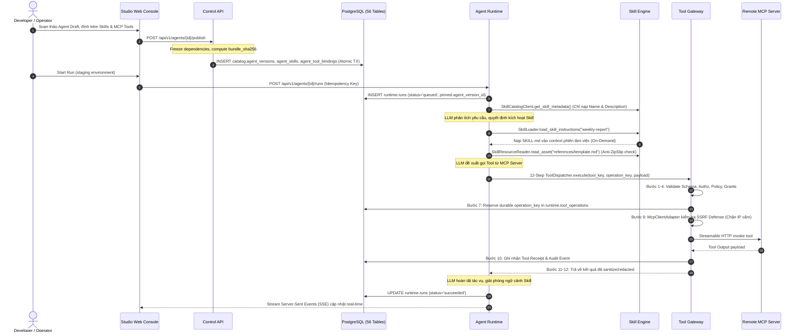

# Enterprise AI Agent Platform — Repository & Implementation Architecture v1.0 (Unified Core Platform)

**Ngày:** 2026-10-30  
**Phạm vi:** Dự án Enterprise AI Agent Platform độc lập, tham khảo FPT AI Agents (Studio, Persona, Task Agent, Knowledge, Business Process, Tools, Guardrails) và FPT AI EOS (Digital Workers, Workflow, Approval, Governance).  
**Định vị kiến trúc:** **Skill Management** và **Model Context Protocol (MCP)** là các **thành phần nền tảng cốt lõi (Core Foundational Pillars)** của hệ thống ngay từ Day-1, **không còn là module mở rộng (extension) hay đề xuất thay đổi phụ trợ**.  
**Cơ sở dữ liệu:** Greenfield Unified Baseline V1.0 gồm **56 bảng / 7 schemas**, 55 chính sách `FORCE ROW LEVEL SECURITY`, 10 immutability triggers bảo vệ snapshot.
**Trạng thái:** Kiến trúc sản xuất V1.0 đồng bộ 100% giữa Contracts (JSON Schema), Control API, Agent Runtime, Studio Web và Database DDL.

---

## 0. Architecture Decision Records cốt lõi (ADR-001 -> ADR-013)

- **ADR-001 — Monorepo Architecture:** Toàn bộ mã nguồn tập trung trong một monorepo với `pnpm` workspaces cho frontend TypeScript (`apps/studio-web`) và `uv` workspace cho Python (`apps/control-api`, `apps/agent-runtime`, `libs/*`).
- **ADR-002 — Dual-Plane Modular Monolith:** Tách bạch 2 tiến trình độc lập: `control-api` (quản trị, cấu hình, identity, metadata, publish) và `agent-runtime` (thực thi đồ thị tác tử, nạp ngữ cảnh, kết nối mô hình và chạy công cụ). Không phân mảnh 15 microservices khi chưa có căn cứ tải đo được.
- **ADR-003 — Runtime Abstraction & LangGraph Engine:** Sử dụng LangGraph làm execution engine ban đầu qua tầng adapter (`langgraph_adapter.py`), hỗ trợ stateful checkpoints, branch routing và `interrupt()` phục vụ Human-in-the-Loop (HITL).
- **ADR-004 — Schema-First Contract Design:** Nghiêm cấm định nghĩa JSON ad-hoc. Mọi cấu hình Agent, Workflow, Tool, Skill và MCP đều phải tuân thủ JSON Schema có phiên bản trong `contracts/jsonschema/`.
- **ADR-005 — Strict Trust Boundaries:** Authentication và Authorization bắt buộc xác minh server-side tại API và Tool Gateway; prompt injection tuyệt đối không được cấp quyền thực thi công cụ hoặc bypass bảo mật.
- **ADR-006 — Durable State & Idempotency:** Phân định rõ 5 loại state (Agent definitions, Checkpoints, Messages, Long-term facts, Knowledge). Mọi tác vụ có side-effect bắt buộc sử dụng unique `(workspace_id, idempotency_key)` để đảm bảo zero duplicate execution.
- **ADR-007 — Zero Plaintext Secrets in Specs:** Mọi thông tin nhạy cảm (API keys, tokens) phải được lưu trữ dưới dạng `secret_ref` và chỉ được giải mã server-side tại Tool Gateway trong transaction có audit trail.
- **ADR-008 — Canonical 12-Step ToolDispatcher:** Mọi lượt gọi công cụ (builtin, http, mcp) đều phải thực thi tuần tự qua 12 bước: Schema Validation -> Principal Authz -> Policy Grant -> Approval Hash -> Idempotency Reservation -> Execution -> Reconciliation -> Receipt.
- **ADR-009 — Immutable Snapshot & Checksum Publishing:** Mọi phiên bản phát hành (`agent_versions`, `skill_versions`, `tool_versions`, `workflow_versions`) là bất biến (immutable), gắn kèm `bundle_sha256` và được bảo vệ bằng trigger CSDL.
- **ADR-010 — Human-in-the-Loop (HITL) Atomic Approval:** Các hành động rủi ro cao hoặc có side-effect phải được ngắt (`interrupt`) và chỉ được tiếp tục (`resume`) sau khi có quyết định phê duyệt hợp lệ khớp với exact payload hash.
- **ADR-011 — Core Skill Engine (On-Demand Loading & Token Containment):** Skill Management là trụ cột nền tảng tích hợp sẵn; hỗ trợ định dạng `SKILL.md` chuẩn, cơ chế discovery metadata tối thiểu và nạp on-demand khi LLM cần, tự động giải phóng context sau khi thực thi để bảo toàn context window; sandbox chống Zip-Slip và Path Traversal.
- **ADR-012 — Core MCP Integration & Multi-Layer SSRF Defense:** Model Context Protocol (MCP) là giao thức nền tảng chính thức kết nối hệ sinh thái công cụ bên ngoài (Streamable HTTP, stdio sandbox); tích hợp bộ lọc phòng vệ SSRF 4 lớp (chặn Loopback, Private RFC1918, Cloud Metadata `169.254.169.254`, Link-Local).
- **ADR-013 — Greenfield Unified Baseline V1.0 (56 Tables):** Hợp nhất toàn bộ 56 bảng / 7 schemas (`iam=5, catalog=16, knowledge=7, runtime=12, integration=6, governance=4, ops=6`), 55 chính sách `FORCE ROW LEVEL SECURITY`, 10 immutability triggers vào `0001_baseline.sql` ngay từ Day-1.

---

## 1. Cây thư mục hệ thống toàn diện V1.0

```text
enterprise-agent-platform/
├── README.md                          # Giới thiệu tổng quan hệ thống
├── AGENTS.md                          # 7 quy tắc an toàn cốt lõi cho Coding Agents
├── AGENT_CODING_RULES.md              # Quy chuẩn code, typing, errors, logging
├── CONTRIBUTING.md                    # Quy trình đóng góp, PR quality gates
├── SECURITY.md                        # Chính sách bảo mật và báo cáo lỗ hổng
├── pyproject.toml                     # uv workspace: cấu hình Python apps/libs
├── package.json                       # Root script cho TypeScript apps
├── pnpm-workspace.yaml                # pnpm workspace cấu hình studio-web
│
├── apps/
│   ├── studio-web/                    # Next.js 15 App Router + TypeScript Web Console
│   │   ├── src/app/(console)/w/[workspaceId]/
│   │   │   ├── overview/page.tsx
│   │   │   ├── agents/page.tsx
│   │   │   ├── skills/page.tsx        # [CORE] Quản lý Skill Catalog & Versioning
│   │   │   ├── mcp/page.tsx           # [CORE] Quản lý MCP Server Connections & Tools
│   │   │   ├── tools/page.tsx
│   │   │   ├── workflows/page.tsx
│   │   │   ├── knowledge/page.tsx
│   │   │   ├── digital-workers/page.tsx
│   │   │   ├── runs/page.tsx
│   │   │   └── approvals/page.tsx
│   │   └── src/features/
│   │       ├── agent-builder/
│   │       ├── skill-management/      # [CORE] Feature components & queries cho Skill
│   │       ├── mcp-management/        # [CORE] Feature components & queries cho MCP
│   │       ├── workflow-builder/
│   │       ├── tool-registry/
│   │       └── run-monitor/
│   │
│   ├── control-api/                   # FastAPI Modular Monolith (Control Plane)
│   │   └── src/control_api/
│   │       ├── main.py                # Đăng ký toàn bộ router hệ thống
│   │       ├── core/                  # Settings, Database Session, Auth, Principal
│   │       └── modules/
│   │           ├── identity/          # OIDC identity, memberships, service accounts
│   │           ├── workspaces/        # Multi-tenancy & workspace isolation
│   │           ├── agents/            # Draft, optimistic lock, freeze spec, publish
│   │           ├── skills/            # [CORE] Skill Catalog, versions, manifest, import
│   │           ├── mcp/               # [CORE] MCP Connections, Discovery, tool sync
│   │           ├── tools/             # Tool definitions, versioning, grants
│   │           ├── workflows/         # Graph validation, compile spec
│   │           ├── business_processes/# Quy trình nghiệp vụ cấp cao
│   │           ├── knowledge/         # Quản trị tài liệu, dataset versions
│   │           ├── approvals/         # Human-in-the-Loop approval requests/decisions
│   │           ├── policies/          # Policy rules, deny-by-default evaluator
│   │           ├── digital_workers/   # Nhiệm vụ nhân sự số
│   │           └── audit/             # Append-only audit logger
│   │
│   ├── agent-runtime/                 # Execution Engine (Execution Plane)
│   │   └── src/agent_runtime/
│   │       ├── skills/                # [CORE] SkillCatalogClient, Loader, ResourceReader (anti-ZipSlip)
│   │       ├── mcp/                   # [CORE] McpClientAdapter, SSRF Defense, Error taxonomy
│   │       ├── tools/                 # [CORE] 12-Step ToolDispatcher, Idempotency Store
│   │       ├── engines/               # LangGraph adapter & checkpointer persistence
│   │       ├── execution/             # Finite state machine, limits, run steps
│   │       ├── context/               # Token budget, context assembler, compaction
│   │       ├── memory/                # Conversation transcript, long-term memory
│   │       ├── safety/                # Zero-width shield, PII scrubber, AST sandbox
│   │       └── observability/         # OpenTelemetry distributed tracing, metrics
│   │
│   └── jobs-worker/                   # Background Async Worker
│       └── src/jobs_worker/           # Polling/Leasing jobs từ runtime.jobs
│
├── contracts/                         # Nguồn chân lý hợp đồng (Source of Truth)
│   ├── jsonschema/
│   │   ├── agent-spec.v1.schema.json
│   │   ├── skill-manifest.v1.schema.json   # [CORE] Hợp đồng cấu trúc SKILL.md
│   │   ├── mcp-connection.v1.schema.json   # [CORE] Hợp đồng kết nối MCP
│   │   ├── mcp-discovery.v1.schema.json    # [CORE] Hợp đồng snapshot MCP tools
│   │   ├── tool-spec.v1.schema.json
│   │   ├── workflow-spec.v1.schema.json
│   │   ├── approval-decision.v1.schema.json
│   │   └── run-event.v1.schema.json
│   └── events/
│
├── libs/python/
│   ├── agent-contracts/               # Pydantic V2 models sinh từ JSON Schema
│   └── platform-common/               # Shared logging, error types, utils
│
├── database/
│   ├── migrations/
│   │   └── 0001_baseline.sql          # 56 bảng V1.0 Greenfield Unified
│   └── tests/
│       └── 0002_smoke.sql             # Test đa tenant & immutability triggers
│
├── examples/
│   ├── skills/weekly-report/          # Mẫu chuẩn SKILL.md & references/
│   └── mcp/                           # Mẫu cấu hình MCP Streamable HTTP
│
└── tests/
    ├── contract/                      # Schema roundtrip, Skill & MCP contracts
    ├── security/                      # Tenant isolation, SSRF, Zip-Slip tests
    ├── recovery/                      # Restart & resume state recovery tests
    └── e2e/                           # Publish & execute agent vertical slice
```

---

## 2. Sáu Trụ cột Nền tảng Cốt lõi (6 Foundational Pillars)

Hệ thống được thiết kế hợp nhất quanh 6 trụ cột công nghệ:

### Trụ cột 1: Agent Studio & Spec Registry
- Quản trị vòng đời Agent: Draft -> Optimistic Revision Check -> Freeze Dependencies -> Compute `bundle_sha256` -> Publish Immutable Version.
- Đính kèm trực tiếp Tools, Skills, Models, Policies vào phiên bản phát hành bất biến.

### Trụ cột 2: Skill Management Engine (On-Demand Token Containment)
- Chuẩn hóa quy trình nghiệp vụ chuyên sâu theo đặc tả **`SKILL.md`**.
- **Cơ chế 3 tầng tối ưu Token:**
  1. *Discovery Layer:* Chỉ đưa metadata tóm tắt (`name`, `description`) vào system prompt.
  2. *Load Layer:* Khi LLM cần, `SkillLoader` mới nạp nội dung hướng dẫn chi tiết vào ngữ cảnh.
  3. *Resources Layer:* Đọc file mẫu/script thông qua `SkillResourceReader` được trang bị lá chắn chống **Zip-Slip** và **Path Traversal**.
- Ngay khi tác vụ hoàn thành, ngữ cảnh được giải phóng để bảo tồn token window.

### Trụ cột 3: Tool Gateway & Model Context Protocol (MCP) Integration
- Tích hợp chuẩn giao thức **Model Context Protocol (2026-07-28)** hỗ trợ `streamable_http` và `stdio` sandbox.
- **SSRF Defense Shield:** Kiểm tra phân giải IP trước khi mở socket kết nối, chặn đứng: Loopback (`127.0.0.0/8`), Private IP RFC1918 (`10.0.0.0/8`, `172.16.0.0/12`, `192.168.0.0/16`), Cloud Metadata (`169.254.169.254`).
- **12-Step ToolDispatcher:** Thực thi tuần tự 12 bước bảo đảm schema, phân quyền, phê duyệt, idempotency reservation, timeout retry, receipt và audit trail.

### Trụ cột 4: Durable Workflow & Digital Workers
- Đồ thị tác tử trạng thái dựa trên LangGraph checkpointer lưu trữ bền vững vào PostgreSQL.
- Hỗ trợ Human-in-the-Loop (HITL) qua `interrupt()`, phê duyệt atomic dựa trên `action_hash`, khôi phục tiến trình chính xác sau khi tiến trình runtime khởi động lại.

### Trụ cột 5: Enterprise Knowledge & Retrieval (RAG)
- Quản trị kho tài liệu doanh nghiệp, kiểm soát phiên bản dataset, phân đoạn (chunking), tạo embedding vector và truy vấn ngữ nghĩa với phân quyền ACL chặt chẽ.

### Trụ cột 6: Multi-Tenant Governance, Security & Observability
- Cơ sở dữ liệu 56 bảng tuân thủ **`FORCE ROW LEVEL SECURITY`** trên 55 bảng tenant-scoped.
- 10 immutability triggers ngăn chặn mọi hành vi chỉnh sửa snapshot đã phát hành.
- Nhật ký kiểm toán WORM (`governance.audit_events`) và truy vết phân tán OpenTelemetry không rò rỉ secret/PII.

---

## 3. Kiến trúc Cơ sở Dữ liệu 56 Bảng (Baseline V1.0)

Cơ sở dữ liệu được khởi tạo một lần duy nhất (Greenfield Unified) bao gồm 56 bảng chia làm 7 schemas:

```text
===================================================================================
SCHEMA          SỐ BẢNG    DANH SÁCH BẢNG
===================================================================================
1. iam          5 bảng     tenants, workspaces, users, memberships, service_accounts
2. catalog      16 bảng    agents, agent_versions, agent_publications, model_configs,
                           tools, tool_versions, agent_tools, agent_tool_bindings,
                           workflows, workflow_versions, business_processes,
                           business_process_versions, digital_workers,
                           [CORE] skills, skill_versions, agent_skills
3. knowledge    7 bảng     knowledge_bases, datasets, dataset_versions, documents,
                           document_chunks, embeddings, agent_knowledge_bindings
4. runtime      12 bảng    runs, run_steps, run_events, approval_requests,
                           approval_decisions, tool_operations, jobs,
                           checkpoint_refs, threads, thread_messages,
                           conversation_contexts, eval_runs
5. integration  6 bảng     connections, outbox_events, inbox_receipts,
                           [CORE] mcp_discovery_snapshots, mcp_discovered_items,
                           [CORE] mcp_tool_mappings
6. governance   4 bảng     policies, policy_rules, audit_events, cost_tracking
7. ops          6 bảng     system_metrics, node_heartbeats, alerts, slo_tracking,
                           incidents, circuit_breakers
===================================================================================
TỔNG CỘNG:      56 BẢNG    (55 bảng FORCE RLS, 10 immutability triggers)
===================================================================================
```

---

## 4. Luồng Xử lý End-to-End Tích hợp Nền tảng Hoàn chỉnh



---

## 5. Quy chuẩn Bảo mật và Phòng vệ Nền tảng (Defense-in-Depth)

| Lớp phòng vệ | Cơ chế thực thi | Nguy cơ ngăn chặn |
|---|---|---|
| **Cơ sở dữ liệu** | PostgreSQL 16 `FORCE ROW LEVEL SECURITY` trên 55 bảng | Rò rỉ dữ liệu chéo giữa các khách hàng thuê (Cross-tenant leakage) |
| **Tính toàn vẹn dữ liệu** | 10 Triggers `tg_prevent_immutability_*` từ chối `UPDATE/DELETE` | Giả mạo hoặc sửa đổi các phiên bản, audit logs và checkpoints đã chốt |
| **Skill Security** | Chuẩn hóa đường dẫn `is_relative_to(skill_root_dir)`, cấm thực thi script | Tấn công vượt thư mục (**Path Traversal**, **Zip-Slip**), chiếm quyền máy chủ |
| **MCP Network Security**| Bộ lọc IP chặn Loopback, Private RFC1918, Cloud Metadata `169.254.169.254` | Tấn công giả mạo yêu cầu máy chủ (**Server-Side Request Forgery - SSRF**) |
| **Tool Execution** | Idempotency reservation qua `(workspace_id, operation_key)` | Thực thi lặp thao tác ngoài khi mạng timeout hoặc worker retry |
| **Quyền hạn Tối thiểu** | Tách biệt role DB: `eap_admin`, `eap_control`, `eap_runtime`, `eap_smoke` | Leo thang đặc quyền ứng dụng |

---

## 6. Tiêu chí Nghiệm thu Kiến trúc (Definition of Done)

1. **Contracts đồng nhất:** Tất cả các schemas trong `contracts/jsonschema/` phản ánh đầy đủ Agent, Skill, MCP, Tool, Workflow.
2. **Database chuẩn xác:** `validate_db_static.py` và `0001_baseline.sql` vượt qua kiểm tra 56 bảng, 55 RLS policies, 10 immutability triggers.
3. **Execution Pipeline hoàn chỉnh:** ToolDispatcher thực hiện đủ 12 bước, Skill nạp on-demand, MCP lọc SSRF.
4. **Kiểm thử tự động:** Test suite đạt 100% tỷ lệ pass cho cả contract tests, security tests và restart recovery tests.
