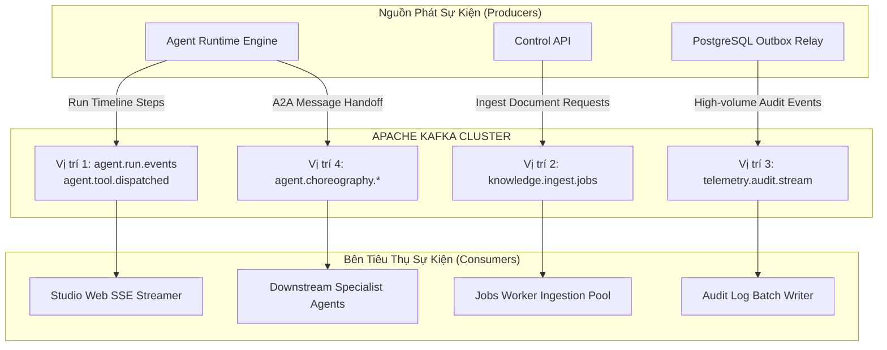

# ADR-014: Pluggable Event Bus & Enterprise Apache Kafka Integration

- **Status:** ACCEPTED
- **Date:** 2026-11-01
- **Deciders:** Principal Architect, Platform Lead, Security Lead
- **Scope:** Runtime, Control API, Jobs Worker, Integration Events, Observability
- **Database Baseline:** `DB-BASELINE-56` (Preserved — zero new domain tables)

---

## 1. Context & Problem Statement

Trong kiến trúc Baseline V1.0 của Enterprise AI Agent Platform, các sự kiện giữa các thành phần nghiệp vụ được lưu trữ bằng mô hình **Transactional Outbox Pattern** trên bảng PostgreSQL `integration.outbox_events`. Mô hình này đảm bảo tính nhất quán ACID giữa giao dịch nghiệp vụ và sự kiện phát sinh.

Tuy nhiên, khi mở rộng quy mô lên môi trường Enterprise (hàng triệu lượt chạy tác tử, xử lý đồng thời hàng nghìn tài liệu RAG, điều phối đa tác tử thời gian thực, và ghi nhận nhật ký kiểm toán tần suất cao), cơ chế Transactional Outbox thuần túy trên PostgreSQL đối mặt với các giới hạn:
1. **Áp lực I/O & Connection Pool:** Việc liên tục ghi và đọc thăm dò (polling) sự kiện trên PostgreSQL làm cạn kiệt tài nguyên kết nối của CSDL giao dịch chính.
2. **Backpressure & Tải Đỉnh:** Khi người dùng đồng thời nạp hàng trăm tài liệu PDF lớn cho RAG, hệ thống cần cơ chế điều tiết lưu lượng (Backpressure) và phân tải song song cho cụm worker mà không làm nghẽn API.
3. **Độ trễ Ghi Nhật ký Kiểm toán (Telemetry Latency):** Ghi nhận trực tiếp từng token suy luận, chi phí USD và chỉ số vào bảng SQL theo thời gian thực có thể làm tăng độ trễ phản hồi của Agent.
4. **Điều phối Đa Tác tử (Multi-Agent Choreography):** Các tác tử chuyên viên cần giao tiếp theo cơ chế hướng sự kiện bất đồng bộ mà không phụ thuộc vòng đời sống còn (decoupled lifecycle).

---

## 2. Decision & Architecture: The 4 Strategic Kafka Positions

Chúng tôi quyết định áp dụng giải pháp **Pluggable Event Bus Architecture (Kiến trúc Cổng Sự kiện Cắm rút)**:
- Môi trường Local / Dev / Lightweight: Mặc định sử dụng `EVENT_BUS_TYPE=postgres_outbox` (nhẹ nhàng, không tốn RAM).
- Môi trường Enterprise High-Throughput: Sử dụng `EVENT_BUS_TYPE=kafka` tích hợp cụm Apache Kafka phân tán tại **4 vị trí chiến lược**:



### Chi tiết 4 Vị trí Tích hợp:

### Vị trí 1: Transactional Outbox Event Streamer (`agent.run.events`, `agent.tool.dispatched`)
- **Vai trò:** Bắn dòng sự kiện vòng đời thực thi của Agent (`step.started`, `tool.requested`, `tool.succeeded`, `approval.requested`).
- **Topic:** `{env}.agent.run.events`, `{env}.agent.tool.dispatched`.
- **Consumer:** Service SSE/WebSocket truyền dữ liệu trực tiếp lên màn hình Studio Web UI Console và các webhook đối tác.

### Vị trí 2: Asynchronous Knowledge Ingestion Pipeline (`knowledge.ingest.jobs`)
- **Vai trò:** Phân tải đường ống nạp tri thức RAG bất đồng bộ cho `jobs-worker`.
- **Topic:** `{env}.knowledge.ingest.jobs`.
- **Consumer:** Cụm `jobs-worker` song song thực hiện Text Parsing, Markdown Chunking, Embedding qua Model Gateway và Upsert vào `pgvector` / Qdrant.
- **Tính năng vượt trội:** Backpressure tự động và hỗ trợ replay từ offset khi worker sập.

### Vị trí 3: High-Throughput WORM Audit & FinOps Stream (`telemetry.audit.stream`)
- **Vai trò:** Hấp thụ dòng nhật ký kiểm toán, chi phí token per-request và chỉ số vận hành với tần suất cao mà không làm chậm Agent Runtime.
- **Topic:** `{env}.telemetry.audit.stream`.
- **Consumer:** Audit Ingestion Worker thu gom sự kiện và thực hiện ghi theo lô (Batch Insert) vào bảng bất biến `ops.audit_logs` hoặc đẩy sang kho phân tích OpenSearch / ClickHouse.

### Vị trí 4: Event-Driven Multi-Agent Choreography (`agent.choreography.*`)
- **Vai trò:** Điều phối giao tiếp bất đồng bộ giữa các tác tử độc lập (như kịch bản Hội đồng phân xử khiếu nại Olist `VIN-P1-D09B`).
- **Topics:** `{env}.agent.choreography.dispute.new`, `{env}.agent.choreography.dispute.evidence`, `{env}.agent.choreography.dispute.ruling`.
- **Consumer:** Các chuyên viên tác tử (Delivery Specialist, Payment Specialist, Ruling Specialist) phản hồi độc lập theo luồng sự kiện.

---

## 3. Partitioning Strategy & Multi-Tenant Isolation

Để đảm bảo nguyên tắc bảo mật và toàn vẹn dữ liệu đa khách hàng (Multi-Tenant):
1. **Partition Key Chuẩn hóa:**  
   Mọi message gửi vào Kafka bắt buộc phải có Message Key theo định dạng:  
   $$\text{Key} = \text{tenant\_id} : \text{workspace\_id}$$
   - *Đảm bảo:* Toàn bộ sự kiện của cùng một Workspace luôn đi vào cùng một Partition duy nhất, đảm bảo tính tuần tự tuyệt đối (Strict FIFO Ordering).
   - *Cách ly tải:* Tránh hiện tượng "ồn ào phòng bên" (Noisy Neighbor), một tenant có lưu lượng lớn không làm nghẽn các partition khác.
2. **Cấu trúc Message chuẩn CloudEvents v1.0:**
   ```json
   {
     "specversion": "1.0",
     "id": "uuid-v4",
     "source": "/enterprise/agent-runtime",
     "type": "enterprise.agent.run.step.v1",
     "datacontenttype": "application/json",
     "time": "2026-11-01T22:30:00Z",
     "tenant_id": "tenant-uuid",
     "workspace_id": "workspace-uuid",
     "data": { ... }
   }
   ```

---

## 4. Domain & Database Schema Impact

- **Số lượng bảng CSDL:** **Chính xác 56 bảng / 7 schemas** (DB-56). Tuyệt đối **không tạo bảng mới** để phục vụ Kafka.
- Bảng `integration.outbox_events` tiếp tục được sử dụng làm nguồn phát sự kiện có bảo đảm giao dịch (Transactional Guarantees).
- Khi Kafka khả dụng, tiến trình Outbox Dispatcher đọc sự kiện từ `integration.outbox_events`, gửi thành công vào Kafka topic rồi đánh dấu trạng thái `PUBLISHED`.

---

## 5. Security & Tenant Boundary Enforcement

1. **Mã hóa đường truyền:** Bắt buộc kích hoạt TLS v1.3 trên toàn bộ kết nối giữa Producer, Broker và Consumer.
2. **Xác thực & Ủy quyền:** Xác thực SASL/SCRAM-SHA-512 hoặc mTLS. Topic ACLs ngăn chặn các ứng dụng ngoài đọc lén sự kiện của Agent.
3. **Không rò rỉ bí mật:** Tuyệt đối không đưa `secret_ref`, API keys hoặc nội dung PII chưa được làm sạch vào Kafka payloads. Mọi dữ liệu phải qua `PiiScrubber` trước khi phát sự kiện.

---

## 6. Error Handling, Dead-Letter Queue (DLQ) & Fallback

1. **Dead-Letter Queue (DLQ):** Khi Consumer xử lý thất bại sau 3 lần thử lại (Exponential Backoff kèm Jitter), message được tự động chuyển vào topic DLQ tương ứng (ví dụ: `knowledge.ingest.jobs.dlq`) kèm nguyên nhân lỗi để điều tra.
2. **Graceful Fallback:** Nếu cụm Kafka gặp sự cố kết nối, Agent Runtime tự động hạ cấp xuống lưu sự kiện cục bộ vào PostgreSQL Outbox, không làm gián đoạn luồng suy luận của người dùng.

---

## 7. Verification & Acceptance Evidence

- `tests/contract/test_event_bus_contract.py`: Kiểm thử chuyển mạch linh hoạt giữa `InMemoryEventBus`, `PostgresOutboxEventBus` và `KafkaEventBus`.
- Kiểm thử xác nhận Message Key luôn chứa đúng `tenant_id:workspace_id`.
- Tải kiểm thử không làm mất message khi worker khởi động lại (Offset Commits `read_committed`).

