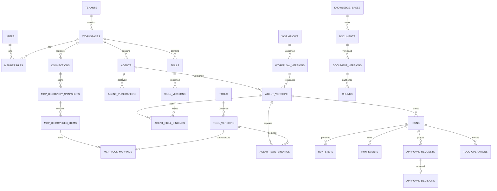

# Enterprise AI Agent Platform — Production Database Design v1.0

**Ngày thiết kế:** 2026-10-30  
**Phiên bản:** v1.0 — Greenfield Unified Production Baseline (56 Bảng)  
**Phạm vi:** Dự án Enterprise AI Agent Platform độc lập, tham khảo FPT AI Agents + FPT AI EOS; tích hợp toàn diện CR-SKILL-001 (Skill Management) và CR-MCP-001 (MCP Integration). **Không liên quan RetailMind-AI.**  
**Đồng bộ kiến trúc:** `ENTERPRISE_AGENT_PLATFORM_REPOSITORY_IMPLEMENTATION_V1.md`, `ENTERPRISE_AGENT_PLATFORM_STEP_BY_STEP_IMPLEMENTATION_RUNBOOK_V1.md`.  
**Trạng thái:** **DESIGN / STATICALLY VERIFIED (56 Tables, 55 RLS Policies PASS)**.  
**Tập tài liệu kèm theo:** 
- `ENTERPRISE_AGENT_PLATFORM_0001_BASELINE.sql` (Unified DDL 56 bảng)
- `ENTERPRISE_AGENT_PLATFORM_0002_SMOKE_TEST.sql` (Transactional multi-tenant & immutability test)
- `ENTERPRISE_AGENT_PLATFORM_DATA_DICTIONARY_V1.md` (Từ điển chi tiết 56 bảng)
- `validate_db_static.py` (Script kiểm tra tĩnh cấu trúc DDL & RLS)

---

## 0. Tóm tắt quyết định kiến trúc CSDL (ADR)

| ADR | Quyết định | Lý do | Giới hạn / Rủi ro |
|---|---|---|---|
| DB-001 | PostgreSQL $\ge$ 16, single cluster, 7 schemas phân lập | ACID, foreign key, transaction isolation, RLS native | Cần phân quyền role chặt chẽ |
| DB-002 | Tenant + Workspace phân cấp 2 tầng | Hỗ trợ mô hình doanh nghiệp đa tổ chức và phòng ban | Membership bắt buộc verify ở backend API |
| DB-003 | `uuid` làm ID; `timestamptz` chuẩn hóa UTC | Khóa chính ngẫu nhiên chống phỏng đoán, phân tán | UUID không đảm bảo thứ tự thời gian tự nhiên |
| DB-004 | AgentSpec / WorkflowSpec / SkillManifest dạng `jsonb` | Cấu hình khai báo schema-first, không code exec | Cần validate chặt chẽ ở application layer |
| DB-005 | Draft mutable; Published version bất biến (Append-only) | Tái lập chính xác hành vi của Agent/Skill theo sha256 | Bắt buộc trigger `reject_immutable_mutation` |
| DB-006 | `runtime.runs` là hệ thống ghi nhận; LangGraph checkpointer quản lý state | Tách biệt trạng thái quản trị nghiệp vụ và state graph | Không can thiệp sửa trực tiếp checkpoint LangGraph |
| DB-007 | Postgres giữ authoritative metadata; Qdrant giữ vector embeddings | Kiểm soát ACL tài liệu chặt chẽ ở cơ sở dữ liệu nguồn | Bắt buộc filter workspace_id khi retrieval |
| DB-008 | Mọi tool side-effect ghi nhận qua `runtime.tool_operations` | Đảm bảo Idempotency, reconciliation kết quả timeout | Không đảm bảo exactly-once nếu tool ngoài thiếu idempotency |
| DB-009 | Phê duyệt dùng CAS (Compare-And-Swap) và action hash | Chống double-approval, chống can thiệp payload | Cần transaction lock `SELECT ... FOR UPDATE` |
| DB-010 | Transactional outbox & inbox receipts | Bảo đảm độ tin cậy khi phát sự kiện bất đồng bộ | Consumer phải xử lý duplicate (at-least-once) |
| DB-011 | Không lưu secret plaintext; chỉ lưu `secret_ref` | Bảo mật bí mật theo chuẩn Vault/KMS | API/Gateway resolve secret theo phiên gọi |
| DB-012 | Chưa partition bảng lớn ở baseline đầu | Tránh hy sinh composite foreign key và global index | Đo đạc tải thực tế trước khi partition theo tháng/quý |
| **DB-013** | **Greenfield Unified Baseline v1.0 (56 bảng)** | Hợp nhất Core (50) + Skill (3) + MCP (3) ngay từ đầu | Áp dụng trên PostgreSQL mới sạch; evolution sau đó dùng Alembic |

---

## 1. Phân bổ Data Ownership qua 7 Schemas (56 Bảng)

| Schema | Bảng cốt lõi | Bảng Skill & MCP | Tổng số bảng v1.0 | Owner Application | Trách nhiệm chính |
|---|---:|---:|---:|---|---|
| `iam` | 5 | 0 | **5** | Control API | Quản lý Tenant, Workspace, User (OIDC), Membership, Service Account |
| `catalog` | 13 | +3 | **16** | Control API | Models, Business Processes, Workflows, Tools, Agents, Publications, **Skills, Skill Versions, Agent-Skill Bindings** |
| `knowledge` | 7 | 0 | **7** | Knowledge Module | Knowledge Bases, ACL Grants, Documents, Document Versions, Chunks, Vector Refs, Ingestion Jobs |
| `runtime` | 12 | 0 | **12** | Agent Runtime | Conversations, Messages, Runs, Steps, Events, Checkpoint Refs, Memory Records, Approvals, Tool Operations, Jobs |
| `integration` | 3 | +3 | **6** | Integration / Gateway | Connections, Outbox, Receipts, **MCP Discovery Snapshots, MCP Discovered Items, MCP Tool Mappings** |
| `governance` | 4 | 0 | **4** | Governance Module | Policy Sets, Policy Versions, Append-only Audit Events, Retention Policies |
| `ops` | 6 | 0 | **6** | Operations Module | Model Usage Meters, Eval Datasets, Dataset Versions, Test Cases, Eval Runs, Results |
| **Tổng** | **50** | **+6** | **56** | | **55 bảng áp dụng RLS (toàn bộ trừ iam.users)** |

---

## 2. Sơ đồ thực thể ERD Tổng thể (v1.0)



---

## 3. Chi tiết 6 Bảng tích hợp Skill và MCP trong v1.0 (56 bảng)

### 3.1 Nhóm Skill Management (`catalog`)
1. **`catalog.skills`**: Lưu danh tính, slug và bản nháp `draft_skill_md` của Skill. Có `revision` phục vụ optimistic locking.
2. **`catalog.skill_versions`**: Lưu bản phát hành bất biến. Gồm toàn văn `skill_md`, `manifest` JSONB, `bundle_ref` và mã băm kiểm tra `bundle_sha256`. Có trigger `reject_immutable_mutation()`.
3. **`catalog.agent_skill_bindings`**: Liên kết cố định giữa `agent_version_id` và `skill_version_id`. Đảm bảo một Agent Version chỉ pin đúng 1 version duy nhất của mỗi Skill.

### 3.2 Nhóm MCP Integration (`integration`)
4. **`integration.mcp_discovery_snapshots`**: Lưu nhật ký mỗi lần scan metadata từ MCP Server. Ghi nhận giao thức (`modern` 2026-07-28 hoặc `legacy` 2025-11-25), capabilities và digest `catalog_sha256`.
5. **`integration.mcp_discovered_items`**: Lưu các item khám phá được (`tool`, `resource`, `resource_template`, `prompt`). Toàn bộ descriptor được đánh dấu untrusted và tính mã băm `schema_sha256`.
6. **`integration.mcp_tool_mappings`**: Lưu quyết định phê duyệt thủ công của quản trị viên. Chỉ các remote tool có status `approved` và khớp chính xác `approved_schema_sha256` mới được ánh xạ vào `catalog.tool_versions` để Agent gọi qua Tool Gateway.

---

## 4. Bảo mật & Row Level Security (RLS)

* **Cô lập Tenant:** 55/56 bảng đều bắt buộc có 2 cột `tenant_id uuid NOT NULL` và `workspace_id uuid NOT NULL`.
* **Chính sách RLS chuẩn:**
  ```sql
  CREATE POLICY tenant_isolation ON <schema>.<table>
    USING (tenant_id = NULLIF(current_setting('app.tenant_id', true), '')::uuid)
    WITH CHECK (tenant_id = NULLIF(current_setting('app.tenant_id', true), '')::uuid);
  ```
* **Bảo vệ tính bất biến:** Bật trigger `BEFORE UPDATE OR DELETE` ngăn chặn tuyệt đối việc chỉnh sửa các phiên bản đã phát hành (`agent_versions`, `skill_versions`, `agent_skill_bindings`, `mcp_discovery_snapshots`, `tool_versions`, `workflow_versions`, `audit_events`, `approval_decisions`).

---

## 5. Kết quả nghiệm thu tĩnh (Quality Gate G1)

```text
Tables found: 56
ENABLE RLS count: 55
FORCE RLS count: 55
CREATE POLICY count: 55
PASS static checks: 56 tables, referenced parents declared earlier, composite FK targets unique, 55 RLS policies.
```

