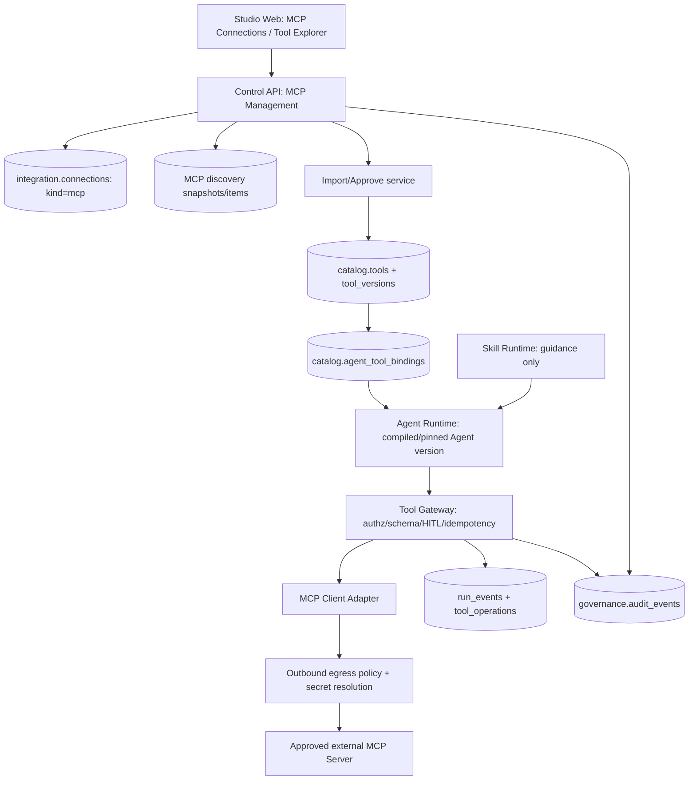

# ĐẶC TẢ PHÂN HỆ NỀN TẢNG — Model Context Protocol (MCP) Integration (Enterprise AI Agent Platform)

> **Phân loại kiến trúc:** Thành phần Nền tảng Cốt lõi (Core Foundational Pillar) của hệ thống từ Day-1 (không phải module mở rộng hay extension).  
> **Loại tài liệu:** Change Request / Implementation Guide dành cho AI Coding Agent (Codex, Claude Code, Cursor)
> **Phiên bản:** 2.0 — 2026-10-30
> **Trạng thái:** `APPROVED / ADOPTED IN ARCHITECTURE V1.0` (Đã phê duyệt & Hợp nhất vào Baseline V1.0 Greenfield Unified 56 bảng)
> **Ưu tiên:** P1 — Core Integration Layer; vận hành song song cùng Tool Gateway & Skill Engine
> **Dự án:** Enterprise AI Agent Platform độc lập (Agent Studio + Agent Operations / Digital Workers)
> **Mối liên hệ:** Tích hợp trực tiếp vào Kiến trúc Repo V1, Database Baseline V1 (56 bảng), Implementation Runbook V1, CR-SKILL-001; **không liên quan RetailMind-AI**
> **Nguồn chuẩn:** MCP specification bản **2026-07-28** (hiện hành), hỗ trợ Streamable HTTP & stdio transports, kèm các cơ chế backward compatibility với 2025-11-25.

---

## 0. CHỈ THỊ BẮT BUỘC DÀNH CHO CODING AGENT

**Nhiệm vụ:** mở rộng nền tảng với `MCP Management`, tái sử dụng `integration.connections`, `catalog.tools`, `catalog.tool_versions`, `catalog.agent_tool_bindings`, `runtime.tool_operations`, `runtime.run_events`, `governance.audit_events`. **KHÔNG** xây một hệ thống registry/cấp quyền/run/audit thứ hai.

**Trước khi viết code:**

1. Đọc `AGENTS.md`, `AGENT_CODING_RULES.md`, `README.md` và các chỉ thị thực tế của repository trước, nếu có. Quy tắc repository ưu tiên hơn file đề xuất này.
2. Đọc theo thứ tự:
   - `docs/02-architecture/ENTERPRISE_AGENT_PLATFORM_REPOSITORY_IMPLEMENTATION_V1.md`;
   - `docs/03-database/DATABASE_DESIGN.md`;
   - `database/migrations/0001_baseline.sql` (56 bảng);
   - `docs/09-implementation/IMPLEMENTATION_RUNBOOK.md` (Runbook V1.0);
   - `docs/05-change-requests/CR-SKILL-001.md` (CR-SKILL-001);
   - file CR-MCP-001 này.
3. Chụp `git rev-parse HEAD`, xem cây source và migrations. Tạo bảng `EXISTS / DESIGN_ONLY / MISSING / NOT_RUN`. **Không đánh đồng blueprint là code chạy thật.**
4. Xác định migration framework đang sử dụng (Alembic hay SQL-managed). **Chỉ dùng một đường migration**; không sửa lại migration đã áp dụng, không chạy lại baseline trên database có dữ liệu.
5. Triển khai **một PR một lần** theo mục 17. Không tiến tới PR kế tiếp nếu quality gate trước còn `FAIL` hoặc `BLOCKED`.
6. Mọi thay đổi API/SQL phải cập nhật hợp đồng và test tương ứng. Chạy được thì ghi `PASS + command + output`, không chạy thì ghi `NOT_RUN` kèm nguyên nhân.
7. Không tự ý tạo Docker service/microservice riêng, không thay framework LangGraph/Agno đã chọn, không cấp quyền mạng/shell không kiểm soát, không dùng secret thật trong tests hoặc tài liệu.
8. Không được kết nối MCP Server chưa được phê duyệt đến môi trường production. Không chạy remote code hoặc tự động thực hiện hành động do tool discovery trả về.

**Đầu ra của mỗi PR**: diff, file list, migration up/down hoặc phương án phục hồi, API contracts, tests, threat assessment, evidence và backlog còn lại.

---

## 1. MỤC TIÊU VÀ CĂN CỨ

### 1.1. Các thành phần đã có trong **thiết kế**

| Existing artifact | Đã thể hiện | Quyết định |
|---|---|---|
| `integration.connections` | `kind IN ('http','mcp','webhook')`, `config`, `secret_ref`, `status` | **Tái sử dụng làm MCP Server/Connection Registry** |
| `catalog.tools` | `kind IN ('http','mcp','builtin')` | **Tái sử dụng Tool Catalog** |
| `catalog.tool_versions` | Input/output schema, execution config, risk, hash | MCP tool được import thành version bất biến |
| `catalog.agent_tool_bindings` | Agent version → tool version, approval mode | Dùng để cấp quyền Agent dùng MCP Tool |
| `catalog.tool_grants` | RBAC/service account grants | Áp dụng cùng Tool Gateway |
| `runtime.tool_operations` | Operation key, request hash, status, references | Giữ idempotency / uncertainty khi gọi tool có side effects |
| `runtime.run_events` | Run timeline có `redacted_payload` | Thêm loại event MCP, không tạo hệ run events khác |
| `governance.audit_events` | Actor, action, resource, trace, redacted details | Dùng audit quản trị và thực thi |
| `integration.outbox_events` | Transactional outbox | Dùng phát sự kiện mapping/enable/disable |

**Nguồn xác minh nội bộ:** các bảng và cột trên đã được tích hợp đầy đủ vào `ENTERPRISE_AGENT_PLATFORM_0001_BASELINE.sql` (V1.0, 56 bảng). Bộ DDL đã vượt qua static validation (`56 tables, 55 RLS policies, 10 immutability triggers`).

### 1.2. Những gì còn thiếu

- Quản lý cấu hình MCP endpoint và trạng thái kết nối bằng giao diện.
- Protocol negotiation/discovery, capabilities, pagination và refresh có giới hạn.
- Snapshot tool/resource/prompt metadata, phát hiện thay đổi schema (drift).
- Quy trình review → approve → import MCP Tool vào Registry hiện hữu.
- Client runtime gọi Tool theo **published Agent version + approved Tool version + tenant policy**.
- Secret handling, OAuth/service authentication, SSRF egress control, health/metrics, revocation.
- Testing: protocol conformance, malformed responses, 401/403, tenant isolation, action replay, timeout, retry.
- Tương tác an toàn với Skill Management: Skill **không** tự đăng ký/cấp quyền MCP Tool.

### 1.3. Mục tiêu người dùng

1. Operator thêm một MCP Server qua UI, quản lý credentials bằng `secret_ref`, và thử kết nối.
2. Developer khám phá Tools/Resources/Prompts nhưng **chỉ approved Tool** mới được import, bind và gọi.
3. Agent được publish chỉ dùng những tool version đã pin; không tự nhận quyền mới khi server đổi catalog.
4. Tool calls được authorize, validate, audit và theo dõi lỗi/latency; hành động rủi ro cần HITL.
5. Khi credentials bị thu hồi, schema thay đổi hoặc server không đáng tin: platform **fail closed**.
6. Cùng một Agent có thể dùng Skill hướng dẫn xử lý nghiệp vụ nhưng mọi MCP call vẫn đi qua Tool Gateway.

---

## 2. PHẠM VI MVP / SAU MVP / LOẠI TRỪ

| Mức | Khả năng | Quyết định |
|---|---|---|
| MUST | MCP Client → remote MCP Server qua **Streamable HTTP**, HTTPS | MVP |
| MUST | Service-to-service credential từ secret manager (server trusted) | MVP |
| MUST | Connection CRUD, Test Connection, Enable/Disable, discovery manual, list snapshot | MVP |
| MUST | `tools/list` (pagination), schema hashing, preview, review, approve/import/pin | MVP |
| MUST | `tools/call` qua Gateway hiện hữu; timeout, input validation, policy, audit | MVP |
| MUST | Tenant isolation/RLS, SSRF protection, allowlist, no secret exposure | MVP |
| MUST | Error taxonomy, retry policy và output sanitization | MVP |
| SHOULD | `resources/list`, `resources/templates/list`, `prompts/list` **metadata preview** | MVP đọc metadata; không tự nạp nội dung |
| SHOULD | Discovery refresh có lịch + xử lý list-changed/subscriptions nếu SDK hỗ trợ | Sau vertical slice đầu |
| SHOULD | OAuth 2.x delegated per-user, token refresh & consent UI | Phase 2; cần thiết kế isolation riêng |
| SHOULD | Cho phép đọc resource được duyệt bằng `resources/read` với ACL và budget | Phase 2 |
| SHOULD | MCP Server xuất bản tool/agent được duyệt của nền tảng | Phase 2 / CR-MCP-002 |
| SHOULD | Interop với `io.modelcontextprotocol/skills` extension | Phase 2 và phải phối hợp CR-SKILL-001 |
| LATER | stdio transport cho server cục bộ trong sandbox chuyên dụng | Không ở MVP chung |
| OUT | Remote arbitrary shell/npm/pip installs; dynamic command execution; unrestricted filesystem/net | CẤM |
| OUT | Công khai tất cả API nội bộ thành MCP Tools theo mặc định | CẤM |
| OUT | Auto-approve tool mới do MCP server tự thêm | CẤM |
| OUT | Lưu access token hoặc refresh token plaintext trong DB/config/trace | CẤM |
| OUT | Tách Tool Gateway và MCP Adapter thành một service mới không cần thiết | CẤM |

**Chủ ý:** MVP làm chắc **MCP Client** trước; MCP Server Publishing là một việc khác, chỉ bắt đầu khi interface và security contract đã ổn định.

---

## 3. PHIÊN BẢN GIAO THỨC & CÁC ĐIỂM TƯƠNG THÍCH QUAN TRỌNG

### 3.1. Baseline protocol 2026-07-28 (hiện hành)

- MCP dùng JSON-RPC 2.0, các transport tiêu chuẩn là **stdio** và **Streamable HTTP**.
- Với **2026-07-28**: core stateless, metadata/capabilities theo từng request; discovery qua `server/discover`, **không** phụ thuộc `initialize`/`Mcp-Session-Id`.
- Trường hợp server đời cũ (**2025-11-25 trở xuống**): dùng `initialize` handshake; adapter SDK phải nhận biết chế độ, không tự viết request bằng tay giả định một era.
- Modern `tools/list` có cache hints (`ttlMs`, `cacheScope`) và thứ tự ổn định; nếu server legacy không hỗ trợ, sử dụng cache/TTL của platform theo policy riêng.
- `subscriptions/listen` và cơ chế change notification thay thế những giả định stream đời cũ. MVP vẫn có nút **Refresh** và quét có lịch để không phụ thuộc notification.
- Các phiên bản SDK Python/TS có thể có thay đổi import và hàm gọi (v1/v2). **Chốt versions trong lockfile và test compatibility** trước khi dùng ví dụ code từ Internet.

**Không dùng `HTTP+SSE` legacy để xây kết nối mới.** Streamable HTTP có thể truyền SSE theo nhu cầu, nhưng điều này khác với transport HTTP+SSE cũ.

### 3.2. Những gì là MCP chuẩn và những gì là policy của dự án

| MCP protocol | Policy của nền tảng (thiết kế mới) |
|---|---|
| `server/discover` / legacy `initialize` | Chỉ allowlist endpoint đã đăng ký và được duyệt |
| `tools/list` | Catalog snapshot bất biến, schema hash, diff/review |
| `tools/call` | Authorization, input validation, HITL, idempotency, output sanitization |
| `resources/list`, `prompts/list` | Preview metadata; không tự inject vào prompt |
| `list_changed` / subscription | Trigger refresh; **không** tự publish/approve |
| OAuth & bearer tokens | Secret store, per-tenant trust, scopes, audience validation |
| Tool annotations | **Untrusted** trừ khi đã được verified/approved |

### 3.3. Quyết định bắt buộc về feature negotiation

MCP server hỗ trợ nhiều capability khác nhau. Không giả định mọi server có đủ Tools, Resources và Prompts. Không gọi một protocol method nếu SDK báo capability không được hỗ trợ; báo trạng thái `unsupported` rõ ràng.

**SDK strategy:** dùng MCP SDK chính thức (Python) qua adapter mỏng. Bản SDK thực tế được chọn phải được pin theo commit/release, lock dependencies; tests bao phủ server mock modern và legacy. Không phụ thuộc trực tiếp vào internal package code.

---

## 4. BOUNDED CONTEXT VÀ TRUST BOUNDARIES



**Boundaries (bắt buộc):**

- Browser không giữ upstream credentials và không kết nối trực tiếp server MCP thay backend.
- Control API quản lý cấu hình và phê duyệt nhưng **không làm agent loop**.
- Runtime không có quyền tự approve/import/enable server hoặc thay đổi `tool_versions`.
- Remote MCP server và tool metadata/outputs đều là **untrusted external input**; tool description không phải system prompt đáng tin.
- Tool Gateway tái kiểm tra policy lúc gọi; việc approved tại catalog **không** thay thế authorization mỗi request.
- Per-run principal và workspace phải được xác định từ trusted identity; LLM không được tự đưa `tenant_id` hợp lệ vào request.
- Mỗi run phải pin `agent_version_id`, `tool_version_id` và tool schema hash; disable/revoke có hiệu lực ngay khi gọi.

---

## 5. CÂY THƯ MỤC DELTA CẦN TẠO/SỬA

```text
enterprise-agent-platform/
├── docs/
│   ├── changes/CR-MCP-001.md                    # ADD: Tài liệu này
│   ├── adr/ADR-MCP-001.md                      # ADD: Protocol, auth, runtime boundaries
│   └── runbooks/mcp-incident-response.md      # ADD: revoke, drift, outage
├── contracts/
│   ├── jsonschema/mcp-connection.v1.schema.json # ADD
│   ├── jsonschema/mcp-discovery.v1.schema.json  # ADD
│   ├── jsonschema/tool-spec.v1.schema.json      # MODIFY: MCP execution ref
│   ├── jsonschema/agent-spec.v1.schema.json     # MODIFY only if needed; use toolRefs
│   └── openapi/control-api.openapi.yaml        # MODIFY MCP endpoints
├── apps/
│   ├── studio-web/src/
│   │   ├── app/(console)/w/[workspaceId]/mcp/
│   │   │   ├── page.tsx                        # NEW connections list
│   │   │   ├── new/page.tsx                    # NEW connection creation
│   │   │   └── [connectionId]/page.tsx         # NEW detail/status/tool explorer
│   │   ├── features/mcp-management/
│   │   │   ├── api/mcpApi.ts                   # API client
│   │   │   ├── components/McpConnectionForm.tsx
│   │   │   ├── components/McpConnectionList.tsx
│   │   │   ├── components/McpDiscoveryDiff.tsx
│   │   │   ├── components/McpToolReview.tsx
│   │   │   ├── components/McpToolExplorer.tsx
│   │   │   └── components/McpConnectionHealth.tsx
│   │   └── features/agent-builder/components/ToolSelector.tsx # MODIFY existing
│   ├── control-api/src/control_api/modules/
│   │   ├── mcp/                               # NEW bounded context
│   │   │   ├── api/router.py
│   │   │   ├── api/requests.py
│   │   │   ├── api/responses.py
│   │   │   ├── application/create_connection.py
│   │   │   ├── application/test_connection.py
│   │   │   ├── application/refresh_discovery.py
│   │   │   ├── application/review_tool.py
│   │   │   ├── application/disable_connection.py
│   │   │   ├── domain/models.py
│   │   │   ├── domain/rules.py
│   │   │   ├── infrastructure/repository.py
│   │   │   ├── infrastructure/secret_refs.py
│   │   │   └── tests/
│   │   ├── tools/                               # MODIFY existing Tool Registry
│   │   ├── agents/                              # MODIFY existing publish/bind logic
│   │   └── audit/                               # REUSE
│   └── agent-runtime/src/agent_runtime/
│       ├── mcp/                                 # NEW thin adapter, not service
│       │   ├── sdk_client.py
│       │   ├── protocol_compat.py
│       │   ├── connection_resolver.py
│       │   ├── tool_adapter.py
│       │   ├── discovery_client.py
│       │   ├── response_normalizer.py
│       │   └── errors.py
│       ├── tools/gateway.py                     # MODIFY existing policy enforcement
│       ├── execution/                            # REUSE run context
│       └── observability/                       # ADD spans/events on existing flow
├── infra/
│   └── db/migrations/                           # ADD forward-only migration(s) using repo's actual tool
├── tests/
│   ├── integration/mcp/
│   │   ├── test_discovery.py
│   │   ├── test_tool_call.py
│   │   ├── test_authz_and_isolation.py
│   │   ├── test_schema_drift.py
│   │   └── test_timeout_and_replay.py
│   ├── security/mcp/
│   │   └── test_ssrf_secret_and_injection.py
│   └── e2e/mcp/
│       └── test_mcp_agent_vertical_slice.py
└── examples/mcp/
    ├── trusted-mock-server/                     # In-process/localhost test ONLY
    ├── sample-mcp-connection.json                # No secrets
    └── sample-approved-tool.json
```

**Không tạo file rỗng hàng loạt.** Tree là target; code agent tạo những file cần thiết trong đúng PR, có tests.

---

## 6. DATA MODEL DELTA — KHÔNG TẠO TOOL REGISTRY THỨ HAI

### 6.1. Quyết định tận dụng CSDL hiện có

- `integration.connections` **chính là MCP connection/server registry**. Với `kind='mcp'`, cột `config` lưu cấu hình không nhạy cảm và `secret_ref` tham chiếu secret manager.
- `catalog.tools` + `catalog.tool_versions` chính là Tool Catalog chung, **không** thêm `mcp_tools` riêng để thực thi.
- `catalog.agent_tool_bindings` quản lý quyền gắn ToolVersion vào AgentVersion, như tools HTTP/Builtin.
- `runtime.tool_operations` dùng để ghi ý định thực thi và kiểm soát duplicate.

**Ba bảng MCP Discovery và Mapping đã được tích hợp chính thức vào Baseline V1.0:**

| Bảng tích hợp | Mục đích | Trạng thái trong Baseline V1.0 |
|---|---|---|
| `integration.mcp_discovery_snapshots` | Lưu một lượt scan + protocol/capability digest bất biến | **Đã tạo trong DDL 0001_baseline.sql** |
| `integration.mcp_discovered_items` | Lưu metadata tools/resources/prompts theo snapshot, không đưa ngay vào production | **Đã tạo trong DDL 0001_baseline.sql** |
| `integration.mcp_tool_mappings` | Liên kết tool remote được review với `catalog.tool_versions` và trạng thái approval | **Đã tạo trong DDL 0001_baseline.sql** |

> **Quyết định kiến trúc ADR-013:** 50 bảng ban đầu + 3 bảng Skill (`catalog.skills`, `catalog.skill_versions`, `catalog.agent_skill_bindings`) + 3 bảng MCP (`integration.mcp_discovery_snapshots`, `integration.mcp_discovered_items`, `integration.mcp_tool_mappings`) = **56 bảng thống nhất trong Baseline V1.0 Day-1**. Toàn bộ 55 bảng tenant-scoped được kích hoạt `FORCE ROW LEVEL SECURITY`.

### 6.2. Cấu hình Connection — không lưu credential plaintext

Ví dụ `integration.connections.config` (do application schema validate):

```json
{
  "schemaVersion": "1.0",
  "transport": "streamable_http",
  "endpoint": "https://mcp.internal.example.com/mcp",
  "authMode": "service_token",
  "connectTimeoutMs": 5000,
  "toolTimeoutMs": 30000,
  "maxResponseBytes": 1048576,
  "allowlistedHost": "mcp.internal.example.com",
  "redirectPolicy": "deny"
}
```

`secret_ref` nằm ngoài JSON, ví dụ `vault://tenant-id/credentials/mcp-service-token` (placeholder, **không** phải URL được tự do đọc). Với remote internet: HTTPS bắt buộc; allowlisted private service qua private network proxy và cấu hình đã phê duyệt, không nới lỏng SSRF filter toàn cục.

**Validation**: chỉ `https` (cho phép localhost HTTP chỉ trong profile dev/test), không chấp nhận URL có userinfo, loopback/private/link-local/meta IP từ request bên ngoài; cấm các redirects tới host khác hoặc HTTPS→HTTP; phân giải DNS và kiểm tra ở thời điểm kết nối (chặn DNS rebinding). Không log full endpoint nếu có query nhạy cảm (tốt nhất cấm secret trong URL).

### 6.3. Cấu trúc SQL đã được chuẩn hóa trong Baseline V1.0

Đoạn DDL dưới đây đã được tích hợp chính thức vào file migration `database/migrations/0001_baseline.sql` và vượt qua static validation. Mọi ràng buộc `(tenant_id, workspace_id)` đều tuân thủ composite FK của nền tảng:

```sql
-- Đã tích hợp chính thức vào Baseline V1.0 (56 bảng)
CREATE TABLE integration.mcp_discovery_snapshots (
    tenant_id uuid NOT NULL,
    workspace_id uuid NOT NULL,
    id uuid PRIMARY KEY DEFAULT gen_random_uuid(),
    connection_id uuid NOT NULL,
    protocol_version text,
    protocol_era text NOT NULL CHECK (protocol_era IN ('modern','legacy','unknown')),
    server_capabilities jsonb NOT NULL DEFAULT '{}'::jsonb,
    catalog_sha256 char(64) CHECK (catalog_sha256 ~ '^[a-f0-9]{64}$'),
    status text NOT NULL CHECK (status IN ('complete','partial','failed')),
    error_code text,
    captured_at timestamptz NOT NULL DEFAULT now(),
    UNIQUE (tenant_id, workspace_id, id),
    UNIQUE (tenant_id, workspace_id, id, connection_id),
    FOREIGN KEY (tenant_id, workspace_id, connection_id)
      REFERENCES integration.connections(tenant_id, workspace_id, id)
);

CREATE TABLE integration.mcp_discovered_items (
    tenant_id uuid NOT NULL,
    workspace_id uuid NOT NULL,
    id uuid PRIMARY KEY DEFAULT gen_random_uuid(),
    connection_id uuid NOT NULL,
    snapshot_id uuid NOT NULL,
    item_kind text NOT NULL CHECK (item_kind IN ('tool','resource','resource_template','prompt')),
    remote_key text NOT NULL,
    descriptor jsonb NOT NULL CHECK (jsonb_typeof(descriptor) = 'object'),
    descriptor_sha256 char(64) NOT NULL CHECK (descriptor_sha256 ~ '^[a-f0-9]{64}$'),
    schema_sha256 char(64) CHECK (schema_sha256 ~ '^[a-f0-9]{64}$'),
    captured_at timestamptz NOT NULL DEFAULT now(),
    UNIQUE (tenant_id, workspace_id, snapshot_id, item_kind, remote_key),
    UNIQUE (tenant_id, workspace_id, connection_id, id),
    FOREIGN KEY (tenant_id, workspace_id, snapshot_id, connection_id)
      REFERENCES integration.mcp_discovery_snapshots(tenant_id, workspace_id, id, connection_id)
);

CREATE TABLE integration.mcp_tool_mappings (
    tenant_id uuid NOT NULL,
    workspace_id uuid NOT NULL,
    id uuid PRIMARY KEY DEFAULT gen_random_uuid(),
    connection_id uuid NOT NULL,
    remote_tool_name text NOT NULL,
    discovery_item_id uuid NOT NULL,
    tool_version_id uuid NOT NULL,
    approved_schema_sha256 char(64) NOT NULL
      CHECK (approved_schema_sha256 ~ '^[a-f0-9]{64}$'),
    status text NOT NULL DEFAULT 'pending'
      CHECK (status IN ('pending','approved','stale','revoked')),
    reviewed_by uuid REFERENCES iam.users(id),
    reviewed_at timestamptz,
    created_at timestamptz NOT NULL DEFAULT now(),
    UNIQUE (tenant_id, workspace_id, id),
    UNIQUE (tenant_id, workspace_id, connection_id, remote_tool_name, tool_version_id),
    FOREIGN KEY (tenant_id, workspace_id, connection_id)
      REFERENCES integration.connections(tenant_id, workspace_id, id),
    FOREIGN KEY (tenant_id, workspace_id, connection_id, discovery_item_id)
      REFERENCES integration.mcp_discovered_items(tenant_id, workspace_id, connection_id, id),
    FOREIGN KEY (tenant_id, workspace_id, tool_version_id)
      REFERENCES catalog.tool_versions(tenant_id, workspace_id, id)
);

CREATE UNIQUE INDEX uq_mcp_approved_active_tool
ON integration.mcp_tool_mappings(tenant_id, workspace_id, connection_id, remote_tool_name)
WHERE status = 'approved';

CREATE INDEX idx_mcp_snapshot_latest
ON integration.mcp_discovery_snapshots(tenant_id, workspace_id, connection_id, captured_at DESC);
CREATE INDEX idx_mcp_items_by_kind
ON integration.mcp_discovered_items(tenant_id, workspace_id, snapshot_id, item_kind);
CREATE INDEX idx_mcp_mapping_tool_lookup
ON integration.mcp_tool_mappings(tenant_id, workspace_id, tool_version_id, status);

-- RLS baseline pattern, replicate for all 3 tables.
ALTER TABLE integration.mcp_discovery_snapshots ENABLE ROW LEVEL SECURITY;
ALTER TABLE integration.mcp_discovery_snapshots FORCE ROW LEVEL SECURITY;
CREATE POLICY tenant_isolation ON integration.mcp_discovery_snapshots
  USING (tenant_id = NULLIF(current_setting('app.tenant_id', true), '')::uuid)
  WITH CHECK (tenant_id = NULLIF(current_setting('app.tenant_id', true), '')::uuid);

ALTER TABLE integration.mcp_discovered_items ENABLE ROW LEVEL SECURITY;
ALTER TABLE integration.mcp_discovered_items FORCE ROW LEVEL SECURITY;
CREATE POLICY tenant_isolation ON integration.mcp_discovered_items
  USING (tenant_id = NULLIF(current_setting('app.tenant_id', true), '')::uuid)
  WITH CHECK (tenant_id = NULLIF(current_setting('app.tenant_id', true), '')::uuid);

ALTER TABLE integration.mcp_tool_mappings ENABLE ROW LEVEL SECURITY;
ALTER TABLE integration.mcp_tool_mappings FORCE ROW LEVEL SECURITY;
CREATE POLICY tenant_isolation ON integration.mcp_tool_mappings
  USING (tenant_id = NULLIF(current_setting('app.tenant_id', true), '')::uuid)
  WITH CHECK (tenant_id = NULLIF(current_setting('app.tenant_id', true), '')::uuid);
```

**Bổ sung quan trọng khi code:**

- Role/GRANT: app role chỉ SELECT/INSERT/UPDATE tùy owner; runtime role read approved mappings/connection metadata nhưng không UPDATE approval; database owner/migration role riêng.
- RLS theo tenant phải đi cùng workspace membership check ở ứng dụng; session context **chỉ được set từ principal xác thực**, không từ request body/LLM; thiết lập trong transaction trước query.
- Snapshot/items đã finalized phải bất biến; nếu phải sửa kết quả discovery thì tạo scan mới, không overwrite evidence. Dùng trigger hoặc service+DB privileges có test.
- `mcp_tool_mappings` approved phải tham chiếu `item_kind='tool'`, `remote_key=remote_tool_name`, `catalog.tools.kind='mcp'` của ToolVersion và `approved_schema_sha256=mcp_discovered_items.schema_sha256` (hash chuẩn hóa input/output schema; khác `descriptor_sha256`, vốn bao gồm metadata) qua **application transactional validation** hoặc trigger. Composite FKs phía trên chỉ chống cross-tenant/connection, **không tự chứng minh** những quan hệ ngữ nghĩa này.
- Khi schema drift: trong một transaction lock mapping, chuyển `status='stale'` hoặc tạm vô hiệu hóa; tool không được gọi tiếp cho đến khi review và tạo `tool_version` mới. Preserve evidence và audit.
- Giới hạn descriptor size, số lượng items mỗi snapshot; tránh DoS từ catalog khổng lồ. Kiểm soát JSON depth và field lengths tại API.
- Khi xóa/disable connection, không cascade xóa `tool_operations`, `audit_events`, versions hoặc run history; thu hồi quyền tác nghiệp.
- Tên bảng cuối cùng tùy repository thực tế; **không tạo bản sao** `integration.connections`/`catalog.tools`.

### 6.4. Data integrity và transaction boundaries

**Import/Approve MCP Tool (atomic):**

1. Xác thực caller + tenant/workspace + quyền quản lý kết nối/tool.
2. Lấy `discovery_item_id` và snapshot đã complete; xác minh `kind='tool'`, remote tool name, schema hợp lệ.
3. Kiểm tra credential/trust của connection vẫn hợp lệ, không bị disabled.
4. Khóa mapping key (row lock hoặc advisory lock có namespace và test) tránh double approve.
5. Tạo/sử dụng `catalog.tools` theo tên stable có namespace từ `connection_id`, và tạo `catalog.tool_versions` mới cho schema change (không mutate published version).
6. Insert mapping `approved`, log `governance.audit_events`, enqueue `integration.outbox_events` **cùng transaction**.
7. Commit. On conflict trả 409; on retry với cùng idempotency key trả cùng result nếu semantic request hash khớp.

**Disable:** transaction đổi `integration.connections.status='disabled'`, revoke approved mappings, audit + outbox; runtime kiểm tra trạng thái tại thời điểm tool call.

**Side-effects:** database idempotency chỉ chặn duplicate dispatch trong platform; nếu remote server không hỗ trợ idempotency, kết quả timeout sau request có thể là `unknown`, cần reconcile hoặc manual review, **không tự retry write một cách mù quáng**.

---

## 7. CONTRACTS (SCHEMA-FIRST)

### 7.1. ConnectionCreateRequest

```json
{
  "name": "CRM Sandbox MCP",
  "transport": "streamable_http",
  "endpoint": "https://mcp.sandbox.example.com/mcp",
  "authMode": "service_token",
  "secretRef": "vault://workspace/mcp/crm-sandbox",
  "timeouts": {"connectMs": 5000, "invokeMs": 30000},
  "discovery": {"manualOnly": true, "maxItems": 200},
  "environment": "development"
}
```

**Contract rules:** `secretRef` chỉ được gửi bởi quyền quản trị và backend ghi reference; user thường xem config không thấy secretRef đầy đủ. `endpoint` kiểm tra chống SSRF ở cả lúc lưu và lúc dial. Không log request body chứa credential.

### 7.2. Discovery snapshot response

```json
{
  "snapshotId": "11111111-1111-4111-8111-111111111111",
  "connectionId": "22222222-2222-4222-8222-222222222222",
  "status": "complete",
  "protocolVersion": "2026-07-28",
  "protocolEra": "modern",
  "capabilities": {"tools": true, "resources": true, "prompts": false},
  "counts": {"tools": 2, "resources": 1, "prompts": 0},
  "catalogSha256": "aaaaaaaaaaaaaaaaaaaaaaaaaaaaaaaaaaaaaaaaaaaaaaaaaaaaaaaaaaaaaaaa",
  "capturedAt": "2026-10-30T00:00:00Z"
}
```

### 7.3. Approved Tool Version — execution_config (existing catalog)

```json
{
  "kind": "mcp",
  "connectionId": "22222222-2222-4222-8222-222222222222",
  "remoteToolName": "crm.lookup_customer",
  "mappingId": "33333333-3333-4333-8333-333333333333",
  "schemaSha256": "bbbbbbbbbbbbbbbbbbbbbbbbbbbbbbbbbbbbbbbbbbbbbbbbbbbbbbbbbbbbbbbb",
  "retryClass": "read_only",
  "timeoutMs": 30000
}
```

`retryClass` do reviewer đánh giá, không tin annotations từ server. `mappingId` phải tham chiếu mapping `approved` còn hiệu lực; runtime phải đối chiếu với ToolVersion và connection được phép.

### 7.4. Error contract chuẩn

```json
{
  "error": {
    "code": "MCP_REMOTE_TIMEOUT",
    "message": "MCP operation could not be completed",
    "retryable": false,
    "requestId": "req-example-1"
  }
}
```

**Error codes tối thiểu:** `MCP_CONNECTION_DISABLED`, `MCP_ENDPOINT_BLOCKED`, `MCP_AUTH_FAILED`, `MCP_PERMISSION_DENIED`, `MCP_DISCOVERY_FAILED`, `MCP_TOOL_NOT_APPROVED`, `MCP_SCHEMA_DRIFT`, `MCP_INPUT_INVALID`, `MCP_REMOTE_TIMEOUT`, `MCP_REMOTE_ERROR`, `MCP_OUTPUT_INVALID`, `MCP_RESULT_UNKNOWN`, `MCP_PROTOCOL_UNSUPPORTED`, `MCP_RESOURCE_UNSUPPORTED`.

---

## 8. CONTROL API — ENDPOINTS ĐỀ XUẤT

Mọi endpoint theo prefix `/api/v1/workspaces/{workspaceId}/mcp` (trong spec OpenAPI có security schemes và responses tương ứng). `workspaceId` từ URL **không** thay thế kiểm tra membership.

| Method | Endpoint | Quyền | Mục đích |
|---|---|---|---|
| POST | `/connections` | admin/developer (policy) | Đăng ký MCP connection |
| GET | `/connections` | viewer+ (policy) | Liệt kê kết nối, redacted |
| GET | `/connections/{id}` | viewer+ | Chi tiết, không tiết lộ secret |
| PATCH | `/connections/{id}` | admin/developer | Cập nhật config **chưa phải approval** |
| POST | `/connections/{id}/test` | admin/developer | Test kết nối tới allowlisted URL |
| POST | `/connections/{id}/discover` | admin/developer | Snapshot metadata, trả job/snapshot |
| GET | `/connections/{id}/discoveries` | viewer+ | Lịch sử snapshot |
| GET | `/connections/{id}/discoveries/{snapshotId}/items` | viewer+ | Items + pagination/diff |
| POST | `/connections/{id}/tools/{itemId}/review` | admin/developer có quyền | Approve/import hoặc reject MCP Tool |
| POST | `/connections/{id}/disable` | admin | Disable và revoke tool mappings |
| POST | `/connections/{id}/enable` | admin | Enable lại, nhưng không auto-reapprove |
| GET | `/connections/{id}/health` | operator+ | Health, latency, last_error (redacted) |
| GET | `/tools/{toolVersionId}/mcp-origin` | viewer+ | Mapping nguồn của ToolVersion |

**Không đưa upstream `tools/call` trực tiếp vào public Control API.** Agent Runtime có Tool Gateway riêng với trusted run context. Nếu muốn playground test tool, dùng endpoint sandbox riêng có approval, rate limit, policy và audit giống tool runtime (một PR độc lập).

**HTTP behavior:** 201 created; 200 read; 202 accepted asynchronous discover; 400 invalid; 401 unauthenticated; 403 unauthorized; 404 missing/cross-tenant (tránh enumeration); 409 version/schema/approval conflict; 422 schema validation; 429 rate limit; 502/503 upstream; 504 timeout. Chuẩn hóa RFC 9457/problem details nếu API hiện có sử dụng, không áp mới cứng nhắc.

### 8.1. Quyền tối thiểu (đề xuất)

| Operation | Viewer | Developer | Operator | Admin |
|---|---:|---:|---:|---:|
| List/preview (redacted) | Read | Read | Read | Read |
| Create/Edit connection | Deny | Scoped | Deny | Allow |
| Test/Discover | Deny | Scoped | Scoped | Allow |
| Approve tool import | Deny | Scoped (nếu policy) | Deny | Allow |
| Disable/rotate credentials | Deny | Deny | Escalate | Allow |
| Read health/audit | Scoped | Scoped | Allow | Allow |

Đây là RBAC gợi ý; nếu repo có chính sách chi tiết, tuân theo policy engine. Không dùng role hardcoded để thay thế ABAC/grants.

---

## 9. DISCOVERY PIPELINE (CHỈ METADATA)

**Luồng:** `POST discover` → kiểm tra principal → kiểm tra connection/egress → connect qua SDK → negotiate protocol → list tools/resources/prompts (chỉ declared capabilities) → paginate → validate/truncate → normalize → canonicalize → hash → snapshot immutable → diff trước/sau → return.

### 9.1. Khả năng tương thích hai thế hệ MCP

```text
MCP client adapter
  ├─ modern (2026-07-28): discovery / stateless per-request metadata
  └─ legacy (<=2025-11-25): initialize / session handshake
       ↓
normalization to internal DiscoverResult
       ↓
{ protocolVersion, capabilities, tools[], resources[], prompts[], scanDigest }
```

**SDK lo protocol-level wire encoding**; coding agent không tự build JSON-RPC transport bằng HTTPX chỉ để tiết kiệm dependency. Phần DTO nội bộ tách biệt với SDK types.

### 9.2. Validation trước lưu snapshot

- Giới hạn số kết quả, kích thước JSON, nesting depth, trùng remote key, malformed JSON schema.
- `remote_tool_name` case-sensitive; tool names trùng giữa hai server được disambiguate bằng `connection_id`, không tin `serverInfo.name` unique.
- `description`, prompt text, resource URI, annotations là **untrusted**, không cho sửa system prompt; render UI escaped/sanitized.
- Bắt buộc follow `nextCursor` cho đến hết hoặc max limits; không đọc một trang rồi coi đã complete.
- Nếu discovery partial/failed: lưu status và error để phân tích nhưng **không tự approve** items từ snapshot incomplete.
- Tính **hai hash khác nhau**: `descriptor_sha256` trên canonical descriptor (bao gồm description/annotations) để phát hiện thay đổi metadata; `schema_sha256` trên canonical `{inputSchema, outputSchema}` (nullable cho resource/prompt) để phát hiện thay đổi hợp đồng gọi. Quy tắc canonical JSON/encoding phải có unit tests.
- Chỉ metadata, không tự `resources/read`/`prompts/get` hay đưa kết quả vào LLM lúc discovery.
- Scheduled refresh đặt TTL và rate limit; cache hints server không thay thế approval workflow.

### 9.3. Schema drift & revocation

| Sự kiện | Hệ thống cần làm |
|---|---|
| Tool mới xuất hiện | Tạo pending discovery item, không import |
| Tool bị xóa | Mapping `stale`/disabled; tool calls fail closed |
| Input schema thay đổi | Mapping `stale`, đóng băng version cũ, tạo review |
| Tool name thay đổi | Coi như tool mới, không tự map theo description |
| Auth scope mất hiệu lực | Tool call fail; connection degraded; alert operator |
| Connection disabled/revoked | Chặn gọi ngay kể cả Agent đã publish |
| Description/annotations thay đổi | Alert + re-review theo policy; không tự đổi risk/read/write |
| Một snapshot scan lỗi | Giữ snapshot cũ làm evidence; không dùng scan lỗi làm bằng chứng server an toàn |

---

## 10. TOOL IMPORT / APPROVAL → SHARED TOOL REGISTRY

**Không** để Agent gọi `MCPItem` trực tiếp trước khi tool được import thành `catalog.tool_versions`.

1. Reviewer xem name/description/inputSchema/outputSchema, connection origin, scope, expected side effects.
2. Reviewer phân loại `risk IN ('read','write','high_impact')`, xác định `requires_approval` và timeout/retry policy. **Không suy luận quyền từ remote annotations.**
3. `catalog.tools.kind='mcp'`; `tool_key` namespace theo connection stable ID, ví dụ `mcp.crm-sandbox.lookup_customer` (phù hợp ràng buộc hiện tại và không collision).
4. `catalog.tool_versions` mới lưu input/output schema và `execution_config` chứa **ID mapping, connection, remote name và approved hash**, không chứa secrets.
5. `integration.mcp_tool_mappings.status='approved'` chỉ tạo khi đã kiểm tra metadata và quyền.
6. Agent Studio cho developer gắn `tool_version_id` đã approved vào `Agent Draft`; publish tạo `catalog.agent_tool_bindings` cố định, không dùng `latest`.
7. Không tự nâng cấp tool_version của Agent đã publish. `revoke` có thể vô hiệu hóa tool_version cũ ngay khi cần, các run đang chờ phải fail closed hoặc đợi review.

**Conformance:** mapping không làm thay đổi định dạng MCP; nó là một policy layer của nền tảng.

---

## 11. MCP TOOL EXECUTION FLOW / GATEWAY

```mermaid
sequenceDiagram
  participant A as Agent Runtime
  participant G as Tool Gateway
  participant D as PostgreSQL
  participant P as Policy / Approvals
  participant M as MCP Client
  participant S as External MCP Server
  A->>G: execute(tool_version_id, args, trusted_run_context)
  G->>D: Load approved mapping + connection + grants
  G->>P: Recheck actor/workspace/risk + HITL
  P-->>G: Allow (or Deny/Pending)
  G->>G: Validate input schema; reserve operation_key
  G->>D: Record tool_operations=reserved
  G->>M: invoke MCP via allowlisted transport
  M->>S: tools/call
  S-->>M: content/structuredContent/isError
  M-->>G: normalized response
  G->>G: Validate size/output schema; sanitize untrusted content
  G->>D: update operation result + run_event + audit
  G-->>A: Typed ToolResult
```

### 11.1. Bắt buộc trước khi invoke

- Derive `tenant_id`, `workspace_id`, `actor`, `run_id`, `agent_version_id` từ signed/trusted run context.
- Kiểm tra AgentVersion đã pin ToolVersion, tool grant, environment policy và remote connection enabled.
- Kiểm tra `mcp_tool_mappings.status='approved'`, exact `tool_version_id`, `remote_tool_name`, schema hash; với stale/revoked/disabled trả permission failure.
- Validate input bằng JSON Schema đúng version, reject extra/unexpected khi hợp đồng cấm.
- Quy tắc approval risk: read-only có thể chạy theo policy; write/high impact cần approval phù hợp với action digest, principal và expiry.
- Chặn arguments chứa path/URL tùy tiện nếu tool định nghĩa phạm vi allowlist hoặc truy cập nội bộ; không tin tool description.

### 11.2. Sau khi invoke

- Distinguish transport/protocol error vs MCP tool-level `isError` vs schema-invalid output.
- Nếu server hỗ trợ structured output, validate theo `output_schema`. Với text blocks, giới hạn bytes/token và làm sạch chỉ thị độc hại, không đưa vào trusted instruction channel.
- Không log secret, email, PII nguyên văn hoặc raw response lớn; lưu redacted summary/ref theo policy.
- Timeout của read-only có thể retry có giới hạn và jitter; write không được blind retry nếu trạng thái remote unknown.
- Nếu platform đã reserve operation nhưng remote timeout: lưu `status='unknown'` và reconciliation/manual escalation thay vì coi failed chắc chắn.
- Tracing span ghi connection ID, tool_version ID, run ID, latency, status, retries; không ghi credentials.

### 11.3. Phân biệt idempotency

- `runtime.tool_operations.operation_key` UNIQUE bảo vệ platform khỏi duplicate dispatch theo scope.
- Điều này **không bảo đảm exactly-once remote side effect**. Chỉ tuyên bố thực thi exactly-once nếu remote Tool/API hỗ trợ idempotency key theo hợp đồng và tests chứng minh; còn lại dùng at-least-once + reconciliation.

---

## 12. AUTHENTICATION, SECRETS & NETWORK SECURITY

### 12.1. Auth MVP

**MVP dùng service credential có phân quyền và được kiểm soát theo tenant/workspace**, chỉ kết nối server cho phép service-to-service authorization. Không cho service token dùng thay quyền từng người dùng đối với dữ liệu cá nhân của họ. Nếu remote tài nguyên phụ thuộc subject của người dùng, **chặn use case đó trong MVP** và bổ sung delegated OAuth flow trong phase riêng.

- Remote `secret_ref` trỏ đến secret manager, token có thời hạn và rotate được.
- Kết nối HTTPS, xác thực TLS, không bỏ verify để "cho dễ demo".
- Scope/issuer/audience/resource binding được kiểm tra theo auth spec tương ứng; tuyệt đối không passthrough một bearer token đến MCP Server khác khi token không được phát hành cho server đó.
- Một tenant không được nhìn secret/connection/tokens của tenant khác.
- Credential rotation không đòi sửa AgentSpec; chỉ đổi secret_ref/secret material theo policy.
- Chỉ `control-api`/runtime authorized resolver được đọc secret; frontend không nhận secret.

### 12.2. SSRF / URL validation — bắt buộc

- Egress policy phải khóa loopback, RFC1918, link-local, multicast, cloud metadata IP, file://, ftp://, gopher://, các host/IP nội bộ trừ explicit approved private service qua gateway riêng.
- Resolve DNS khi connect và kiểm tra địa chỉ cuối cùng; kiểm soát DNS rebinding, redirect chain, HTTP method/size/timeouts.
- Không tin host/IP chỉ vì URL tạo từ admin input; admin vẫn có thể bị lừa bởi một URL độc hại.
- Hostnames private chỉ cấu hình qua allowlist + VPC/private network policy của operator, không tắt SSRF protection toàn hệ thống.
- Không cho HTTP response headers của remote MCP server ghi đè security headers hoặc lộ system metadata.

### 12.3. Scope của SDK vs trách nhiệm của ứng dụng

MCP SDK hỗ trợ transport/capability và một số auth flow. **SDK không tự bảo đảm tenant isolation, secret isolation, business approval, output trust hoặc network egress policy**. Những cơ chế này là bắt buộc ở tầng Platform.

### 12.4. Những tính năng MCP hiện đại chưa đưa vào MVP

- `Tasks` extension, MRTR `input_required` cho long-running input: normalize được response nhưng implementation đầy đủ/HITL mapping là PR riêng.
- `Skills over MCP` extension: có tiêu chuẩn chính thức, nhưng **không tự import được Skills**. Phải review manifest/bundle và đi qua `CR-SKILL-001`; không tạo Skill với quyền Tool tự tăng.
- MCP Apps interactive UI: không thực thi HTML/script remote tùy ý trong Agent Studio.
- Remote server publishing: chưa public endpoint MCP mới ở MVP.

---

## 13. TÍCH HỢP VỚI CR-SKILL-001 (SKILL MANAGEMENT)

**Skill, Tool, MCP là ba abstraction khác nhau.**

| Thành phần | Nội dung | Quyền |
|---|---|---|
| Skill | `SKILL.md` và resources hướng dẫn thực hiện công việc | Không cấp tool grants |
| MCP Server/Connection | Protocol endpoint, remote tools/resources/prompts | Không tự grant Agent |
| Catalog ToolVersion | Tool đã review, schema pin, risk + mapping | Có thể bind vào AgentVersion qua policy |
| AgentVersion | AgentSpec, pinned Skills và pinned Tools | Quyền do grant + policy runtime quyết định |

**Ví dụ kiểm chứng:**

- Skill `prepare-quotation` hướng dẫn quy trình lập báo giá và có thể đề cập `crm.lookup_customer`.
- Catalog phát hiện remote tool `crm.lookup_customer` nhưng trạng thái `pending`: **Agent không gọi được**.
- Admin approve/import ToolVersion và developer bind vào AgentVersion; Skill đã publish không tự thay đổi.
- Khi tool bị revoke, Agent còn Skill vẫn **không** dùng được tool.
- Khi Skill bị revoke nhưng Tool vẫn approved, Agent không được load Skill; Tool policy tiếp tục độc lập.
- Nếu MCP server cung cấp `Skills over MCP`, chỉ coi là external discovery; cần có import/review/mapping vào Skill Registry theo CR-SKILL-001 ở phase sau.

Không thêm một “Skill MCP Registry” khác ngoài `catalog.skills` và các bảng Skill của CR-SKILL-001.

---

## 14. FRONTEND — MCP MANAGEMENT UI

### 14.1. Page inventory

| View | Chức năng | Safety requirement |
|---|---|---|
| MCP Connection List | Name, transport, owner, status, last health | Không show secret token |
| Create/Edit Connection | URL, auth method, validation, environment | URL allowlist & submit permission |
| Connection Detail | Protocol version, capabilities, last scan, errors | Hide sensitive upstream metadata |
| Tool Explorer | Name, summary, input/output schema, risk | Escape remote descriptions; mark untrusted |
| Discovery Diff | New/changed/removed tools; schema hash diff | Không auto approve |
| Review/Import | Explicit risk, approval requirement, import target | Confirmation and actor audit |
| Agent Tool Selector | Chỉ approved tool versions đúng workspace | Không hiện pending/revoked cho lựa chọn publish |
| Monitoring | Latency, errors, disabled/healthy/degraded | No credentials or raw PII |

### 14.2. UI acceptance

- Button Connect/Discover chỉ gọi Control API; browser không mở transport tới remote server.
- Tool description remote được sanitize, hiển thị như dữ liệu không đáng tin.
- Các lựa chọn tool luôn gắn version và origin; khi tool stale hiện warning + hành động re-review.
- Không hiển thị tool chưa approved trong Agent publish selector.
- Có UI xác nhận cho disable/rotate và các action ảnh hưởng quyền.
- Loading/empty/error states rõ ràng; sử dụng API client và state conventions hiện tại.

---

## 15. OBSERVABILITY, AUDIT & VẬN HÀNH

### 15.1. Events sử dụng bảng hiện có

| Event type | Thời điểm |
|---|---|
| `mcp.connection.created` | Tạo connection |
| `mcp.connection.tested` | Test connection; outcome |
| `mcp.discovery.completed` / `.failed` | Discovery snapshot |
| `mcp.tool.reviewed` | Approval/reject/import |
| `mcp.tool.schema_drift` | Cấu hình tool không khớp |
| `mcp.connection.disabled` | Thu hồi quyền |
| `mcp.tool.invoke.started` / `.finished` | Runtime tool call |
| `mcp.tool.invoke.unknown` | Remote side-effect outcome chưa xác định |

**Lưu ý:** event quản trị không có `run_id` phải đi vào `governance.audit_events`/outbox; chỉ runtime events liên quan run mới ghi `runtime.run_events`.

### 15.2. Metrics tối thiểu

- `mcp_discovery_duration_ms`, `mcp_discovery_failure_total`, `mcp_discovered_tools_total`.
- `mcp_tool_call_duration_ms`, `mcp_tool_call_total{outcome}`, `mcp_tool_timeout_total`.
- `mcp_schema_drift_total`, `mcp_connection_disabled_total`, `mcp_auth_failures_total`.
- `mcp_tool_unknown_outcome_total` cho write/tool side effect.

Không gắn ID tenant/connection/remote URL trực tiếp vào **metric labels cardinality cao**. Thông tin chi tiết đặt trong spans và audit có kiểm soát. Đo latency thật; không hardcode.

### 15.3. Runbook tối thiểu

- Khi upstream MCP outage: ngừng gọi tool có rủi ro, trả lỗi phù hợp; read-only retry theo policy.
- Khi credential leak: disable connection ngay, revoke secret, rà audit, rotate, kiểm tra quyền.
- Khi schema drift: chuyển stale, chặn tool, tạo review, publish ToolVersion mới, chỉ rebind khi được phê duyệt.
- Khi tenant data leak nghi vấn: chặn egress connection, giữ evidence đã redacted, kích hoạt incident response.

---

## 16. TEST MATRIX / QUALITY GATES

> **Trạng thái test hiện tại: `NOT_RUN`.** Các case sau là yêu cầu nghiệm thu, không phải kết quả thực thi.

| ID | Test | Expected |
|---|---|---|
| MCP-001 | Tạo connection hợp lệ bằng admin | 201, config redacted, audit success |
| MCP-002 | Viewer tạo connection | 403, không có DB change |
| MCP-003 | Tenant A xem connection Tenant B | 404/403, không leak |
| MCP-004 | Thiếu app.tenant_id trong DB session | RLS deny/empty, không lộ records |
| MCP-005 | Cố kết nối localhost/meta IP/private không allowlisted | Block SSRF trước dial |
| MCP-006 | DNS rebinding hoặc redirect sang private IP | Bị chặn tại dial/redirect |
| MCP-007 | TLS certificate invalid | Connection failed, không disable TLS verification |
| MCP-008 | Server modern 2026-07-28 | Discovery thành công, protocolEra modern |
| MCP-009 | Server legacy 2025-11-25 | Fallback qua SDK, protocolEra legacy |
| MCP-010 | `tools/list` paginated | Đọc đến hết hoặc ghi partial, không mất trang |
| MCP-011 | Server không có tools capability | No tools; không gọi tools/list trái capability |
| MCP-012 | Remote tool mới được discover | Status pending, không thể invoke |
| MCP-013 | Approve tool thành công | New ToolVersion + mapping + audit atomic |
| MCP-014 | Hai admin approve đồng thời | Tối đa một mapping approved active, không duplicate |
| MCP-015 | Agent không bind ToolVersion | Runtime deny trước gọi remote |
| MCP-016 | Disable connection giữa run | Các tool call sau bị chặn |
| MCP-017 | Thay đổi remote input schema | Stale, fail closed, re-review required |
| MCP-018 | Remote tool trả `isError=true` | Error typed, không ghi success |
| MCP-019 | Remote trả schema/output độc hại hoặc quá size | Reject/quarantine, không prompt injection |
| MCP-020 | OAuth expired/invalid audience | Deny, không tự passthrough token khác |
| MCP-021 | Read-only timeout | Retry bounded và có trace |
| MCP-022 | Write timeout sau khi remote có thể đã commit | Unknown + reconcile, **không blind retry** |
| MCP-023 | Replay operation_key cùng hash | Không double dispatch |
| MCP-024 | Replay operation_key khác hash | 409 conflict |
| MCP-025 | Skill nhắc MCP tool chưa approved | Deny; Skill không cấp quyền |
| MCP-026 | UI tool description có HTML/script độc hại | Render sanitized; không execute |
| MCP-027 | Runtime context có tenant_id giả từ LLM | Trusted identity được dùng, spoof bị từ chối |
| MCP-028 | Rotation credentials | Không sửa AgentVersion, calls theo secret mới |
| MCP-029 | Migration up + down trên DB test | Pass; rollback không xóa history ngoài ý muốn |
| MCP-030 | Không có secrets trong logs/events | Traces/logs audit đã redacted |

**Release blockers (zero-tolerance trong test suite):** cross-tenant leaks, unauthorized tool call, SSRF tới private/meta IP, credential exposure, remote write duplicate do retry mù, auto-import/approve từ discovery, UI XSS qua metadata.

**Baseline performance:** đo p50/p95 trên mock trusted server và staging thật; **không đặt cam kết SLA số học khi chưa benchmark**. Mọi threshold phải có môi trường đo và owner approve.

---

## 17. KẾ HOẠCH TRIỂN KHAI THEO PR (DEPENDENCY ORDER)

| PR | Chủ đề | File/migration chính | Gate |
|---|---|---|---|
| `MCP-PR01` | Contracts + ADR + policy | MCP connection/discovery JSON schema, SDK version pin | JSON schemas validated, compatibility decision documented |
| `MCP-PR02` | DB migrations + RLS | 3 tables, indexes, runtime roles/grants | Migration clean/existing DB + tenant isolation tests |
| `MCP-PR03` | Control API CRUD | connections, test, disable, audit, vault refs | RBAC, SSRF tests, no secrets exposed |
| `MCP-PR04` | Discovery/scan/diff | sdk adapter, snapshots/items, pagination | Modern+legacy mock, incomplete scan behavior |
| `MCP-PR05` | Tool approval/import | mappings → catalog tools/tool_versions | Concurrency, hash pin, no auto-approve |
| `MCP-PR06` | Runtime Gateway integration | tools/call, policy, idempotency, output guards | Deny/timeout/retry/unknown tests |
| `MCP-PR07` | Studio UI | MCP pages, tool explorer, diff/review, ToolSelector | UI e2e & accessibility |
| `MCP-PR08` | Security/ops/e2e | full audit, metrics, alerts, CI | 30 tests + vertical slice evidence |

**Sequencing với CR-SKILL-001:**

- Skills `SK-PR01..04` có thể độc lập với MCP.
- `MCP-PR01..05` độc lập Skill Loader, nhưng dùng chung Tool Registry/AgentVersion contracts.
- Khi `MCP-PR06` chạy được, integration test Skill→MCP mới bật; **không chặn MVP Skill do MCP chưa sẵn sàng**.
- Đưa file CR-MCP-001 vào `docs/changes/`, cập nhật README index, không thay trực tiếp main architecture docs khi chưa có ADR.

---

## 18. VERTICAL SLICE — BẮT BUỘC DEMO

**Kịch bản sandbox (không dùng dữ liệu khách hàng thật):**

1. Workspace `acme-dev` đã có auth và DB đã migrate.
2. Admin tạo connection tới **trusted mock MCP server** có tool `lookup_account` (read-only) và `create_draft_quote` (write, requires approval).
3. Test connection pass; discover trả snapshot có 2 tools; UI hiện pending.
4. Admin review và approve cả hai, tool import vào `catalog.tools`/`tool_versions` với schema hash.
5. Developer tạo AgentVersion có bind đúng hai ToolVersions; gắn Skill `quotation-preparation` (nếu CR-SKILL-001 đã có).
6. Runtime Agent gọi `lookup_account` và trace result; muốn `create_draft_quote` thì dừng chờ HITL.
7. Approver từ chối: tool không được gọi. Thử lại run mới, approver chấp thuận: tool gọi đúng một lần.
8. Tắt runtime giữa checkpoint/approval rồi restart: resume không lặp write theo policy.
9. Thay schema remote `create_draft_quote`; refresh → mapping stale → tool denied cho đến review/publish version mới.
10. Disable connection; mọi lần gọi tiếp theo bị chặn, kể cả AgentVersion cũ.
11. Xuất log, trace (redacted), DB query và test result.

**Demo PASS chỉ khi có bằng chứng chạy thực tế.** Nếu chưa có `CR-SKILL-001`, bước 5 có thể bỏ riêng Skill nhưng phải ghi `SKILL_INTEGRATION_NOT_RUN`, không báo toàn bộ tích hợp đã hoàn thành.

---

## 19. CODE REVIEW CHECKLIST / DEFINITION OF DONE

- [ ] Không thay framework/kiến trúc chính, không thêm microservice.
- [ ] Có file `ADR-MCP-001`, ghi rõ 2026 protocol + legacy compatibility.
- [ ] Không còn secrets trong logs, config JSON, frontend responses, errors.
- [ ] CSDL migration forward-only, test migration thực trên PostgreSQL, RLS/roles/grants.
- [ ] MCP snapshots immutable, mappings có approval và schema fingerprint.
- [ ] Tool Gateway recheck grants, policies, connection, approved mapping ở mọi call.
- [ ] Runtime fail closed khi stale/revoked/disabled/tool unbound.
- [ ] SSRF + DNS rebinding + redirect + TLS tests pass.
- [ ] Approval, idempotency, unknown side-effect behavior pass.
- [ ] Discovery phân trang & chịu lỗi ở modern và legacy protocol.
- [ ] UI preview metadata untrusted và không XSS.
- [ ] Scope MCP Client MVP vs MCP Server later rõ ràng.
- [ ] `CR-SKILL-001` vẫn hoạt động, Skill không cấp Tool permission.
- [ ] Có test commands, outputs, commit SHA và evidence cho từng PR.
- [ ] Docs API/database/runbook được cập nhật, ghi assumptions.

---

## 20. PROMPT COPY GIAO CHO CODING AGENT

```text
Bạn là Principal Software Engineer phụ trách Enterprise AI Agent Platform.

Nhiệm vụ: triển khai đúng MỘT PR của CR-MCP-001 — MCP Management & Integration.

BẮT BUỘC:
1. Đọc AGENTS.md, AGENT_CODING_RULES.md, README.md.
2. Đọc docs/changes/CR-MCP-001.md và CR-SKILL-001.md, repository/database/runbook hiện có.
3. Kiểm tra source thực tế, chỉ rõ EXISTS/MISSING/DESIGN_ONLY. Ghi git SHA.
4. Không thay đổi monorepo architecture, không tạo Tool Registry mới,
   không đổi Agent runtime, không thêm microservice.
5. Sử dụng integration.connections, catalog.tools, tool_versions,
   agent_tool_bindings, runtime.tool_operations, run_events và audit hiện hữu.
6. Chốt MCP SDK + protocol compatibility (2026-07-28 và legacy 2025-11-25),
   không copy API v1 nếu đang dùng SDK v2.
7. Security first: deny-by-default, SSRF/egress, RLS, secrets, review,
   per-tool authorization, approval, idempotency. Không chạy lệnh remote.
8. Mọi code change đi kèm tests + schema/contract update; không khẳng định PASS
   khi chưa chạy. Không tự ý sửa migration đã apply.
9. Làm [MCP-PRXX] theo thứ tự trong tài liệu, dừng khi gate chưa pass.

Trả về: FILES_CHANGED, DESIGN_DECISIONS, MIGRATIONS, TEST_COMMANDS,
TEST_RESULTS (PASS/FAIL/NOT_RUN), SECURITY_EVIDENCE, BLOCKERS, NEXT_PR.
```

Dành cho PR đầu tiên: thay `[MCP-PRXX]` bằng `MCP-PR01`.

---

## 21. TÌNH TRẠNG TRIỂN KHAI (CODING AGENT CẬP NHẬT)

| ID | Status | Commit/PR | Evidence | Blockers |
|---|---|---|---|---|
| MCP-PR01 | NOT_STARTED | — | — | — |
| MCP-PR02 | NOT_STARTED | — | — | — |
| MCP-PR03 | NOT_STARTED | — | — | — |
| MCP-PR04 | NOT_STARTED | — | — | — |
| MCP-PR05 | NOT_STARTED | — | — | — |
| MCP-PR06 | NOT_STARTED | — | — | — |
| MCP-PR07 | NOT_STARTED | — | — | — |
| MCP-PR08 | NOT_STARTED | — | — | — |

**Không tự cập nhật `NOT_STARTED` thành `PASS` vì chỉ tạo file tài liệu hoặc viết tests.** PASS yêu cầu chạy kiểm thử và lưu output.

---

## 22. NGUỒN CHUẨN VÀ CÁC ĐIỀU KIỆN CẬP NHẬT

**Nguồn chính thức đã đối chiếu tại ngày 2026-10-30:**

- [MCP Specification — 2026-07-28](https://modelcontextprotocol.io/specification/2026-07-28) — baseline hiện hành, stateless, transport, capabilities, trust principles.
- [MCP Tools — 2026-07-28](https://modelcontextprotocol.io/specification/2026-07-28/server/tools) — list/call, pagination, tool annotations, naming, list-change.
- [MCP Transports — 2026-07-28](https://modelcontextprotocol.io/specification/2026-07-28/basic/transports) — Streamable HTTP, stdio, per-request metadata.
- [MCP 2026-07-28 Release Notes](https://blog.modelcontextprotocol.io/posts/2026-07-28/) — backward compatibility, change notes.
- [MCP Authorization — 2025-11-25](https://modelcontextprotocol.io/specification/2025-11-25/basic/authorization) — legacy handshake/OAuth; đối chiếu auth hiện hành trước khi code.
- [Official Python SDK — Client](https://github.com/modelcontextprotocol/python-sdk/blob/main/docs/client/index.md) — high-level client lifecycle, tool invocation, negotiation.
- [Official Python SDK — Transports](https://github.com/modelcontextprotocol/python-sdk/blob/main/docs/client/transports.md) — Streamable HTTP, stdio, redirects, auth behavior; API thay đổi theo SDK version.
- [Official Python SDK — Migration](https://github.com/modelcontextprotocol/python-sdk/blob/main/docs/migration.md) — v1 → v2, không copy nhầm API cũ.
- [Skills Over MCP Working Group](https://modelcontextprotocol.io/community/working-groups/skills-over-mcp) — extension chính thức và tương thích CR-SKILL-001, **không** tự bật import/unrestricted tools.

**Phân biệt nguồn:** các đường link trên là đặc tả/công bố công khai; mọi cấu trúc `integration.mcp_*`, API route, RBAC, PR, migration và JSON trong CR-MCP-001 là **thiết kế của dự án**, không phải code FPT hay Agno và chưa chạy.

**Điều kiện cập nhật:** trước khi coding, kiểm tra lại MCP SDK version cụ thể trong lockfile và bản spec mà upstream server hỗ trợ; không mặc định tất cả MCP servers hỗ trợ bản modern. Khi protocol/SDK thay đổi, cập nhật ADR + compatibility tests trước thay đổi runtime.
