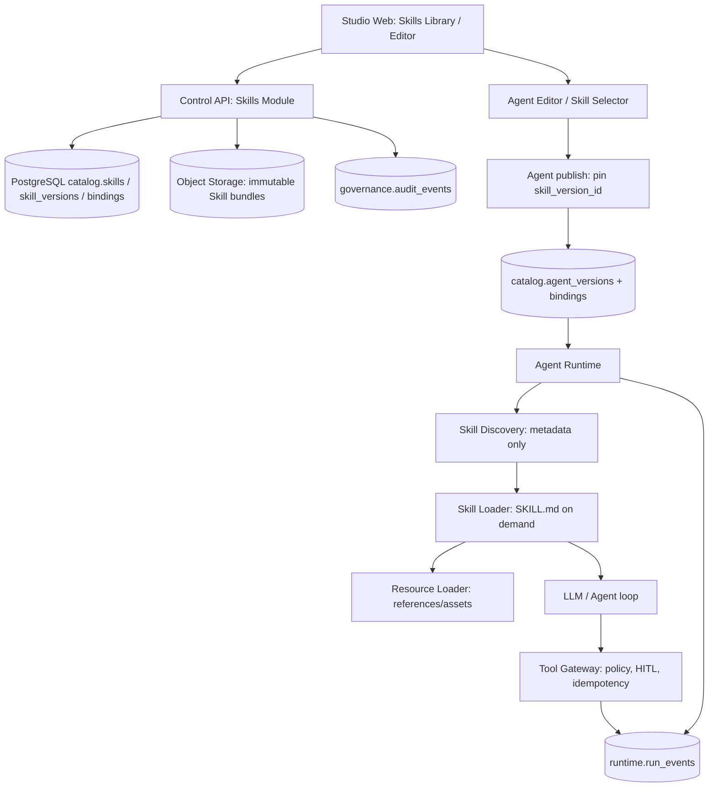

# ĐẶC TẢ PHÂN HỆ NỀN TẢNG — Agent Skill Management Engine (Enterprise AI Agent Platform)

> **Phân loại kiến trúc:** Thành phần Nền tảng Cốt lõi (Core Foundational Pillar) của hệ thống từ Day-1 (không phải module mở rộng hay extension).  
> **Loại tài liệu:** Implementation-ready Change Request / Hướng dẫn dành cho AI coding agent (Codex, Claude Code, Cursor...)  
> **Phiên bản:** 2.0 — 2026-10-30  
> **Mức ưu tiên:** P1 — sau nền tảng Identity/Workspace/Agent Registry; tích hợp trước khi nghiệm thu Agent Studio/Runtime  
> **Dự án:** Enterprise AI Agent Platform **độc lập**, tham khảo FPT AI Agents, FPT AI EOS, Agno AgentOS và bài D05 Tool Use & Skill Use  
> **Trạng thái:** `APPROVED / ADOPTED IN ARCHITECTURE V1.0` (Đã phê duyệt & Hợp nhất vào Baseline V1.0 Greenfield Unified 56 bảng)
> **Không liên quan:** RetailMind-AI hoặc bất kỳ repository kinh doanh bán lẻ nào.

---

## 0. HƯỚNG DẪN BẮT BUỘC CHO CODING AGENT

**Mục tiêu:** mở rộng kiến trúc hiện hữu bằng một bounded context `Skill Management`; **không thay kiến trúc**, không đổi LangGraph, không viết lại Tool Registry/Knowledge/Workflow/Agent Registry, không dựng thêm microservice. `Skill != Tool != Agent != Workflow != Knowledge`.

**ĐỌC THEO THỨ TỰ** (nếu file có trong repo):

1. `AGENTS.md`, `AGENT_CODING_RULES.md`, `README.md`; tuân thủ các ràng buộc có mức ưu tiên cao hơn.
2. `docs/02-architecture/ENTERPRISE_AGENT_PLATFORM_REPOSITORY_IMPLEMENTATION_V1.md` — bản thiết kế source;
3. `docs/03-database/DATABASE_DESIGN.md` và `ENTERPRISE_AGENT_PLATFORM_0001_BASELINE.sql` — mô hình 7 schemas / 56 tables, đã pass static validation;
4. `docs/09-implementation/IMPLEMENTATION_RUNBOOK.md` (Runbook V1.0);
5. `contracts/jsonschema/skill-manifest.v1.schema.json`, `contracts/jsonschema/agent-spec.v1.schema.json`;
6. Tài liệu hiện tại — **CR-SKILL-001**, triển khai bằng PR nhỏ theo phần 15.

**Trước khi sửa code:**

- Liệt kê các file thực tế có/không có; phân biệt `EXISTS`, `MISSING`, `NOT_RUN`. Nếu repo mới chỉ là blueprint, không tự tuyên bố các app đã hoàn thành.
- Xác định migrations thực tế (Alembic hay SQL thuần) và chủ sở hữu DB schema; chỉ sử dụng **một** migration system; **không chạy lại baseline** trên DB đã có dữ liệu.
- Chốt `git commit SHA`, lưu branch làm việc; không chỉnh lại những migration đã áp dụng vào môi trường chung.
- Đề xuất diff cho đúng một PR; không làm PR tiếp theo khi gate PR trước còn `FAILED`.
- Không tự gắn API key, không viết demo với secret thật, không tạo shell execution permission.
- Không đổi quyền hoặc trạng thái tenant, không lách RLS bằng superuser/BYPASSRLS.
- Với chi tiết không có trong code thật, **ghi ASSUMPTION** và implement theo style hiện hữu, không tạo kiến trúc song song.

**Nguyên tắc output của từng PR:** thay đổi thực tế + migrations + tests + cập nhật contracts/docs + kết quả `PASS/FAIL/NOT_RUN` + hạn chế còn lại + evidence. Không báo `PASS` khi chưa chạy.

## 1. BỐI CẢNH & LÝ DO THAY ĐỔI

### 1.1. Những gì bản thiết kế hiện tại đã có

- Control Plane: `catalog.agents`, `catalog.agent_versions`, `catalog.agent_publications`, `catalog.tools`, `catalog.tool_versions`, grants, Knowledge/Workflow/Policy.
- Execution Plane: `runtime.runs`, `runtime.run_events`, checkpoint, tool dispatcher, LLM/context, audit.
- UI: Agent Builder, Tool Selector, Knowledge, Workflows, Digital Workers, Operations.
- Data boundaries: PostgreSQL source-of-truth, Object Storage tài liệu/artifact, Redis cache, Qdrant vector retrieval; tenant/workspace isolation.

### 1.2. Phần còn thiếu

Chưa có mô hình **Skill riêng** cho việc đóng gói, kiểm tra, quản lý vòng đời và gắn **các hướng dẫn có thể tái sử dụng** (`SKILL.md`) vào phiên bản Agent đã publish. Cũng chưa có discovery/loading qua ba lớp:

1. **Discover:** chỉ đưa metadata tối thiểu (`name`, `description`, version/reference) vào context Agent được phép dùng.
2. **Load:** tải đầy đủ `SKILL.md` của một phiên bản Skill được chọn.
3. **Resources:** đọc `references/` / `assets/` khi thực sự cần. `scripts/` thuộc giai đoạn execution sandbox riêng.

Nguồn: D05 lab (stage-02 skills; stage-04 script skills), Agent Skills specification, Agno Skills. Bài D05 có Bash ở stage-03 nhưng **đây là lab**, không cho phép copy unrestricted Bash vào production.

### 1.3. Mục tiêu nghiệp vụ

- Admin/Developer tạo một Skill theo chuẩn `SKILL.md`, cập nhật draft, validate, publish bản bất biến.
- Nhiều Agent có thể tái sử dụng Skill với **skill_version_id cố định**.
- Agent đang chạy tự chọn Skill từ danh sách **đã gắn, đã publish, đúng tenant/workspace và chưa disable**.
- Runtime chỉ nạp nội dung khi cần; nhận lỗi rõ ràng nếu Skill không tồn tại, không được cấp quyền, bị disable hoặc resource không hợp lệ.
- Audit cho biết run dùng Skill nào, phiên bản nào, đã load resource nào; **không ghi nguyên văn nội dung nhạy cảm vào trace**.
- **Skill không được cấp Tool permissions**. Quyền gọi Tool được kiểm tra độc lập ở Tool Gateway lúc thực thi.

## 2. SCOPE, ƯU TIÊN & NON-GOALS

| Mức | Phạm vi | Quyết định |
|---|---|---|
| `MVP / MUST` | CRUD Skill draft; import/upload bundle tin cậy; validation; immutable versions; Agent-Skill Binding; discover/load/read resources; UI; audit; tests | **Implement** |
| `MVP / MUST` | Tenant/workspace isolation; policy cho publish/attach/load; content checksum; giới hạn kích thước; bảo vệ zip/path/symlink; feature flag | **Implement** |
| `MVP / MUST` | `scripts/` có thể được phát hiện/kiểm kê nhưng **không thực thi** | **Fail closed** |
| `NEXT / SHOULD` | Skill evaluation: positive/negative selection, regression, quality metrics; import từ Git URL được kiểm duyệt; per-version revocation | Sau MVP |
| `NEXT / SHOULD` | Skill registry organization-wide/cross-workspace chia sẻ theo grant | Chỉ khi scope multi-workspace được phê duyệt |
| `LATER / SECURITY GATED` | Executable Skill sandbox; approval policy; isolated worker; time/memory/network/filesystem limits | PR riêng, **không** trong MVP |
| `OUT` | Marketplace công cộng, remote arbitrary code execution, dynamic pip install, sửa core LangGraph/Agno engine, skill tự sinh tool, multi-framework conversion | Không implement |

**Policy mặc định:** skills từ tenant khác hoặc không được gắn vào Agent = không thể discover/load; script bundle = có thể lưu để xét duyệt nhưng không được chạy.

## 3. THUẬT NGỮ VÀ RANH GIỚI TRÁCH NHIỆM

| Khái niệm | Ý nghĩa | Owner |
|---|---|---|
| `Skill` | Gói hướng dẫn/procedure + resources, có vòng đời draft/publish | `control-api/modules/skills` |
| `SkillVersion` | Snapshot nội dung được xác minh và phát hành, bất biến | `catalog.skill_versions` |
| `AgentSkillBinding` | Ràng buộc `agent_version_id -> skill_version_id`, không resolve `latest` khi run | `catalog.agent_skill_bindings` |
| `Tool` | Hàm/API/MCP có side effects hoặc trả dữ liệu | Tool Registry + Gateway hiện có |
| `Knowledge` | Kho tài liệu phục vụ retrieval/RAG, ACL riêng | Knowledge Service hiện có |
| `Workflow` | Đồ thị nhiệm vụ với state/checkpoint/HITL | Workflow Engine hiện có |
| `SkillCatalog` | Danh sách metadata ngắn của các Skill hợp lệ cho run | `agent-runtime/skills/catalog_client.py` |
| `SkillLoader` | Tải immutable `SKILL.md` và resource đã giới hạn | `agent-runtime/skills/loader.py` |
| `SkillPolicy` | Quyền create/publish/bind/load, cộng với tool policy độc lập | Control API + Runtime policy |

Quy tắc: một Skill có thể **hướng dẫn** gọi 3 Tools, nhưng khi Agent cần gọi từng Tool, gateway vẫn kiểm tra actor, permission, schema, approval và idempotency.

## 4. KIẾN TRÚC MỞ RỘNG (KHÔNG THAY KIẾN TRÚC CHÍNH)



- Không đặt Skill loader trong browser.
- Không cho Runtime sửa catalog/publish.
- Runtime nhận **pinned snapshot**, không tự tải `main` branch, `latest`, hoặc URL tùy ý.
- Control API xác thực quyền khi bind/publish; Runtime **tái kiểm tra quyền và trạng thái** khi discover/load/resource read.
- Không copy raw SKILL.md vào system prompt của mọi Agent ngay khi bắt đầu run.

## 5. CÂY FILE DELTA — FILE NÀO CẦN TẠO/SỬA

Dưới đây là **delta của bản thiết kế**, không yêu cầu tạo hàng loạt file rỗng. Nếu code hiện tại đặt tên khác, điều chỉnh tại chỗ và mô tả tương đương trong PR.

```text
enterprise-agent-platform/
├── apps/
│   ├── studio-web/src/
│   │   ├── app/(console)/w/[workspaceId]/skills/
│   │   │   ├── page.tsx                       # Skill Library
│   │   │   ├── new/page.tsx                   # Tạo draft
│   │   │   └── [skillId]/page.tsx             # Editor / Versions / Publish
│   │   └── features/
│   │       ├── skill-management/
│   │       │   ├── api/skillApi.ts            # API client wrapper
│   │       │   ├── components/SkillEditor.tsx
│   │       │   ├── components/SkillImport.tsx
│   │       │   ├── components/SkillVersions.tsx
│   │       │   ├── components/SkillValidation.tsx
│   │       │   └── components/SkillSelector.tsx
│   │       └── agent-builder/components/AgentEditor.tsx   # MODIFY: SkillSelector
│   ├── control-api/src/control_api/modules/
│   │   ├── skills/                            # NEW
│   │   │   ├── api/router.py                 # Endpoints
│   │   │   ├── api/requests.py               # Pydantic DTO
│   │   │   ├── api/responses.py              # DTO
│   │   │   ├── application/create_skill.py
│   │   │   ├── application/update_draft.py
│   │   │   ├── application/validate_skill.py
│   │   │   ├── application/publish_skill.py
│   │   │   ├── application/bind_skill.py
│   │   │   ├── domain/skill_manifest.py
│   │   │   ├── domain/rules.py
│   │   │   ├── infrastructure/repository.py
│   │   │   └── infrastructure/bundle_store.py
│   │   └── agents/application/publish_agent.py     # MODIFY: freeze Skill bindings
│   └── agent-runtime/src/agent_runtime/
│       ├── skills/                            # NEW
│       │   ├── catalog_client.py             # Fetch only eligible/pinned metadata
│       │   ├── discovery.py                  # Catalog with bounded context budget
│       │   ├── loader.py                     # load_skill(skill_version_id)
│       │   ├── resource_reader.py            # read_skill_resource(...)
│       │   ├── authorization.py              # Defense in depth
│       │   ├── context_injector.py           # Context assembly + source tagging
│       │   └── events.py                     # Structured Skill events
│       ├── application/spec_resolver.py       # MODIFY: resolve pinned Skill versions
│       ├── compilation/spec_validator.py      # MODIFY: skillRefs schema
│       ├── context/context_builder.py         # MODIFY: metadata only
│       └── tools/dispatcher.py                # UNCHANGED behavior: tool auth enforced
├── contracts/
│   ├── jsonschema/skill-manifest.v1.schema.json          # NEW
│   ├── jsonschema/agent-spec.v1.schema.json              # MODIFY
│   ├── openapi/control-api.openapi.yaml                 # MODIFY
│   └── events/run-events.md                            # MODIFY
├── libs/python/agent-contracts/src/agent_contracts/
│   └── skill_spec.py                                    # NEW
├── database/migrations/
│   └── <next_revision>_add_skill_registry.sql           # NEW; or Alembic if canonical
├── database/tests/
│   └── test_skills_rls.sql                              # NEW
├── policies/skill-permissions.yaml                     # NEW
├── examples/skills/weekly-report/
│   ├── SKILL.md
│   └── references/report-template.md
├── tests/contract/test_skill_contract.py
├── tests/security/test_skill_tenant_isolation.py
├── tests/security/test_skill_bundle_traversal.py
├── tests/e2e/test_agent_with_skill.py
├── evals/datasets/skill_selection.v1.jsonl
├── docs/architecture/SKILL_ARCHITECTURE.md             # NEW
├── docs/security/SKILL_THREAT_MODEL.md                 # NEW
└── docs/adr/0004-agent-skills-registry.md              # NEW
```

### Quy tắc phụ thuộc

```text
Studio UI -> generated API client -> Control API
Control API skills/api -> application -> domain -> repository/bundle-store
Agent publish -> published Skill Version IDs -> immutable Agent Version
Runtime -> catalog_client -> discovery/loader/resource_reader -> LLM context
Tool invocation -> EXISTING Tool Gateway (no skill bypass)
```

## 6. ĐỊNH DẠNG SKILL — BÁM CHUẨN AGENT SKILLS

Skill là directory chứa `SKILL.md` bắt buộc, tùy chọn `references/`, `assets/`, `scripts/`.

```text
weekly-report/
├── SKILL.md
├── references/
│   └── report-template.md
└── assets/
    └── example.json
```

Ví dụ `SKILL.md`:

```markdown
---
name: weekly-report
description: Tạo báo cáo tiến độ tuần có cấu trúc, dựa trên dữ liệu công việc được cung cấp. Dùng khi người dùng yêu cầu tổng hợp báo cáo tuần, nêu blockers hoặc kết quả hoàn thành.
license: Proprietary
metadata:
  author: enterprise-platform
  version: "1.0"
---

# Weekly Report

## Khi nào dùng
- Người dùng cần báo cáo tiến độ tuần dựa trên dữ liệu có nguồn.

## Quy trình
1. Kiểm tra dữ liệu đầu vào và hỏi lại nếu thiếu.
2. Sắp xếp công việc theo trạng thái và mức ưu tiên.
3. Đọc `references/report-template.md` khi cần mẫu trình bày.
4. Tạo bản nháp và nêu rõ thông tin chưa xác minh.

## Giới hạn
- Không suy diễn dữ liệu không có trong nguồn.
- Không gửi email hoặc thay đổi hệ thống nếu chưa có Tool grant và approval.
```

**Các validation bắt buộc:**

- `SKILL.md` có YAML frontmatter hợp lệ và Markdown body; `name` 1–64 ký tự, `[a-z0-9-]`, không đầu/cuối bằng `-`, không `--`, trùng tên directory; `description` 1–1024 ký tự, nêu cả nhiệm vụ và thời điểm dùng.
- `license` và `compatibility` tùy chọn, `metadata` là map string→string, `allowed-tools` tùy chọn mang tính thử nghiệm. **Không dùng `allowed-tools` làm cấp quyền thật.**
- Tuân theo khuyến nghị nội dung chính dưới 500 dòng / dưới ~5.000 tokens; nếu vượt, báo diagnostic và yêu cầu đưa nội dung phụ vào references. Không cắt ngầm `SKILL.md`.
- `name` unique theo tenant/workspace; không tin `metadata.version` làm version của DB; version authoritative là `skill_versions.version`.
- Giới hạn configurable cho file count, kích thước từng file, archive nén/giải nén; yêu cầu rõ lỗi, không trả partial success.
- Chỉ `references/` và `assets/` được đọc ở MVP; scripts lưu được nếu product cho phép upload nhưng **không** execute; nghiêm cấm `eval`, shell tùy ý, dynamic package installs.
- Resource URI/path là path tương đối từ Skill root; từ chối path tuyệt đối, `..`, URL bên ngoài, symlink, hardlink, device node, escaping symlink và path đổi sau validate. API không nhận `file:///`, không tin đường dẫn từ model.
- Chống ZIP Slip, zip bomb, Unicode normalization collision, case-insensitive duplicate, nested archives và file extension giả mạo. Hash tính trên bytes canonical *sau khi* có quy ước đóng gói ổn định; giữ checksum immutable.
- Phân biệt **skill instructions là untrusted content** với system-level instructions; không cho Skill ghi đè policy, authorization hoặc biến môi trường.

## 7. CƠ SỞ DỮ LIỆU — 3 BẢNG SKILL ĐÃ TÍCH HỢP TRỰC TIẾP VÀO BASELINE V2.0

**Quyết định kiến trúc ADR-013:** Thay vì phát hành migration delta sau này, 3 bảng phân hệ Skill (`catalog.skills`, `catalog.skill_versions`, `catalog.agent_skill_bindings`) đã được hợp nhất trực tiếp vào `database/migrations/0001_baseline.sql` V1.0 (tổng cộng 56 bảng / 7 schemas Day-1), được bảo vệ bằng RLS và immutability trigger.

### 7.1. Bảng đề xuất

#### `catalog.skills` — Mutable drafts/identity

| Column | Type | Constraints / nghĩa |
|---|---|---|
| `id` | `uuid` | PRIMARY KEY, default `gen_random_uuid()` |
| `tenant_id`, `workspace_id` | `uuid` | NOT NULL; composite FK tới `iam.workspaces` |
| `slug` | `text` | NOT NULL; unique `(tenant_id,workspace_id,slug)` |
| `display_name` | `text` | NOT NULL |
| `draft_skill_md` | `text` | NOT NULL, default `''`; chỉ bản nháp |
| `draft_manifest` | `jsonb` | NOT NULL, object; metadata tách từ SKILL.md |
| `draft_bundle_ref` | `text` | NULL; staged artifact URI, không phải secret |
| `revision` | `integer` | NOT NULL >=1; optimistic lock |
| `status` | `text` | `active`, `disabled`, `archived`; default `active` |
| `created_by` | `uuid` | FK `iam.users(id)`, actor audit |
| `created_at`, `updated_at` | `timestamptz` | NOT NULL |

#### `catalog.skill_versions` — Published immutable snapshots

| Column | Type | Constraints / nghĩa |
|---|---|---|
| `id` | `uuid` | PRIMARY KEY |
| `tenant_id`, `workspace_id` | `uuid` | NOT NULL; cùng tenant/workspace với Skill |
| `skill_id` | `uuid` | Composite FK `(tenant_id,workspace_id,skill_id)` tới skills |
| `version` | `integer` | >0, unique `(tenant_id,workspace_id,skill_id,version)` |
| `schema_version` | `text` | `agentskills/v1` hoặc format schema đã chốt |
| `manifest` | `jsonb` | NOT NULL object; parsed, validated |
| `skill_md` | `text` | NOT NULL, immutable instructions |
| `bundle_ref` | `text` | NOT NULL, versioned immutable object key |
| `bundle_sha256` | `char(64)` | NOT NULL hex; checksum contents bundle |
| `published_by` | `uuid` | FK `iam.users(id)` |
| `published_at` | `timestamptz` | NOT NULL |

Thêm `UNIQUE(tenant_id,workspace_id,skill_id,id)` nếu cần FK ràng buộc cả parent Skill lẫn SkillVersion. **Không UPDATE/DELETE các bản published.** Để disable toàn bộ Skill trong MVP, đổi `catalog.skills.status`; cơ chế block riêng từng version đưa vào migration tương lai thay vì cập nhật nội dung version.

#### `catalog.agent_skill_bindings` — Pin Skill Version vào Agent Version

| Column | Type | Constraints / nghĩa |
|---|---|---|
| `id` | `uuid` | PRIMARY KEY |
| `tenant_id`, `workspace_id` | `uuid` | NOT NULL |
| `agent_version_id` | `uuid` | Composite FK tới `catalog.agent_versions` |
| `skill_id` | `uuid` | Composite FK tới `catalog.skills` |
| `skill_version_id` | `uuid` | Composite FK `(tenant,workspace,skill_id,skill_version_id)` tới `skill_versions` |
| `created_at` | `timestamptz` | NOT NULL |

Unique `(tenant_id,workspace_id,agent_version_id,skill_id)` để **một AgentVersion chỉ pin một version của mỗi Skill**. Bảng bindings cũng immutable sau publish.

### 7.2. Migration và RLS — tiêu chuẩn bắt buộc

Tạo migration **mới** theo hệ migration đang dùng, không chỉnh sửa `0001_baseline.sql` nếu đã áp dụng ở nơi nào đó.

- FK giữa `(tenant_id,workspace_id)` tới workspace; mọi FK từ binding sang `skill_versions` và `agent_versions` phải có cùng tenant/workspace.
- `UNIQUE (tenant_id,workspace_id,id)` trên từng bảng mới để hỗ trợ composite FK như schema cũ.
- `ENABLE ROW LEVEL SECURITY` và `FORCE ROW LEVEL SECURITY` trên cả 3 bảng.
- `USING` và `WITH CHECK` theo tenant context của phiên transaction. Ví dụ pattern **tham khảo**:

```sql
ALTER TABLE catalog.skills ENABLE ROW LEVEL SECURITY;
ALTER TABLE catalog.skills FORCE ROW LEVEL SECURITY;
CREATE POLICY tenant_isolation ON catalog.skills
  USING (tenant_id = NULLIF(current_setting('app.tenant_id', true), '')::uuid)
  WITH CHECK (tenant_id = NULLIF(current_setting('app.tenant_id', true), '')::uuid);
```

- **RLS theo tenant chưa đủ:** API vẫn phải xác minh membership/quyền tại workspace. Nếu dùng DB connection pool, set/reset tenant context **per transaction**; chống SQL injection; không dùng role owner, superuser hay `BYPASSRLS` trong app.
- Áp dụng trigger immutable hiện hữu `governance.reject_immutable_mutation()` cho `skill_versions` và `agent_skill_bindings` sau khi đã xác nhận function tồn tại. Đừng sửa code function toàn cục chỉ để hỗ trợ Skill.
- Index phục vụ list skills theo `(tenant_id,workspace_id,status,created_at)`, lookup published `(tenant_id,workspace_id,skill_id,version)`; không index JSONB chung nếu chưa có workload chứng minh.
- DDL chạy bằng migration owner; cập nhật ma trận `GRANT` cho API role và runtime read role theo principle of least privilege.
- Viết `tests/security/test_skill_tenant_isolation.py` và SQL role tests chạy bằng **non-bypass** role; test `SET LOCAL app.tenant_id` trong transaction, cross-workspace cùng tenant phải bị API từ chối.
- Object Storage artifact phải có tenant-scoped key, version + checksum; DB metadata/commit và upload object là quy trình hai pha có retry và cleanup orphan. Không công bố version nếu bundle chưa upload thành công và checksum không khớp.

**Rollout an toàn:** additive migration; existing Agents với `skillRefs` vắng mặt tiếp tục chạy như cũ; không bắt buộc backfill. Nếu cần rollback code, giữ 3 bảng chưa dùng, tránh DROP TABLE chứa dữ liệu.

### 7.3. Tính toàn vẹn của Skill publish

Trong một publish transaction có transaction isolation phù hợp:

1. Kiểm tra `skills.revision` / `If-Match`, quyền `skill:publish`, status active.
2. Validate *toàn bộ* bundle, frontmatter, resource refs, size/path/scan.
3. Đẩy artifact staging tới immutable object key, xác minh digest và visibility trước khi commit DB.
4. Lock skill row / atomic version allocation `MAX(version)+1` dưới lock (hoặc dùng sequence version), insert `skill_versions`, ghi audit + outbox event **cùng DB transaction**.
5. Không thay đổi bản cũ; xử lý retry cùng `Idempotency-Key` không tạo version mới; công bố bản mới chỉ sau khi transaction thành công.
6. Nếu DB transaction fail: cleanup orphan staging/object hoặc để asynchronous GC có kiểm soát; tuyệt đối không nói publish thành công.

## 8. CONTRACTS: `SkillManifest` + AGENT SPEC V1

### 8.1. Skill Manifest — JSON biểu diễn metadata (không thay SKILL.md)

```json
{
  "schemaVersion": "1.0",
  "name": "weekly-report",
  "description": "Tạo báo cáo tuần từ dữ liệu có nguồn. Dùng khi cần tổng kết tiến độ và blockers.",
  "license": "Proprietary",
  "compatibility": "Markdown instructions; no executable scripts in MVP",
  "metadata": {"author": "enterprise-platform", "version": "1.0"},
  "resources": ["references/report-template.md"]
}
```

Contract JSON dùng trên API; `name`, `description` lấy từ frontmatter, phải khớp bản gốc. `resources` là phần bổ sung **nội bộ platform** (không được giả định là field chuẩn Agent Skills frontmatter). Nội dung `allowed-tools` chỉ là metadata/hint, không cấp quyền.

### 8.2. AgentSpec bổ sung optional `skillRefs`

```json
{
  "schemaVersion": "1.0",
  "name": "Operations Assistant",
  "mode": "fixed_plan",
  "modelRef": "models/approved-default",
  "toolRefs": ["tools/report-read@1"],
  "skillRefs": [
    {"skillId": "<uuid>", "skillVersionId": "<uuid>"}
  ],
  "limits": {"maxSteps": 8}
}
```

**Invariant:** `skillRefs` optional; `[]` hoặc vắng mặt = không load skill, bảo toàn Agent đang có. UUID ví dụ là placeholder, không được chấp nhận trong schema thực tế.

- API draft cho phép cấu hình `skillRefs`, validate membership + permission + published version.
- Khi publish Agent, lưu `skillRefs` đã pin trong `agent_versions.frozen_spec` **và** tạo `catalog.agent_skill_bindings` trong cùng transaction; hash bundle Agent bao gồm SkillVersion IDs + hashes; reject nếu mismatch.
- Kết quả Runtime **không được resolve `latest`**; resolve từ `agent_version_id` và binding/frozen spec đã chốt.
- Skill disabled sau publish: run mới không được discover; run đang hoạt động phải tái kiểm tra trước load/resource, chính sách dừng có kiểm soát với các run có rủi ro cao (đã nạp vào context thì không có cơ chế 'xóa' token khỏi lịch sử; cần hủy hoặc làm mới context).
- Schema backward-compatible, không đổi các AgentVersion cũ.

### 8.3. Generated code và hợp đồng hai ngôn ngữ

- `contracts/jsonschema/skill-manifest.v1.schema.json` (authoritative contract đã review).
- `libs/python/agent-contracts/src/agent_contracts/skill_spec.py` tương ứng Pydantic.
- Regenerate `packages/api-client` từ OpenAPI sau khi thay schema/route.
- Unit tests JSON roundtrip giữa Python/TS và negative schema fixtures.

## 9. CONTROL API — CHI TIẾT ENDPOINT & HÀNH VI

Theo style hiện có của API `/api/v1/agents` (không tạo một version khác của router cho Skill).

| Method | Endpoint (đề xuất) | Permission | Chức năng / kết quả |
|---|---|---|---|
| `GET` | `/api/v1/skills?workspace_id=...` | `skill:read` | List paginated; chỉ workspace hợp lệ, không trả raw bundle |
| `POST` | `/api/v1/skills` | `skill:create` | Tạo Skill draft, status active; `201` |
| `GET` | `/api/v1/skills/{skill_id}` | `skill:read` | Chi tiết draft/metadata, version list link |
| `PATCH` | `/api/v1/skills/{skill_id}` | `skill:update` | Update draft với `If-Match`/revision; `409`/`412` nếu conflict |
| `POST` | `/api/v1/skills/{skill_id}/import` | `skill:update` | Import ZIP/skill package với giới hạn an toàn; ghi staging |
| `POST` | `/api/v1/skills/{skill_id}/validate` | `skill:update` | Diagnostics `errors[]`, `warnings[]`, không publish |
| `POST` | `/api/v1/skills/{skill_id}/publish` | `skill:publish` | Đóng băng version; `201`; idempotency |
| `GET` | `/api/v1/skills/{skill_id}/versions` | `skill:read` | Danh sách phiên bản |
| `GET` | `/api/v1/skills/{skill_id}/versions/{version}` | `skill:read` | Immutable metadata/preview đã sanitize |
| `POST` | `/api/v1/skills/{skill_id}/disable` | `skill:disable` | Ngăn new load/new run; audit; không delete version |
| `POST` | `/api/v1/agents/{agent_id}/skills/validate` | `agent:update` | Check proposed bindings với draft (không publish) |

Khi publish Agent, đóng băng bindings trong cùng transaction; **không cần endpoint public riêng để sửa binding của AgentVersion đã publish**.

**Internal API** (chỉ service account có quyền; có thể thay bằng repository read adapter nếu kiến trúc thực tế như vậy):

- `GET /internal/v1/agent-versions/{agent_version_id}/skills` → array `skill_version_id`, name, description, content hash; tenant/workspace được lấy từ principal+run trusted context.
- `GET /internal/v1/skill-versions/{skill_version_id}` → approved metadata + full SKILL.md **chỉ khi runtime được phép**.
- `GET /internal/v1/skill-versions/{skill_version_id}/resources/{path}` → content bytes theo path đã normalize, đã validate; không cho arbitrary object key.

**Quy tắc lỗi:** `400` syntax, `401` unauthenticated, `403` unauthorized, `404` not visible (không leak existence), `409/412` concurrent revision, `413` payload too large, `422` invalid Skill/manifest, `429` rate limit, `503` object store/dependency unavailable. Response phải có `code`, `message`, `correlation_id`, `details` không chứa secret.

Không expose generic `GET /file?path=...` cho người dùng hoặc model.

## 10. SKILL RUNTIME — PROGRESSIVE DISCLOSURE

### 10.1. Discovery (metadata-only)

**Input:** `RunContext(tenant_id,workspace_id,agent_version_id,run_id,principal,limits)`; **Output:** danh sách SkillVersion được bind và cho phép, chỉ `(name,description,skill_version_id)` + tối thiểu metadata không nhạy cảm.

- Query 1 lần theo AgentVersion; nếu không có Skill, trả empty.
- Filter tenant/workspace/bindings/status/policy ở server; không lọc bằng prompt.
- Đặt giới hạn tổng số kỹ năng và tổng token metadata; nếu vượt phải có error/selection algorithm có kiểm thử, không cắt silently hoặc vô tình lộ Skill cấm.
- Agent được quyền **không chọn Skill**; không làm keyword-router cứng (`if "report" in message`). Chọn bằng model tool use/structured selection và đánh giá positive/negative.
- Trong system prompt chỉ nêu mô tả và hướng dẫn dùng `load_skill`, không đưa nội dung của mọi SKILL.md vào.

### 10.2. `load_skill(skill_version_id)` — Full instructions on demand

- Tool được runtime đăng ký cho Agent đủ quyền; server resolve only pinned version của run, kiểm tra trạng thái và cache scope.
- Load full Markdown **một lần được yêu cầu**; trả tên/version, content SHA, hướng dẫn, danh sách resources tối giản.
- Nếu `SKILL.md` quá kích thước cho phép: báo `SKILL_TOO_LARGE`, không trả nội dung bị cắt và không để model hành động trên thông tin thiếu.
- Chống prompt injection như một nguồn dữ liệu chưa tin cậy; skill author review, warning/flag, context boundaries và Tool Gateway độc lập; **không hứa chặn 100% prompt injection**.
- Idempotent read, có thể cache theo `(tenant_id, workspace_id, skill_version_id, bundle_sha256)`; cache không được bypass permission/disable và phải có invalidation.

### 10.3. `read_skill_resource(skill_version_id, relative_path)`

- Chỉ đọc `references/`/`assets/` thuộc immutable bundle của chính SkillVersion; `scripts/` bị từ chối trong MVP.
- Validate path ở server. Dùng object key immutable do server sinh từ manifest allowlist; không concat trực tiếp path của user với root path.
- Giới hạn byte/tokens, MIME, UTF-8/JSON/Markdown; assets binary trả metadata/safe signed access nếu được phê duyệt, không nhúng binary vào prompt.
- Nếu lỗi, trả structured error; **không** đoán nội dung tài liệu bị lỗi và không retry vô hạn.

### 10.4. Bộ công cụ nội bộ gợi ý

```python
# PSEUDOCODE — interfaces cần điều chỉnh theo code thật
class SkillProvider(Protocol):
    async def catalog_for_run(self, ctx: RunContext) -> list[SkillSummary]: ...
    async def load_skill(self, ctx: RunContext, skill_version_id: UUID) -> LoadedSkill: ...
    async def read_resource(self, ctx: RunContext, skill_version_id: UUID, relative_path: str) -> Resource: ...
```

**Không thêm `run_skill_script` vào danh sách Tool MVP**. Nếu Skill body có hướng dẫn chạy shell, runtime phải coi đó là text không có authority và không có công cụ shell để thực thi.

### 10.5. Restart/Resume và version pinning

- Checkpoint lưu `agent_version_id`, `skill_version_ids`/snapshot refs đã xác minh; load lại đúng content hash sau restart.
- Nếu bundle bị thiếu, bị disable hoặc hash không khớp: fail controlled; không fallback sang latest version hay Skill của workspace khác.
- Khi resume, re-verify approval/tool permissions; skills chỉ là instructions, không thay checkpoint hay grants.

## 11. FRONTEND — AGENT STUDIO SKILL MANAGEMENT

### 11.1. Màn hình

| Screen | UI elements | Guardrails |
|---|---|---|
| `/skills` | Search, filter status, metadata, versions, owner | Không trả skills cross-workspace |
| `/skills/new` | Name/description editor, starter SKILL.md, import ZIP | Validation client tiện ích, server là authoritative |
| `/skills/[skillId]` | Draft editor, resource list, diagnostics, validate, publish | Revision/If-Match; disable nếu có quyền |
| `AgentEditor / Skills tab` | Chọn skill version published, preview metadata, remove | Không gắn draft/disabled/cross-tenant |
| `Run Details` | Used skills, loaded at, resource names, version, outcomes | Không đưa raw Skill body/PII vào public traces |

### 11.2. UX bắt buộc

- Hiển thị trạng thái Draft / Published / Disabled; cảnh báo rõ “sửa draft không thay đổi bản đã publish”.
- `Publish` mở confirm có diff/version/review diagnostics; thiếu quyền hoặc cảnh báo high risk thì disable action server-side.
- Chỉ sử dụng generated API client/hook đã có; không gửi credentials cho SDK ngoài browser.
- Tương thích `skills=[]`; không thay UI của Agent không dùng Skill.

## 12. SECURITY & GOVERNANCE — NON-NEGOTIABLE

**Threat model phải bao gồm:** malicious Skill instructions, prompt injection qua references, bundle archive traversal/zip bomb, symlink escape, supply chain tampering, cross-tenant disclosure, stale cache, privilege escalation qua `allowed-tools`, secrets trong logs, shadow versions, script/binary execution và race khi publish.

**Control bắt buộc:**

1. Registry chỉ nhận package được user có quyền trong workspace tạo; nguồn upload được đánh dấu trusted/untrusted, không tự publish package bên ngoài.
2. Publish qua role check + kiểm duyệt rủi ro; audit ghi actor, skill/version, digest, decisions.
3. Dữ liệu Skill không có đặc quyền ngang system prompt/policy. Runtime không cho Skill tự bổ sung tools hoặc network/secret access.
4. Tool invocation thực thi bằng **Tool Gateway hiện có**: allowlist, principal, ACL, risk, HITL, idempotency, audit. `allowed-tools` YAML experimental **không** bypass.
5. Script execution **disabled by default**. Nếu phase sau bật: sandbox độc lập non-root, immutable image, readonly root FS, không mount Docker socket/host credentials, egress deny-by-default, CPU/memory/wall-time/process quotas, artifact allowlist, approvals, malware scanning, audit; phải có threat review và tests riêng.
6. Error/log/traces không chứa secrets, toàn bộ text Skill, prompts nhạy cảm hoặc raw tài liệu. Có correlation ID, audit IDs, PII redaction.
7. RLS thực thi với app roles không `BYPASSRLS`; API verify workspace membership. Không tin `tenant_id` do model truyền.
8. Khả năng disable khẩn: skill `disabled` chặn new runs/new loads; đang chạy phải fail-safe hoặc cancel theo chính sách; không tự thay version khác.
9. Cache must be tenant-scoped & version-hash keyed, và mọi lần truy cập lại kiểm tra entitlement; không dùng cache global không kiểm soát.
10. Artifact retention và xóa dữ liệu tuân thủ chính sách; immutable published version không bị in-place edit; delete phải là quy trình quản trị có audit/retention.

## 13. OBSERVABILITY & EVALUATION

### 13.1. Structured run events (tái sử dụng `runtime.run_events`)

Thêm event types (giữ trường `redacted_payload jsonb` hiện có):

| Event | Dữ liệu tối thiểu |
|---|---|
| `skill.catalog.discovered` | run_id, count, skill_version_ids (chỉ IDs, no content) |
| `skill.selected` | run_id, skill_version_id, selection_source/model |
| `skill.loaded` | run_id, skill_version_id, bundle_sha256, duration_ms |
| `skill.resource.read` | run_id, skill_version_id, relative_path sanitized, bytes_read |
| `skill.access.denied` | run_id, skill_version_id, reason_code |
| `skill.load.failed` | run_id, skill_version_id, safe_error_code |

Không ghi model private reasoning; trace chỉ tool call, arguments an toàn, results đã redacted. Metrics: selected rate, true-use rate (loaded), latency, skill load failures, token overhead, wrong-skill/no-skill rates, quality delta.

### 13.2. Skill evaluation

Tạo `evals/datasets/skill_selection.v1.jsonl` với tối thiểu 20 case (con số mục tiêu PoC, không phải benchmark bên ngoài):

- 8 positive: nhiệm vụ phải chọn đúng skill.
- 6 negative: không được load skill không liên quan.
- 3 ambiguities: cần hỏi rõ hoặc chọn skill có điều kiện.
- 3 adversarial: prompt injection hoặc yêu cầu dùng Skill/Tool không được cấp.

**Gates:** không cross-tenant leaks, không execute scripts, không use unpublished/disabled versions, no unauthorized tool calls trên toàn bộ test fixtures. Các chỉ số chọn skill/latency phải báo **giá trị đo thực tế**, không tự bịa threshold đạt production.

## 14. TEST MATRIX & DEFINITION OF DONE

| Test ID | Mục tiêu | Pass criteria |
|---|---|---|
| `SK-VAL-01` | Frontmatter hợp lệ | Schema pass, fields khớp directory |
| `SK-VAL-02` | Name sai / thiếu description | 422 + diagnostics rõ |
| `SK-VAL-03` | ZIP Slip, symlink, bomb, oversized file | Reject trước khi publish, không tạo file bên ngoài |
| `SK-DB-01` | Tenant A đọc Skill B | Không thấy nội dung (403/404), no leak |
| `SK-DB-02` | Hai workspace cùng tenant | Member A không thể truy cập B nếu không được cấp quyền |
| `SK-DB-03` | Non-bypass role + RLS | Select/insert/update sai tenant bị chặn hoặc 0 rows |
| `SK-VER-01` | Publish hai lần đồng thời | Không duplicate version/constraint violation có xử lý |
| `SK-VER-02` | Edit published version | Block update/delete, không đổi checksum |
| `SK-VER-03` | Disable skill | New runs/loads bị chặn |
| `SK-BIND-01` | Bind draft/foreign SkillVersion | Publish Agent thất bại an toàn |
| `SK-BIND-02` | Draft Agent không có Skill | Backward compatible |
| `SK-RUN-01` | Positive selection | Load đúng pinned version, trace event |
| `SK-RUN-02` | Negative selection | Không load skill nào |
| `SK-RUN-03` | Restart/Resume | Đúng skill version/hash cũ, không chuyển latest |
| `SK-RUN-04` | Path traversal resource | Reject, không đọc ngoài bundle |
| `SK-RUN-05` | Malicious allowed-tools/script instruction | Không execute, không tăng quyền |
| `SK-SEC-01` | Tool unauthorized via skill | Tool Gateway deny, no side effect |
| `SK-SEC-02` | Logs/traces | Không chứa secrets hoặc raw sensitive Skill text |
| `SK-E2E-01` | UI create → validate → publish → bind → run | End-to-end đúng version, đầy đủ audit |
| `SK-OPS-01` | Object storage unavailable | Fail controlled, không publish thành công giả |

**Definition of Done:** tất cả `MUST` implemented; migrations pass trên PostgreSQL sạch và upgrade DB; RLS non-bypass test pass; unit, integration, contract, E2E pass; package malicious tests pass; no regressions; docs synced; CI green; evidence thật. Nếu chưa có infra, đánh dấu `BLOCKED/NOT_RUN`, không tuyên bố production-ready.

## 15. KẾ HOẠCH PR THEO PHỤ THUỘC (KHÔNG BUILD TẤT CẢ MỘT LẦN)

| PR | Phụ thuộc | Files/Changes | Demo/Gate |
|---|---|---|---|
| `SK-PR01` | DB foundation/identity | ADR, Skill manifest contract, fixtures, validator/negative tests | `SK-VAL-*` pass |
| `SK-PR02` | SK-PR01 + DB roles/RLS | Migration 3 bảng; repositories; RLS/immutability | `SK-DB-*`, `SK-VER-02` pass |
| `SK-PR03` | SK-PR02 | Control API draft/import/validate/publish/disable + audit | Positive/negative API tests, concurrency |
| `SK-PR04` | SK-PR03 + Agent Registry | AgentSpec optional skillRefs, bind + freeze | `SK-BIND-*`, regression existing agents |
| `SK-PR05` | SK-PR04 + Runtime foundation | catalog/discovery/load/resource, context builder, run events | `SK-RUN-*`, no executable scripts |
| `SK-PR06` | SK-PR03/04 | Skill Library/Editor/Selector, generated client | UI/E2E scenario |
| `SK-PR07` | SK-PR05/06 | Evals, adversarial tests, metrics, docs, security hardening | `SK-SEC-*`, `SK-E2E-*`, CI gate |
| `SK-PR08` | **NEW approval** | Design executable scripts sandbox (ADR + threat model + isolated runner) | **Design only**; no production script support automatically |

Các PR phải nhỏ và revertable; có thể triển khai `SK-PR06` song song `SK-PR05` sau khi API/schema chốt.

## 16. CÁCH DEMO NGHIỆM THU VERTICAL SLICE

**Kịch bản:** Workspace A tạo `weekly-report`; admin publish Skill v1; tạo Agent gắn v1; yêu cầu Agent tổng hợp tiến độ từ mock inputs; run chỉ thấy metadata, Agent chọn Skill, loader nạp `SKILL.md`, đọc `references/report-template.md`, trả báo cáo có nguồn, ghi events.

Sau đó:

1. Publish Skill v2 với template khác; AgentVersion cũ vẫn **dùng v1** (pinned).
2. Tạo AgentVersion mới gắn v2; new run dùng v2.
3. Disable Skill; new run/load phải bị chặn; kiểm thử run đang chờ.
4. User tenant B query v1 resource của tenant A → denied; không leak existence.
5. Một SKILL.md chứa `Run bash rm -rf ...` hoặc `allowed-tools: Bash(...)` → runtime không có shell tool, không chạy.
6. Thử resource `../../secrets.env` và symlink traversal → error, không đọc.
7. Restart runtime giữa run → restore checkpoint + pinned v1 + audit events không trùng.

**Bằng chứng bắt buộc:** screenshot UI, API request/response redacted, DB queries dưới non-bypass role, test logs, trace/run events, commit SHA. Không dùng ảnh demo làm bằng chứng duy nhất.

## 17. CẬP NHẬT CÁC TÀI LIỆU CŨ, KHÔNG LÀM CHỆCH SCOPE

Sau khi `SK-PR01–07` hoàn tất và được review, cập nhật:

| Tài liệu gốc | Delta bắt buộc |
|---|---|
| `ENTERPRISE_AGENT_PLATFORM_REPOSITORY_IMPLEMENTATION_V1.md` | Nâng v3; thêm `skills/` vào 3 apps, Skill spec/contracts, imports và dependency boundaries |
| `ENTERPRISE_AGENT_PLATFORM_DATABASE_DESIGN_V1.md` | Nâng v2; mô tả 3 bảng mới (50 → **53 bảng theo đề xuất**, không tuyên bố đã migrate), ERD, RLS, immutability |
| `ENTERPRISE_AGENT_PLATFORM_STEP_BY_STEP_IMPLEMENTATION_RUNBOOK_V1.md` | Nâng v2; đưa SK-PR01..07 giữa Agent Registry và Agent Studio/Runtime gate |
| `AGENTS.md` / `AGENT_CODING_RULES.md` | Quy tắc Skill vs Tool, không shell, metadata-only discovery, limits, auditing, tests |
| `docs/security/THREAT_MODEL.md` | Thêm Skill supply chain/prompt injection/executable risks |
| `contracts/compatibility.md` | Optional `skillRefs` preserves backward compatibility |

**Không** sửa nội dung bản baseline đã chạy hoặc đánh dấu các file thiết kế trước đó là production đã đạt test.

## 18. HƯỚNG DẪN COPY GIAO VIỆC CHO CODING AGENT

Dùng đoạn sau làm **task message** cho coding agent (sau khi đã đặt file CR-SKILL-001 vào repo):

```text
Đọc AGENTS.md, AGENT_CODING_RULES.md, repository architecture, DB design,
implementation runbook và CR-SKILL-001 trước khi sửa code.

Nhiệm vụ HIỆN TẠI: chỉ thực hiện SK-PR01 của CR-SKILL-001.
1. Audit source thực tế (EXISTS/MISSING/NOT_RUN), chốt commit SHA.
2. Tạo Skill manifest contract, validator, positive/negative fixtures và tests.
3. Không đổi Agent Runtime, Tool Gateway, DB baseline hoặc UI ở PR này.
4. Chạy lint/typecheck/test có thể chạy; ghi evidence thật.
5. Trả danh sách file diff, commands, PASS/FAIL/NOT_RUN, risks, next PR.
Không tự tiếp tục SK-PR02 nếu chưa được review.
```

Sau mỗi PR, đổi `SK-PR01` thành PR tiếp theo và cập nhật dependency/gate cụ thể; không giao tất cả PR trong một lượt nếu repo chưa có nền tảng.

## 19. QUALITY & STATUS TRACKER (CODING AGENT CẬP NHẬT SAU KHI CHẠY)

| Gate | Status | Evidence path / link | Owner |
|---|---|---|---|
| SK-PR01 contract/validator | NOT_RUN | TBD | TBD |
| SK-PR02 migration/RLS | NOT_RUN | TBD | TBD |
| SK-PR03 Control API | NOT_RUN | TBD | TBD |
| SK-PR04 Agent bindings | NOT_RUN | TBD | TBD |
| SK-PR05 Runtime loader | NOT_RUN | TBD | TBD |
| SK-PR06 UI | NOT_RUN | TBD | TBD |
| SK-PR07 E2E/security/observability | NOT_RUN | TBD | TBD |

## 20. NGUỒN CHUẨN / REFERENCE (ĐỌC TỪ NGUỒN GỐC)

1. D05 — Tool Use & Skill Use: https://pub.nndkhoa9.win/agentic-ai-engineering/d05-tool-use-skill-use/slide.html
2. Agent Skills — Specification: https://agentskills.io/specification
3. Agno Skills overview: https://docs.agno.com/skills/overview
4. Microsoft Agent Framework — Skills (security/progressive loading): https://learn.microsoft.com/en-us/agent-framework/agents/skills
5. Anthropic — Enterprise Skills governance: https://platform.claude.com/docs/en/agents-and-tools/agent-skills/enterprise
6. LangGraph — Persistence and idempotency: https://docs.langchain.com/oss/python/langgraph/persistence
7. Dự án nội bộ (trong cuộc hội thoại này): `ENTERPRISE_AGENT_PLATFORM_REPOSITORY_IMPLEMENTATION_V1.md`, `ENTERPRISE_AGENT_PLATFORM_0001_BASELINE.sql`, `ENTERPRISE_AGENT_PLATFORM_STEP_BY_STEP_IMPLEMENTATION_RUNBOOK_V1.md`.

> **Phân biệt nguồn và thiết kế:** các yêu cầu về `SKILL.md`, frontmatter, progressive disclosure đến từ nguồn công khai; tên bảng, endpoints, file paths, permissions, rollout, PR gates là **thiết kế đề xuất** dành riêng cho Enterprise AI Agent Platform của chúng ta. Chưa có implementation/test evidence.

---

**FINAL INVARIANT:** *Skill là gói hướng dẫn có version và quyền truy cập; chỉ Tool Gateway được phép thực thi hành động; Control Plane quản lý & publish; Runtime chỉ load bản pinned hợp lệ; mọi truy cập có tenant/workspace policy và audit; script execution không tồn tại trong MVP.*
